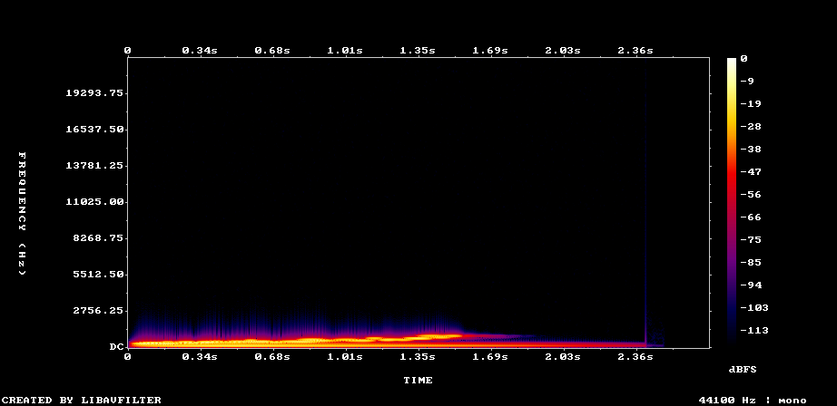
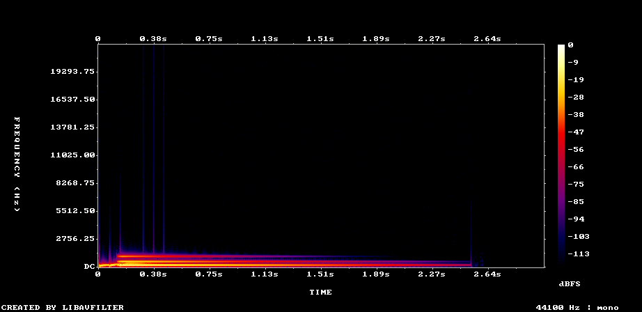
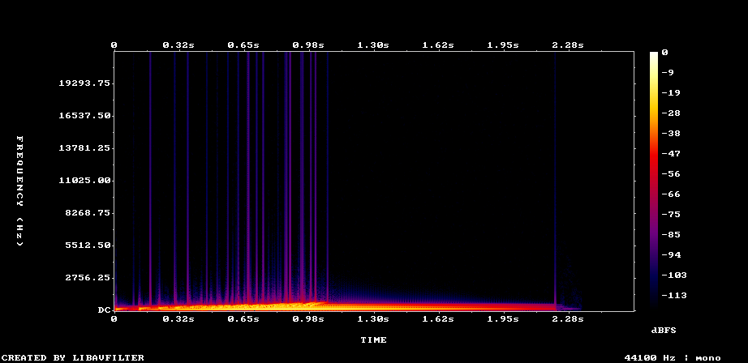
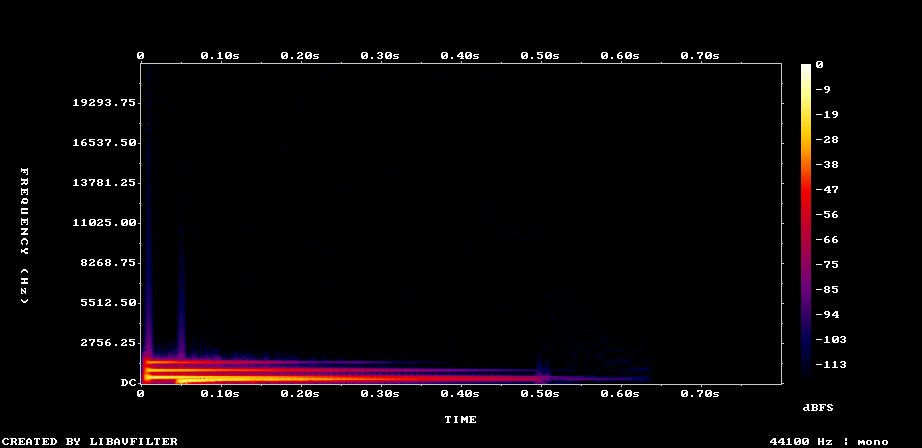
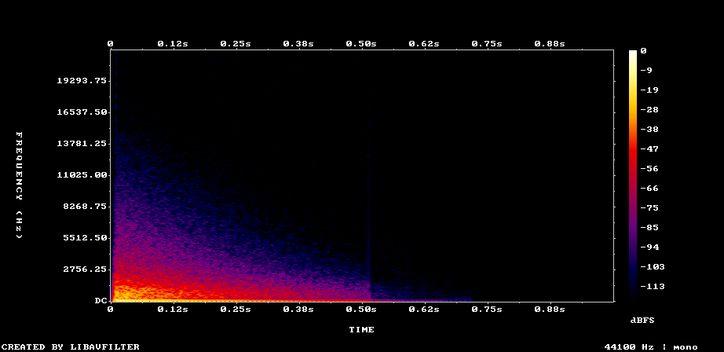
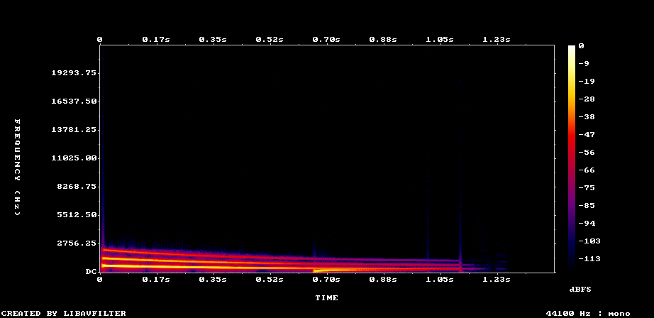
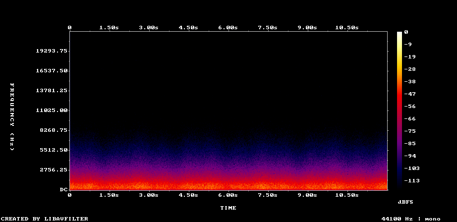
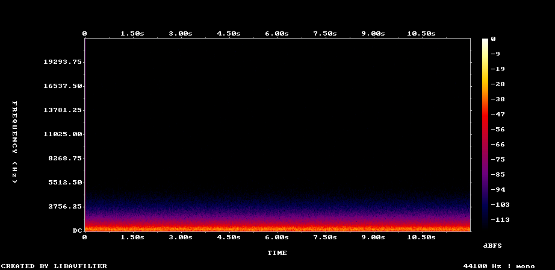
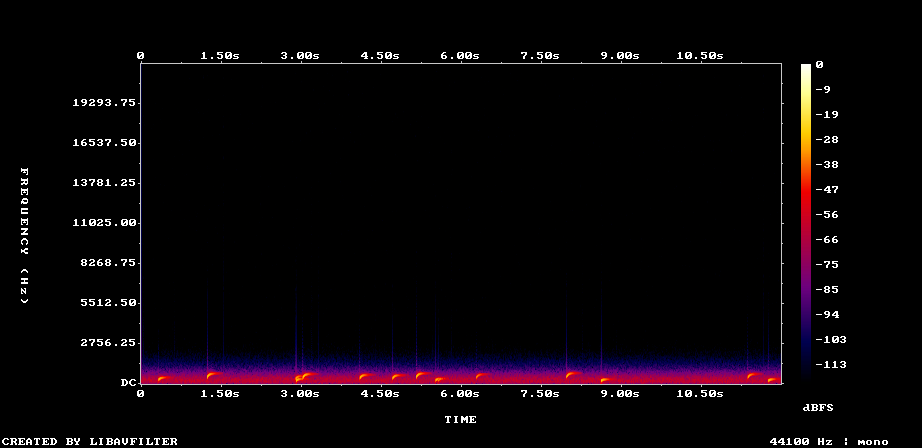
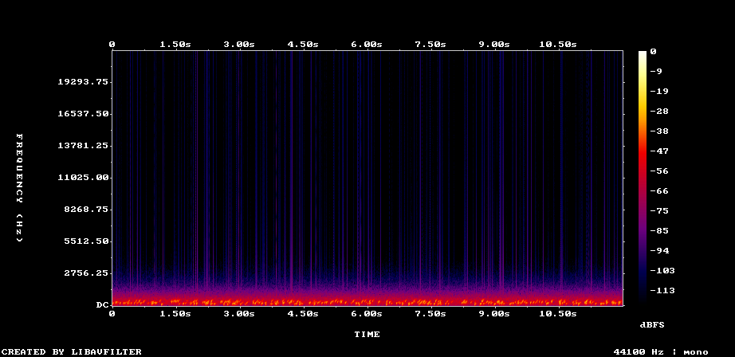

# Messwerte Brunnen-Hoerprobe (#438)

Erzeugt von `messen.py`. Alles gemessen, nichts gehoert. Spitze = hoechster Abtastwert; Mittel = ffmpeg `volumedetect`; ueber 3 kHz = Pegel nach Hochpass 3 kHz minus Gesamtpegel; Mitte 300-3000 = Pegel im Band 300 bis 3000 Hz minus Gesamtpegel; Einsaetze = Pegelspruenge ueber 8 dB in 50 ms (10-/30-ms-Fenster); Abklang = Zeit bis 40 dB unter Spitze; Ende = Spitze der letzten 50 ms (Regel 7, Soll hoechstens -50 dBFS; bei Schleifen entfaellt sie).

## Einzelklaenge

| Datei | Laenge s | Spitze dBFS | Mittel dB | ueber 3 kHz dB | Einsaetze 10/30 ms | Abklang s | Ende dBFS | Spektrogramm |
|---|---|---|---|---|---|---|---|---|
| glueck-a-funkeln-steigt.wav | 2.70 | -6.0 | -18.9 | -33.0 | 1 / 1 | 2.22 | -180.0 |  |
| glueck-b-glocke-aus-der-tiefe.wav | 3.02 | -6.0 | -22.9 | -38.5 | 1 / 0 | 2.13 | -180.0 |  |
| glueck-c-aufquellen.wav | 2.60 | -6.0 | -20.5 | -41.6 | 3 / 2 | 2.20 | -180.0 |  |
| wurf-a-muenze-plumpst.wav | 0.80 | -6.0 | -23.6 | -31.1 | 0 / 0 | 0.40 | -180.0 |  |
| wurf-b-platsch.wav | 1.00 | -6.0 | -24.6 | -30.9 | 0 / 0 | 0.50 | -180.0 |  |
| wurf-c-sinken.wav | 1.40 | -6.0 | -20.5 | -25.3 | 1 / 1 | 1.09 | -180.0 |  |

## Schleifen

Naht = Betrag des Sprungs letztes -> erstes Sample, daneben der groesste Sprung zwischen zwei Nachbarwerten in der Datei (Naht soll nicht darueber liegen). Die Fassung `-ohne-tropfen` ist das Rauschbett von B allein (Regel 6 misst die Flaeche ohne Einzelereignisse).

| Datei | Laenge s | Spitze dBFS | Mittel dB | ueber 3 kHz dB | Mitte 300-3000 dB | Naht / groesster Nachbarsprung | Spektrogramm |
|---|---|---|---|---|---|---|---|
| wasser-a-rieseln.wav | 12.00 | -18.0 | -31.8 | -25.1 | -1.4 | 0.00061 / 0.01294 |  |
| wasser-b-tropfen-im-becken-ohne-tropfen.wav | 12.00 | -18.0 | -30.2 | -38.8 | -5.3 | 0.00067 / 0.00491 |  |
| wasser-b-tropfen-im-becken.wav | 12.00 | -18.0 | -38.8 | -32.4 | -1.8 | 0.00003 / 0.00696 |  |
| wasser-c-gurgeln.wav | 12.00 | -18.0 | -36.2 | -38.7 | -4.2 | 0.00021 / 0.01462 |  |
