# Messwerte – Hörprobe 1

Erzeugt mit `python messen.py` (Python-Standardbibliothek und `ffmpeg`). Spitze und Mittel stammen aus `ffmpeg -af volumedetect`, die Spektrogramme aus `ffmpeg -lavfi showspectrumpic` (Zeit nach rechts, Frequenz logarithmisch nach oben). Alle Dateien: WAV, 16 Bit, 44 100 Hz; Geräusche mono, Ambiente stereo und zusätzlich als OGG.

Diese Datei beschreibt nur Aufbau und Messwerte. Ob etwas gut klingt, entscheidet die Hörprobe.

## Prüfung gegen den technischen Rahmen der Audio Bible

Spitzenpegel höchstens −1 dBFS; Anfang und Ende: erstes und letztes Sample exakt 0, und 20–40 ms vor dem Ende liegt der Pegel mindestens 40 dB unter der Spitze (die Ausblende schneidet also nichts Lautes ab).

| Datei | Länge | Spitze | Ränder | Ergebnis |
|---|---|---|---|---|
| `pistole-a-trocken.wav` | 0.300 s (< 0.6 s) ✔ | -1.5 dBFS ✔ | erstes/letztes Sample 0/0, Rest vor Blende -74 dB ✔ | bestanden |
| `pistole-b-gewoelbe.wav` | 0.580 s (< 0.6 s) ✔ | -1.5 dBFS ✔ | erstes/letztes Sample 0/0, Rest vor Blende -62 dB ✔ | bestanden |
| `pistole-c-metallisch.wav` | 0.450 s (< 0.6 s) ✔ | -1.5 dBFS ✔ | erstes/letztes Sample 0/0, Rest vor Blende -58 dB ✔ | bestanden |
| `klinge-a-dumpf.wav` | 0.300 s (< 0.6 s) ✔ | -4.0 dBFS ✔ | erstes/letztes Sample 0/0, Rest vor Blende -52 dB ✔ | bestanden |
| `klinge-b-schnitt.wav` | 0.380 s (< 0.6 s) ✔ | -4.0 dBFS ✔ | erstes/letztes Sample 0/0, Rest vor Blende -53 dB ✔ | bestanden |
| `klinge-c-klirren.wav` | 0.550 s (< 0.6 s) ✔ | -4.0 dBFS ✔ | erstes/letztes Sample 0/0, Rest vor Blende -47 dB ✔ | bestanden |
| `ghul-a-knurren-steigend.wav` | 0.850 s (< 1.5 s) ✔ | -3.0 dBFS ✔ | erstes/letztes Sample 0/0, Rest vor Blende -48 dB ✔ | bestanden |
| `ghul-b-atem-schrei.wav` | 1.100 s (< 1.5 s) ✔ | -3.0 dBFS ✔ | erstes/letztes Sample 0/0, Rest vor Blende -48 dB ✔ | bestanden |
| `ghul-c-gurgeln-zaehlen.wav` | 0.800 s (< 1.5 s) ✔ | -3.0 dBFS ✔ | erstes/letztes Sample 0/0, Rest vor Blende -45 dB ✔ | bestanden |
| `schritt-a-weich-1.wav` | 0.140 s (< 0.3 s) ✔ | -12.3 dBFS ✔ | erstes/letztes Sample 0/0, Rest vor Blende -57 dB ✔ | bestanden |
| `schritt-a-weich-2.wav` | 0.140 s (< 0.3 s) ✔ | -12.7 dBFS ✔ | erstes/letztes Sample 0/0, Rest vor Blende -56 dB ✔ | bestanden |
| `schritt-a-weich-3.wav` | 0.140 s (< 0.3 s) ✔ | -13.1 dBFS ✔ | erstes/letztes Sample 0/0, Rest vor Blende -53 dB ✔ | bestanden |
| `schritt-a-weich-4.wav` | 0.140 s (< 0.3 s) ✔ | -12.2 dBFS ✔ | erstes/letztes Sample 0/0, Rest vor Blende -55 dB ✔ | bestanden |
| `schritt-a-weich-folge.wav` | 4.300 s (Hörhilfe, keine Grenze) ✔ | -12.2 dBFS ✔ | erstes/letztes Sample 0/0, Rest vor Blende digitale Stille ✔ | bestanden |
| `schritt-b-stiefel-1.wav` | 0.220 s (< 0.3 s) ✔ | -12.1 dBFS ✔ | erstes/letztes Sample 0/0, Rest vor Blende digitale Stille ✔ | bestanden |
| `schritt-b-stiefel-2.wav` | 0.220 s (< 0.3 s) ✔ | -13.2 dBFS ✔ | erstes/letztes Sample 0/0, Rest vor Blende digitale Stille ✔ | bestanden |
| `schritt-b-stiefel-3.wav` | 0.220 s (< 0.3 s) ✔ | -12.4 dBFS ✔ | erstes/letztes Sample 0/0, Rest vor Blende digitale Stille ✔ | bestanden |
| `schritt-b-stiefel-4.wav` | 0.220 s (< 0.3 s) ✔ | -12.4 dBFS ✔ | erstes/letztes Sample 0/0, Rest vor Blende -85 dB ✔ | bestanden |
| `schritt-b-stiefel-folge.wav` | 4.300 s (Hörhilfe, keine Grenze) ✔ | -12.1 dBFS ✔ | erstes/letztes Sample 0/0, Rest vor Blende digitale Stille ✔ | bestanden |
| `schritt-c-hall-1.wav` | 0.280 s (< 0.3 s) ✔ | -13.5 dBFS ✔ | erstes/letztes Sample 0/0, Rest vor Blende -63 dB ✔ | bestanden |
| `schritt-c-hall-2.wav` | 0.280 s (< 0.3 s) ✔ | -13.3 dBFS ✔ | erstes/letztes Sample 0/0, Rest vor Blende -56 dB ✔ | bestanden |
| `schritt-c-hall-3.wav` | 0.280 s (< 0.3 s) ✔ | -12.5 dBFS ✔ | erstes/letztes Sample 0/0, Rest vor Blende -60 dB ✔ | bestanden |
| `schritt-c-hall-4.wav` | 0.280 s (< 0.3 s) ✔ | -12.4 dBFS ✔ | erstes/letztes Sample 0/0, Rest vor Blende -58 dB ✔ | bestanden |
| `schritt-c-hall-folge.wav` | 4.300 s (Hörhilfe, keine Grenze) ✔ | -12.4 dBFS ✔ | erstes/letztes Sample 0/0, Rest vor Blende digitale Stille ✔ | bestanden |
| `ambiente-a-grollen.wav` | 30.000 s (20–40 s) ✔ | -23.2 dBFS ✔ | Schleife, siehe Naht ✔ | bestanden |
| `ambiente-b-tropfen.wav` | 30.000 s (20–40 s) ✔ | -22.7 dBFS ✔ | Schleife, siehe Naht ✔ | bestanden |
| `ambiente-c-ferne-ereignisse.wav` | 30.000 s (20–40 s) ✔ | -23.3 dBFS ✔ | Schleife, siehe Naht ✔ | bestanden |

### Ghul: Wann ist der Laut am lautesten?

Der Schlag kommt bei 0,50 s. Gemessen: Mitte des lautesten 10-ms-Fensters, mittlerer Pegel kurz davor (0,40–0,48 s) und direkt danach (0,50–0,56 s).

| Datei | lautestes Fenster | 0,40–0,48 s | 0,50–0,56 s |
|---|---|---|---|
| `ghul-a-knurren-steigend.wav` | 0.509 s | -25.6 dBFS | -15.7 dBFS |
| `ghul-b-atem-schrei.wav` | 0.659 s | -24.6 dBFS | -15.3 dBFS |
| `ghul-c-gurgeln-zaehlen.wav` | 0.554 s | -23.0 dBFS | -15.2 dBFS |

### Ambiente: Nahtstelle und Frequenzbänder

Beim Wiederholen folgt auf das letzte Sample wieder das erste. *Sprung* ist der Abstand dieser beiden Werte; zum Vergleich der Abstand zweier Nachbar-Samples, den 99,9 % aller Stellen im Stück nicht überschreiten, und der größte überhaupt. Ist der Sprung kleiner als diese Werte, unterscheidet sich die Naht nicht von einer beliebigen Stelle im Stück. Dazu die mittlere Lautstärke der letzten und ersten 0,5 s. Die OGG-Datei wurde dafür mit `ffmpeg` zurück in WAV decodiert. Die Band-Zeile misst mit je zwei Hoch- und Tiefpässen von `ffmpeg`, wie viel Pegel in der Mitte des Hörbereichs liegt.

| Datei | Kanal | Länge | letztes → erstes Sample | Sprung | 99,9 % | größter | Mittel Ende / Anfang |
|---|---|---|---|---|---|---|---|
| `ambiente-a-grollen` WAV | L | 30.000 s | +0.00159 → +0.00119 | 0.00040 | 0.00385 | 0.00543 | -38.3 / -37.1 dBFS |
| `ambiente-a-grollen` WAV | R | 30.000 s | +0.01184 → +0.01105 | 0.00079 | 0.00381 | 0.00504 | -35.3 / -35.7 dBFS |
| `ambiente-a-grollen` OGG | L | 30.000 s | +0.00192 → +0.00119 | 0.00073 | 0.00403 | 0.00589 | -38.2 / -37.2 dBFS |
| `ambiente-a-grollen` OGG | R | 30.000 s | +0.01077 → +0.01126 | 0.00049 | 0.00403 | 0.00604 | -35.2 / -35.6 dBFS |
| `ambiente-a-grollen` Bänder | – | – | Mitte 300–3000 Hz: Mittel -76.9 dBFS | Tiefen < 300 Hz: Mittel -38.1 dBFS | gesamt -38.0 dBFS | – | – |
| `ambiente-b-tropfen` WAV | L | 30.000 s | +0.00925 → +0.01038 | 0.00113 | 0.00436 | 0.01913 | -38.0 / -36.8 dBFS |
| `ambiente-b-tropfen` WAV | R | 30.000 s | -0.02939 → -0.02985 | 0.00046 | 0.00534 | 0.02432 | -36.5 / -35.6 dBFS |
| `ambiente-b-tropfen` OGG | L | 30.000 s | +0.00919 → +0.01083 | 0.00165 | 0.00458 | 0.01941 | -38.0 / -36.8 dBFS |
| `ambiente-b-tropfen` OGG | R | 30.000 s | -0.03043 → -0.03040 | 0.00003 | 0.00522 | 0.02280 | -36.5 / -35.6 dBFS |
| `ambiente-b-tropfen` Bänder | – | – | Mitte 300–3000 Hz: Mittel -72.0 dBFS | Tiefen < 300 Hz: Mittel -38.1 dBFS | gesamt -38.0 dBFS | – | – |
| `ambiente-c-ferne-ereignisse` WAV | L | 30.000 s | +0.00888 → +0.00912 | 0.00024 | 0.00372 | 0.00525 | -37.2 / -36.9 dBFS |
| `ambiente-c-ferne-ereignisse` WAV | R | 30.000 s | +0.02350 → +0.02563 | 0.00214 | 0.00369 | 0.00479 | -34.3 / -34.7 dBFS |
| `ambiente-c-ferne-ereignisse` OGG | L | 30.000 s | +0.00873 → +0.00925 | 0.00052 | 0.00391 | 0.00635 | -37.2 / -36.9 dBFS |
| `ambiente-c-ferne-ereignisse` OGG | R | 30.000 s | +0.02307 → +0.02570 | 0.00262 | 0.00391 | 0.00574 | -34.3 / -34.7 dBFS |
| `ambiente-c-ferne-ereignisse` Bänder | – | – | Mitte 300–3000 Hz: Mittel -66.2 dBFS | Tiefen < 300 Hz: Mittel -38.1 dBFS | gesamt -38.0 dBFS | – | – |

## Dateien im Einzelnen

## Pistolenschuss

### pistole-a-trocken

Heller Rausch-Knall (Hochpass 900 Hz, 6 ms), Druck-Rauschen (Tiefpass 1,6 kHz, 25 ms) und ein von 110 auf 45 Hz fallender Sinus-Stoss, dazu nur zwei frühe Reflexionen (7 und 13 ms); die kürzeste und trockenste der drei.

| Datei | Länge | Spitze | Mittel | Spektrogramm |
|---|---|---|---|---|
| `pistole-a-trocken.wav` | 0.300 s | -1.5 dBFS | -23.3 dBFS | 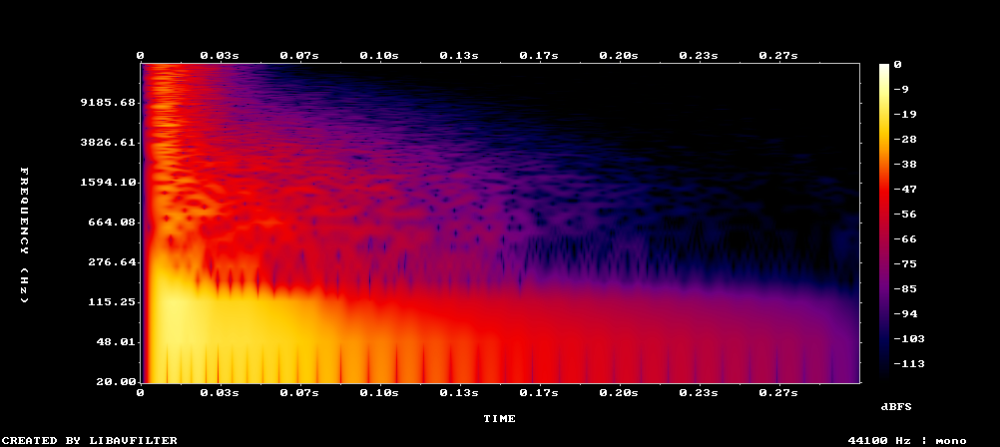 |

### pistole-b-gewoelbe

Derselbe Kern mit etwas mehr Tiefe, dazu ein dunkler Schroeder-Hall (RT60 0,6 s, Dämpfung 1,8 kHz), der bis 0,58 s ausklingt; unterscheidet sich durch den langen, dumpfen Raum.

| Datei | Länge | Spitze | Mittel | Spektrogramm |
|---|---|---|---|---|
| `pistole-b-gewoelbe.wav` | 0.580 s | -1.5 dBFS | -20.2 dBFS | 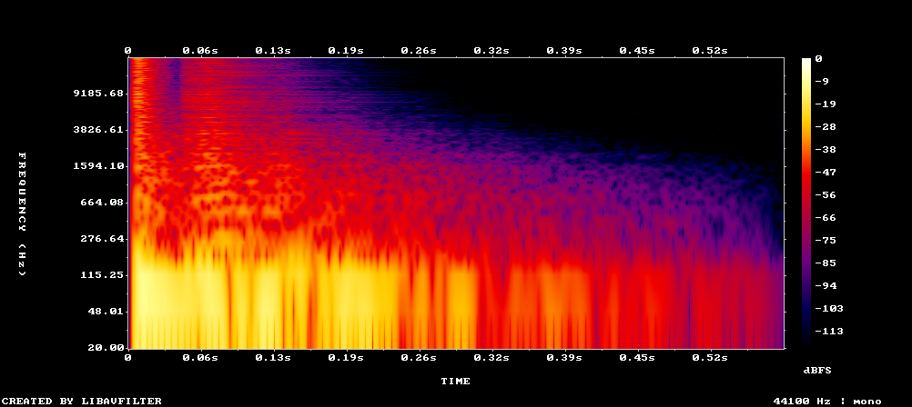 |

### pistole-c-metallisch

18 ms vor dem Schuss ein Hahn-Klick (Bandpass 3,2 kHz), danach ein kürzerer Knall mit weniger Tiefe und unharmonischen Teiltönen (2,35/3,71/5,18/6,89 kHz, verstimmtes Paar für Schwebung) in einem kurzen, hellen Raum (RT60 0,35 s); die hellste der drei.

| Datei | Länge | Spitze | Mittel | Spektrogramm |
|---|---|---|---|---|
| `pistole-c-metallisch.wav` | 0.450 s | -1.5 dBFS | -22.4 dBFS | 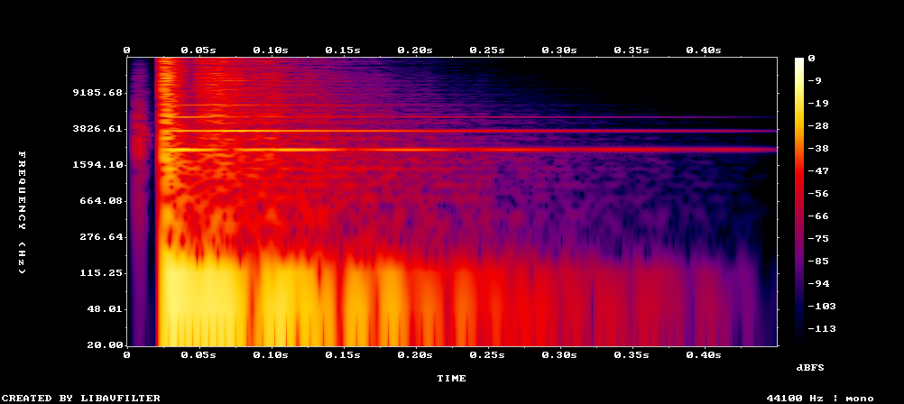 |

## Klingentreffer

### klinge-a-dumpf

Nur der Aufprall: Tiefpass-Rauschen (420 Hz), ein von 95 auf 58 Hz fallender Körperton und ein unregelmäßig moduliertes Band-Rauschen um 700 Hz als feuchtes Quetschen; kein heller Anteil.

| Datei | Länge | Spitze | Mittel | Spektrogramm |
|---|---|---|---|---|
| `klinge-a-dumpf.wav` | 0.300 s | -4.0 dBFS | -16.5 dBFS | 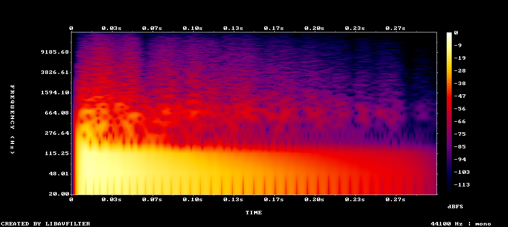 |

### klinge-b-schnitt

Vorweg 70 ms Band-Rauschen, das von 7 auf 2,5 kHz gleitet (der Schnitt), dann derselbe dumpfe Aufprall mit mehr Quetschen; unterscheidet sich durch den hellen Anlauf vor dem Treffer.

| Datei | Länge | Spitze | Mittel | Spektrogramm |
|---|---|---|---|---|
| `klinge-b-schnitt.wav` | 0.380 s | -4.0 dBFS | -18.0 dBFS | 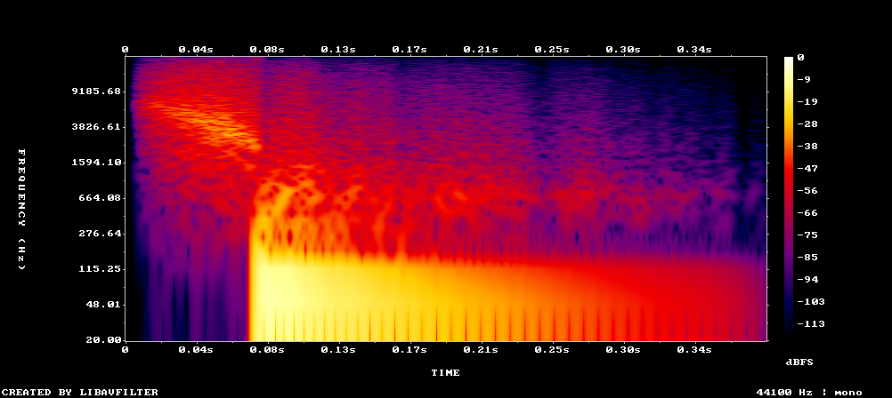 |

### klinge-c-klirren

Dumpfer Aufprall mit hellem Anschlag-Klick, darüber eine bis 0,55 s nachklingende Silberklinge aus sechs unharmonischen Teiltönen (1,87–7,55 kHz, mit Schwebung); unterscheidet sich durch das metallische Nachklingen.

| Datei | Länge | Spitze | Mittel | Spektrogramm |
|---|---|---|---|---|
| `klinge-c-klirren.wav` | 0.550 s | -4.0 dBFS | -23.3 dBFS | 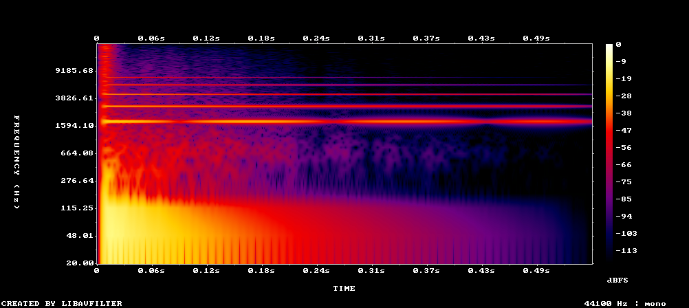 |

## Ghul-Laut

### ghul-a-knurren-steigend

Kehliger Impulszug (55→95 Hz, mit Tonhöhen-Zittern und jeder zweiten Periode leiser) durch tiefe Formant-Filter, 0,5 s lang um 14 dB lauter und heller werdend, bei 0,50 s ein Sprung auf 135 Hz mit Rausch-Ausstoß, dann Abfall; Zeitgeber ist das stetige Ansteigen bis zum Gipfel.

| Datei | Länge | Spitze | Mittel | Spektrogramm |
|---|---|---|---|---|
| `ghul-a-knurren-steigend.wav` | 0.850 s | -3.0 dBFS | -24.8 dBFS | 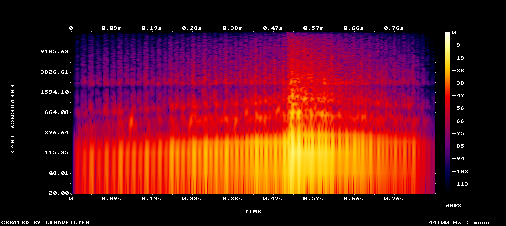 |

### ghul-b-atem-schrei

Feuchtes Einatmen (Band-Rauschen 300→1300 Hz, gurgelnd moduliert, mit Blasen), das bei 0,48 s abreißt; nach 20 ms Stille setzt bei 0,50 s ein rauer Schrei ein (150→85 Hz, viel Hauch); Zeitgeber ist der Einsatz nach der Lücke.

| Datei | Länge | Spitze | Mittel | Spektrogramm |
|---|---|---|---|---|
| `ghul-b-atem-schrei.wav` | 1.100 s | -3.0 dBFS | -21.7 dBFS | 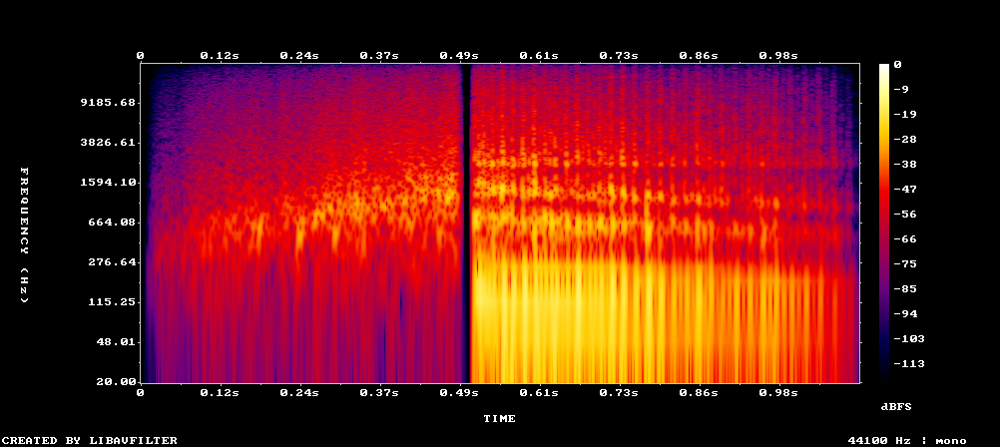 |

### ghul-c-gurgeln-zaehlen

Drei kurze, nasse Gurgel-Stöße bei 0 / 0,25 / 0,40 s (Abstände werden kürzer, Tonhöhe und Pegel steigen), der vierte und lauteste bei 0,50 s; Zeitgeber ist der Rhythmus wie beim Anzählen.

| Datei | Länge | Spitze | Mittel | Spektrogramm |
|---|---|---|---|---|
| `ghul-c-gurgeln-zaehlen.wav` | 0.800 s | -3.0 dBFS | -22.8 dBFS | 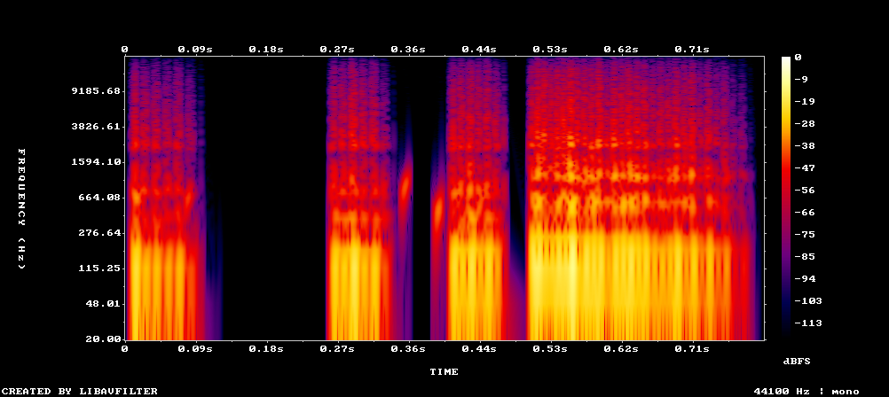 |

## Schritt auf Stein

### schritt-a-weich

Weiche Sohle: kurzes Tiefpass-Rauschen (um 1,1 kHz, 12 ms) mit leisem tiefem Stoß, kein Raum; die vier Schritte unterscheiden sich in Filter, Abklingzeit, Stoß-Tonhöhe (je ±10–20 %) und Pegel (bis −1,5 dB).

| Datei | Länge | Spitze | Mittel | Spektrogramm |
|---|---|---|---|---|
| `schritt-a-weich-1.wav` | 0.140 s | -12.3 dBFS | -28.0 dBFS | 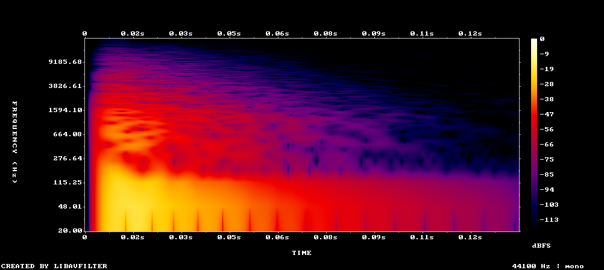 |
| `schritt-a-weich-2.wav` | 0.140 s | -12.7 dBFS | -28.5 dBFS | 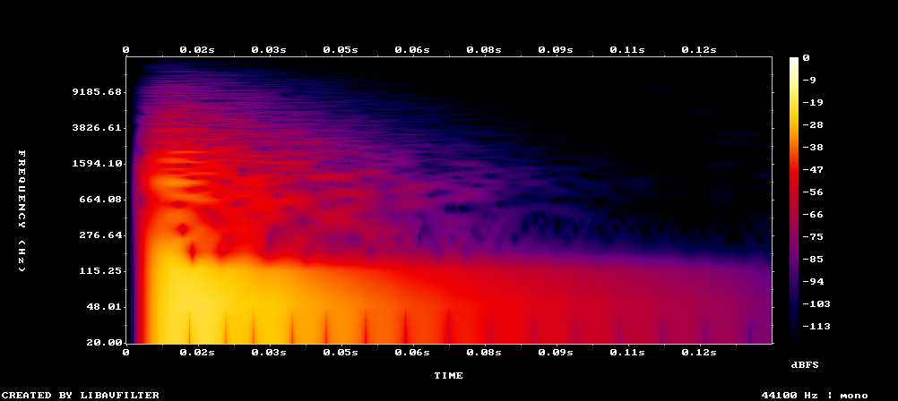 |
| `schritt-a-weich-3.wav` | 0.140 s | -13.1 dBFS | -26.8 dBFS | 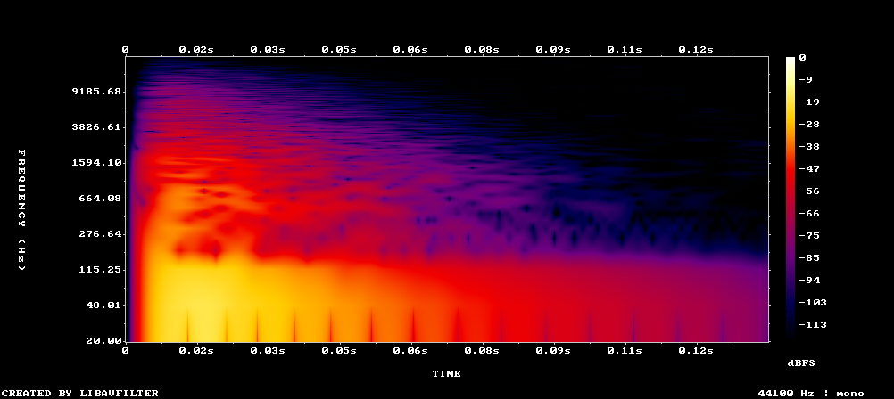 |
| `schritt-a-weich-4.wav` | 0.140 s | -12.2 dBFS | -27.1 dBFS | 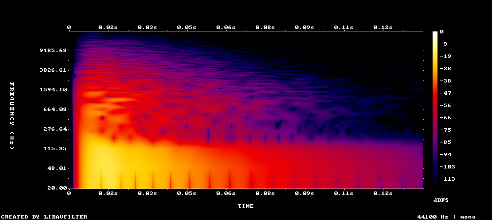 |

Hörhilfe, kein Spiel-Asset: die vier Schritte zweimal im Abstand von 0,5 s; für sie gilt die 0,3-s-Grenze nicht.

| Datei | Länge | Spitze | Mittel | Spektrogramm |
|---|---|---|---|---|
| `schritt-a-weich-folge.wav` | 4.300 s | -12.2 dBFS | -33.4 dBFS | 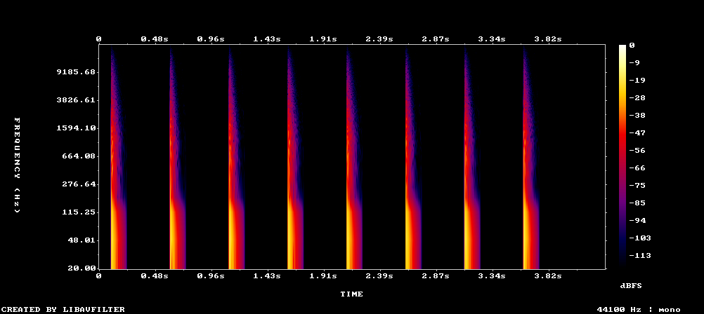 |

### schritt-b-stiefel

Harte Ferse (um 2,8 kHz) mit kräftigem tiefem Stoß, 35–55 ms später die leisere Spitze, dazu verstreutes Sandknirschen über 2,5 kHz; die vier Schritte unterscheiden sich zusätzlich im Abstand Ferse–Spitze.

| Datei | Länge | Spitze | Mittel | Spektrogramm |
|---|---|---|---|---|
| `schritt-b-stiefel-1.wav` | 0.220 s | -12.1 dBFS | -31.1 dBFS | 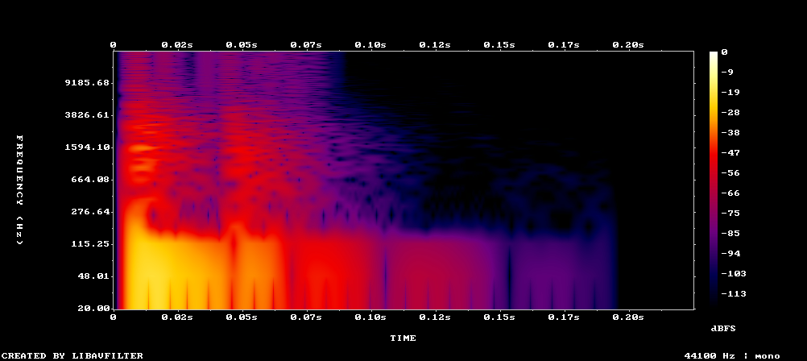 |
| `schritt-b-stiefel-2.wav` | 0.220 s | -13.2 dBFS | -30.5 dBFS | 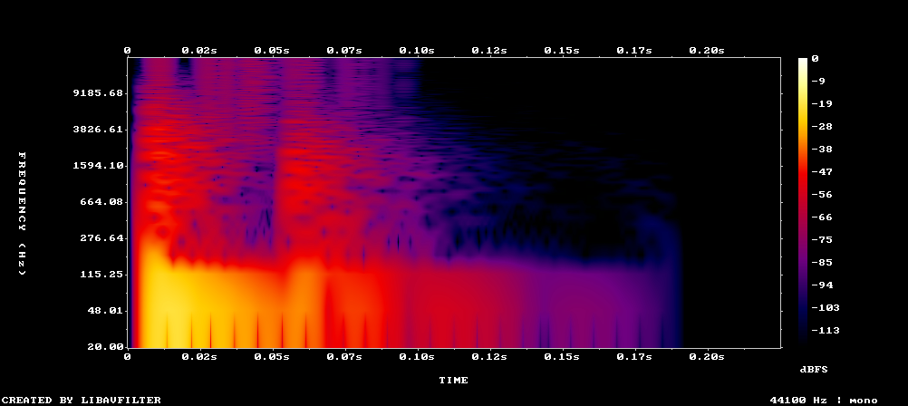 |
| `schritt-b-stiefel-3.wav` | 0.220 s | -12.4 dBFS | -28.7 dBFS | 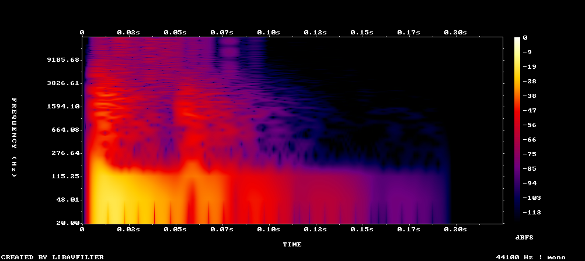 |
| `schritt-b-stiefel-4.wav` | 0.220 s | -12.4 dBFS | -29.8 dBFS | 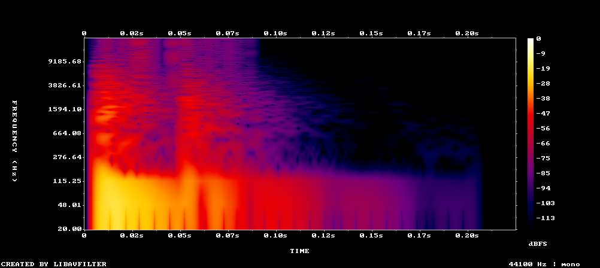 |

Hörhilfe, kein Spiel-Asset: die vier Schritte zweimal im Abstand von 0,5 s; für sie gilt die 0,3-s-Grenze nicht.

| Datei | Länge | Spitze | Mittel | Spektrogramm |
|---|---|---|---|---|
| `schritt-b-stiefel-folge.wav` | 4.300 s | -12.1 dBFS | -33.8 dBFS | 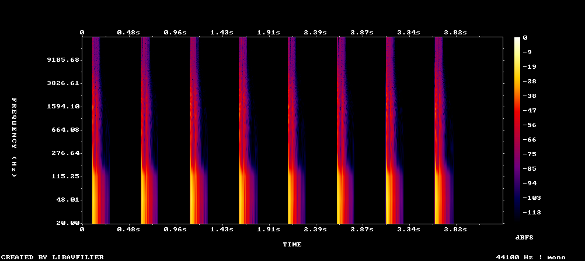 |

### schritt-c-hall

Heller, kurzer Aufsatz (um 3,5 kHz, 7 ms) mit kurzem Raumhall (RT60 0,35 s), der bis 0,28 s ausklingt; die vier Schritte unterscheiden sich in Filter, Abklingzeit, Pegel und Hall-Muster.

| Datei | Länge | Spitze | Mittel | Spektrogramm |
|---|---|---|---|---|
| `schritt-c-hall-1.wav` | 0.280 s | -13.5 dBFS | -33.4 dBFS | 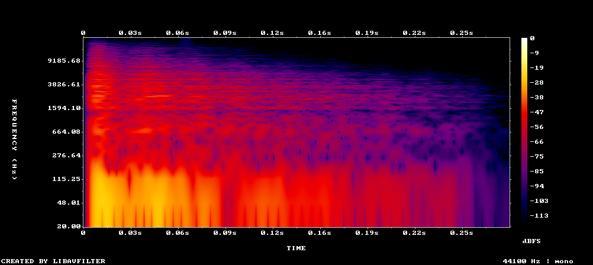 |
| `schritt-c-hall-2.wav` | 0.280 s | -13.3 dBFS | -34.9 dBFS | 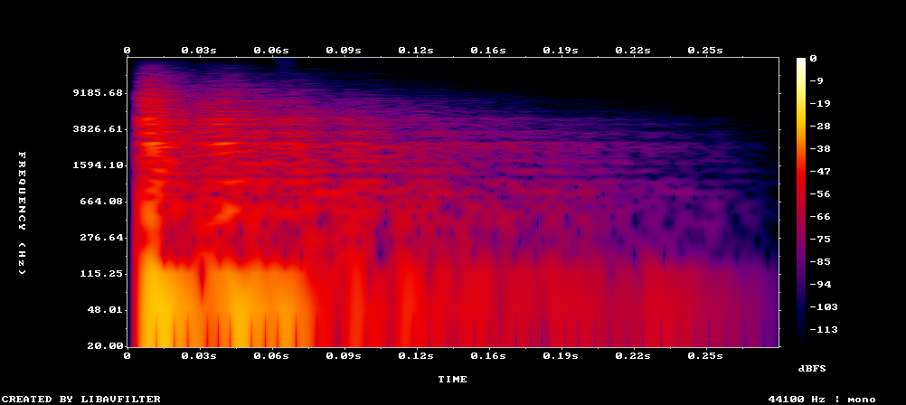 |
| `schritt-c-hall-3.wav` | 0.280 s | -12.5 dBFS | -31.9 dBFS | 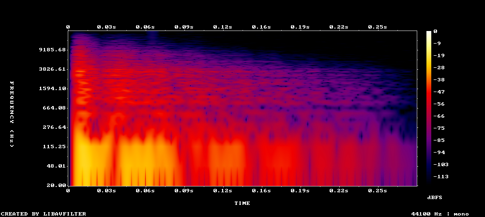 |
| `schritt-c-hall-4.wav` | 0.280 s | -12.4 dBFS | -34.6 dBFS | 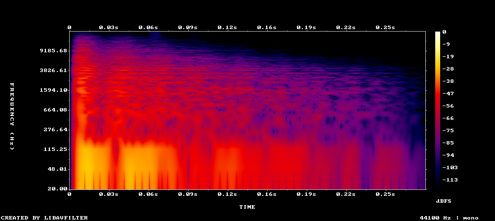 |

Hörhilfe, kein Spiel-Asset: die vier Schritte zweimal im Abstand von 0,5 s; für sie gilt die 0,3-s-Grenze nicht.

| Datei | Länge | Spitze | Mittel | Spektrogramm |
|---|---|---|---|---|
| `schritt-c-hall-folge.wav` | 4.300 s | -12.4 dBFS | -36.4 dBFS | 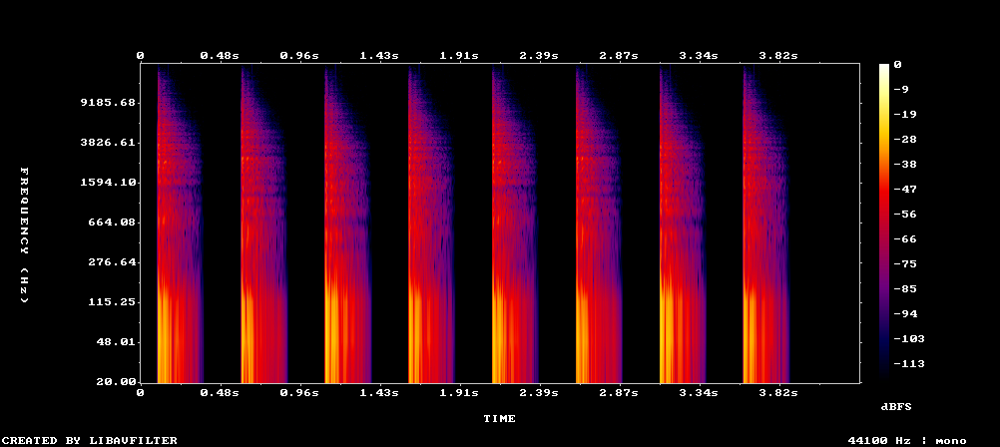 |

## Katakomben-Ambiente

### ambiente-a-grollen

Nur die Grundfläche: zweifach tiefpassgefiltertes Rauschen (unter etwa 120 Hz), das langsam atmet (1 und 3 Perioden je Schleife), und sehr leise Luft zwischen 6,5 und 9 kHz; keine Ereignisse.

| Datei | Länge | Spitze | Mittel | Spektrogramm |
|---|---|---|---|---|
| `ambiente-a-grollen.wav` | 30.000 s | -23.2 dBFS | -38.0 dBFS | 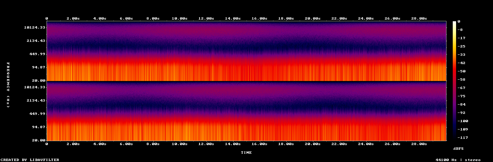 |

### ambiente-b-tropfen

Dieselbe Grundfläche plus sieben seltene, leise Wassertropfen (3–5,5 kHz, aufsteigend, 2,5–6 s Abstand, im Stereobild verteilt) mit zwei dunkleren Echos bei 90 und 170 ms.

| Datei | Länge | Spitze | Mittel | Spektrogramm |
|---|---|---|---|---|
| `ambiente-b-tropfen.wav` | 30.000 s | -22.7 dBFS | -38.0 dBFS |  |

### ambiente-c-ferne-ereignisse

Dieselbe Grundfläche plus fünf ferne Ereignisse mit langem dunklem Hall, überwiegend unter 400 Hz (die Stein-Anschläge reichen schwach bis etwa 2 kHz): zweimal Steinpoltern, ein Schaben, zweimal tiefes Wehen; das Wehen bei 27,5 s reicht über die Naht und klingt am Anfang aus.

| Datei | Länge | Spitze | Mittel | Spektrogramm |
|---|---|---|---|---|
| `ambiente-c-ferne-ereignisse.wav` | 30.000 s | -23.3 dBFS | -38.0 dBFS | 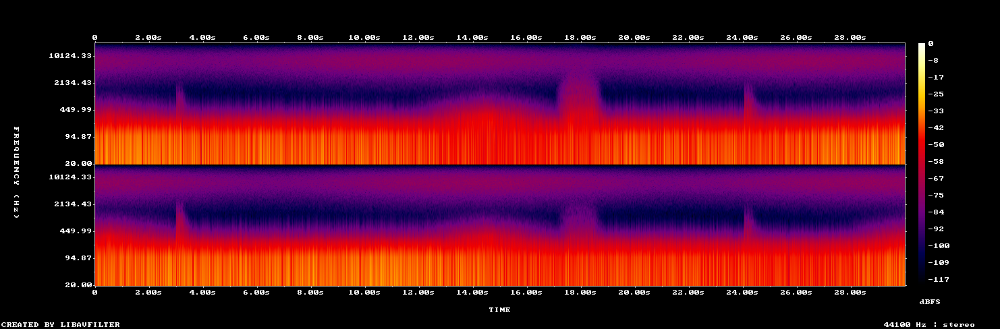 |
