# Messwerte – Hörprobe 2

Erzeugt mit `python messen.py`. Spitze und Mittel aus `ffmpeg -af volumedetect`, Spektrogramme aus `ffmpeg -lavfi showspectrumpic` (Zeit nach rechts, Frequenz logarithmisch nach oben), Lautheit aus `ffmpeg -af ebur128`. WAV, 16 Bit, 44 100 Hz; Geräusche mono, Ambiente stereo und zusätzlich als OGG. Dateien mit `vergleich-` sind unverändert aus Hörprobe 1 kopiert.

Diese Datei beschreibt nur Aufbau und Messwerte. Ob etwas gut klingt, entscheidet die Hörprobe.

## Prüfung gegen den technischen Rahmen der Audio Bible

Spitzenpegel höchstens −1 dBFS; erstes und letztes Sample exakt 0; 20–40 ms vor dem Ende mindestens 40 dB unter der Spitze.

| Datei | Länge | Spitze | Ränder | Ergebnis |
|---|---|---|---|---|
| `ghul-d-anschwellen.wav` | 0.620 s (< 1.5 s) ✔ | -3.0 dBFS ✔ | erstes/letztes Sample 0/0, Rest vor Blende -97 dB ✔ | bestanden |
| `ghul-e-fauchen.wav` | 0.620 s (< 1.5 s) ✔ | -3.0 dBFS ✔ | erstes/letztes Sample 0/0, Rest vor Blende digitale Stille ✔ | bestanden |
| `ghul-f-aufsteigen.wav` | 0.700 s (< 1.5 s) ✔ | -3.0 dBFS ✔ | erstes/letztes Sample 0/0, Rest vor Blende -57 dB ✔ | bestanden |
| `pistole-d-hell-kurz.wav` | 0.400 s (< 0.6 s) ✔ | -1.5 dBFS ✔ | erstes/letztes Sample 0/0, Rest vor Blende -79 dB ✔ | bestanden |
| `pistole-d-hell-kurz-22k.wav` | 0.400 s (< 0.6 s) ✔ | -1.5 dBFS ✔ | erstes/letztes Sample 0/0, Rest vor Blende -81 dB ✔ | bestanden |
| `pistole-e-dunkel-schwer.wav` | 0.550 s (< 0.6 s) ✔ | -1.5 dBFS ✔ | erstes/letztes Sample 0/0, Rest vor Blende -65 dB ✔ | bestanden |
| `vergleich-pistole-a-trocken.wav` | 0.300 s (< 0.6 s) ✔ | -1.5 dBFS ✔ | erstes/letztes Sample 0/0, Rest vor Blende -74 dB ✔ | bestanden |
| `klinge-d-kurz-dumpf.wav` | 0.240 s (< 0.6 s) ✔ | -4.0 dBFS ✔ | erstes/letztes Sample 0/0, Rest vor Blende -48 dB ✔ | bestanden |
| `klinge-e-schwer-nass.wav` | 0.320 s (< 0.6 s) ✔ | -4.0 dBFS ✔ | erstes/letztes Sample 0/0, Rest vor Blende -47 dB ✔ | bestanden |
| `vergleich-klinge-a-dumpf.wav` | 0.300 s (< 0.6 s) ✔ | -4.0 dBFS ✔ | erstes/letztes Sample 0/0, Rest vor Blende -52 dB ✔ | bestanden |
| `schritt-d-klar-1.wav` | 0.160 s (< 0.3 s) ✔ | -13.3 dBFS ✔ | erstes/letztes Sample 0/0, Rest vor Blende -79 dB ✔ | bestanden |
| `schritt-d-klar-2.wav` | 0.160 s (< 0.3 s) ✔ | -13.0 dBFS ✔ | erstes/letztes Sample 0/0, Rest vor Blende -79 dB ✔ | bestanden |
| `schritt-d-klar-3.wav` | 0.160 s (< 0.3 s) ✔ | -13.1 dBFS ✔ | erstes/letztes Sample 0/0, Rest vor Blende -77 dB ✔ | bestanden |
| `schritt-d-klar-4.wav` | 0.160 s (< 0.3 s) ✔ | -12.3 dBFS ✔ | erstes/letztes Sample 0/0, Rest vor Blende -80 dB ✔ | bestanden |
| `schritt-d-klar-folge.wav` | 4.300 s (Hörhilfe, keine Grenze) ✔ | -12.3 dBFS ✔ | erstes/letztes Sample 0/0, Rest vor Blende digitale Stille ✔ | bestanden |
| `schritt-e-schwer-1.wav` | 0.200 s (< 0.3 s) ✔ | -13.4 dBFS ✔ | erstes/letztes Sample 0/0, Rest vor Blende -63 dB ✔ | bestanden |
| `schritt-e-schwer-2.wav` | 0.200 s (< 0.3 s) ✔ | -12.6 dBFS ✔ | erstes/letztes Sample 0/0, Rest vor Blende -63 dB ✔ | bestanden |
| `schritt-e-schwer-3.wav` | 0.200 s (< 0.3 s) ✔ | -13.4 dBFS ✔ | erstes/letztes Sample 0/0, Rest vor Blende -61 dB ✔ | bestanden |
| `schritt-e-schwer-4.wav` | 0.200 s (< 0.3 s) ✔ | -12.4 dBFS ✔ | erstes/letztes Sample 0/0, Rest vor Blende -63 dB ✔ | bestanden |
| `schritt-e-schwer-folge.wav` | 4.300 s (Hörhilfe, keine Grenze) ✔ | -12.4 dBFS ✔ | erstes/letztes Sample 0/0, Rest vor Blende digitale Stille ✔ | bestanden |
| `vergleich-schritt-a-weich-1.wav` | 0.140 s (< 0.3 s) ✔ | -12.3 dBFS ✔ | erstes/letztes Sample 0/0, Rest vor Blende -57 dB ✔ | bestanden |
| `vergleich-schritt-a-weich-2.wav` | 0.140 s (< 0.3 s) ✔ | -12.7 dBFS ✔ | erstes/letztes Sample 0/0, Rest vor Blende -56 dB ✔ | bestanden |
| `vergleich-schritt-a-weich-3.wav` | 0.140 s (< 0.3 s) ✔ | -13.1 dBFS ✔ | erstes/letztes Sample 0/0, Rest vor Blende -53 dB ✔ | bestanden |
| `vergleich-schritt-a-weich-4.wav` | 0.140 s (< 0.3 s) ✔ | -12.2 dBFS ✔ | erstes/letztes Sample 0/0, Rest vor Blende -55 dB ✔ | bestanden |
| `vergleich-schritt-a-weich-folge.wav` | 4.300 s (Hörhilfe, keine Grenze) ✔ | -12.2 dBFS ✔ | erstes/letztes Sample 0/0, Rest vor Blende digitale Stille ✔ | bestanden |
| `ambiente-b1-quinte.wav` | 30.000 s (20–40 s) ✔ | -22.7 dBFS ✔ | Schleife, siehe Naht ✔ | bestanden |
| `ambiente-b2-oktave.wav` | 30.000 s (20–40 s) ✔ | -22.7 dBFS ✔ | Schleife, siehe Naht ✔ | bestanden |
| `ambiente-b3-anderthalb-oktaven.wav` | 30.000 s (20–40 s) ✔ | -22.7 dBFS ✔ | Schleife, siehe Naht ✔ | bestanden |

## Ghul: eine Geste?

Der Schlag kommt bei 0,50 s. *Gipfel*: Mitte des lautesten 10-ms-Fensters. *Nach dem Schlag*: Pegel 0,56–0,60 s relativ zur Spitze (zeigt, wie klar der Laut nach dem Schlag endet). *Einsätze*: wie oft der Pegel (50-ms-Fenster) bis kurz nach dem Schlag gegenüber 50 ms vorher um mehr als 8 dB steigt; der Beginn des Lauts zählt mit – ein Maß dafür, ob der Laut aus mehreren Ereignissen besteht. Ziel für eine einzige Geste: 1. Zum Vergleich die drei Varianten aus Hörprobe 1.

| Datei | Gipfel | nach dem Schlag | Einsätze bis zum Schlag |
|---|---|---|---|
| `ghul-d-anschwellen.wav` (Hörprobe 2) | 0.489 s | -79 dB | 1 |
| `ghul-e-fauchen.wav` (Hörprobe 2) | 0.499 s | Stille | 1 |
| `ghul-f-aufsteigen.wav` (Hörprobe 2) | 0.499 s | -30 dB | 1 |
| `ghul-a-knurren-steigend.wav` (Hörprobe 1) | 0.509 s | -17 dB | 2 |
| `ghul-b-atem-schrei.wav` (Hörprobe 1) | 0.659 s | -12 dB | 2 |
| `ghul-c-gurgeln-zaehlen.wav` (Hörprobe 1) | 0.554 s | -16 dB | 4 |

## Ambiente: Naht, Mitte, Lautheit, Unterschied zur Vorlage

*Naht*: Sprung vom letzten zum ersten Sample, verglichen mit dem Abstand zweier Nachbar-Samples, den 99,9 % aller Stellen nicht überschreiten (WAV und zurückdecodierte OGG, je Kanal). *Mitte*: mittlerer Pegel im Band 300–3000 Hz. *Unterschied zur Vorlage*: Zahl der getrennten Stellen, an denen sich die Datei von `../hoerprobe-1/ambiente-b-tropfen.wav` um mehr als 0,001 unterscheidet – erwartet sind genau die sieben Tropfen, sonst nichts.

| Datei | Naht | Mitte 300–3000 Hz | gesamt | Lautheit | Unterschied zur Vorlage |
|---|---|---|---|---|---|
| `ambiente-b1-quinte` | WAV L: 0.00113 ≤ 0.00406; WAV R: 0.00046 ≤ 0.00424; OGG L: 0.00119 ≤ 0.00424; OGG R: 0.00122 ≤ 0.00446 ✔ | -66.8 dBFS | -38.0 dBFS | -40.9 LUFS | L 7, R 7 |
| `ambiente-b2-oktave` | WAV L: 0.00113 ≤ 0.00394; WAV R: 0.00046 ≤ 0.00406; OGG L: 0.00165 ≤ 0.00415; OGG R: 0.00015 ≤ 0.00424 ✔ | -65.1 dBFS | -38.0 dBFS | -40.9 LUFS | L 7, R 7 |
| `ambiente-b3-anderthalb-oktaven` | WAV L: 0.00113 ≤ 0.00388; WAV R: 0.00046 ≤ 0.00391; OGG L: 0.00168 ≤ 0.00406; OGG R: 0.00012 ≤ 0.00409 ✔ | -64.4 dBFS | -38.0 dBFS | -41.0 LUFS | L 7, R 7 |
| Vorlage `ambiente-b-tropfen` (Hörprobe 1) | – | -72.0 dBFS | – | -40.9 LUFS | – |

## Dateien im Einzelnen

## Ghul-Laut

### ghul-d-anschwellen

**Geste:** Eine tiefe, raue Stimme auf gleichbleibendem Ton (58 Hz, jede zweite Periode leiser) schwillt in 0,5 s gleichmäßig um 30 dB an und bricht beim Schlag in 40 ms ab. Zwei Schichten: Stimme und leiser Atem durch denselben festen Rachen (Formanten 380/700 Hz).

| Datei | Länge | Spitze | Mittel | Spektrogramm |
|---|---|---|---|---|
| `ghul-d-anschwellen.wav` | 0.620 s | -3.0 dBFS | -19.6 dBFS | 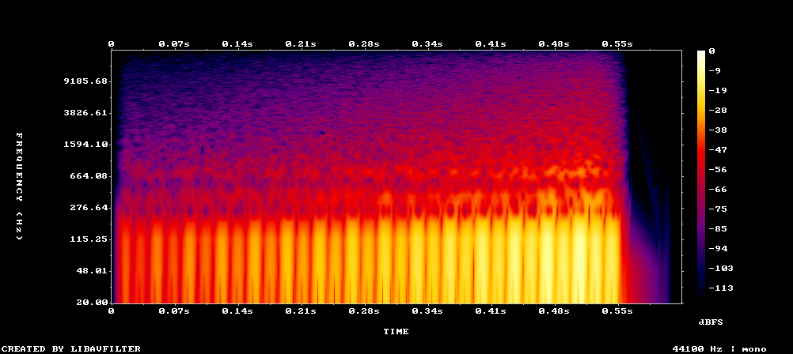 |

### ghul-e-fauchen

**Geste:** Ein einziges Fauchen (Rauschen durch zwei Rachen-Formanten, die von 450 auf 900 Hz wandern) schwillt in 0,5 s um 30 dB an, wird dabei heller und bricht beim Schlag in 40 ms ab. Eine Schicht, keine Stimme.

| Datei | Länge | Spitze | Mittel | Spektrogramm |
|---|---|---|---|---|
| `ghul-e-fauchen.wav` | 0.620 s | -3.0 dBFS | -21.5 dBFS | 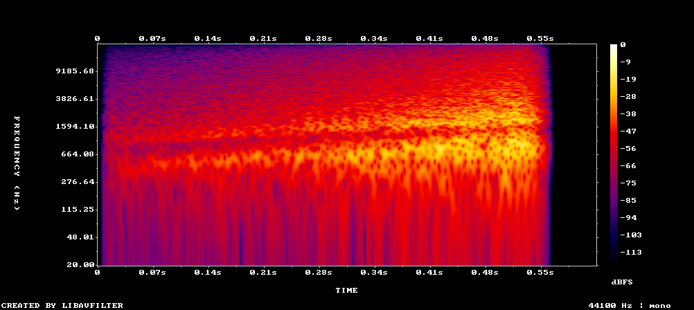 |

### ghul-f-aufsteigen

**Geste:** Eine raue Stimme gleitet in 0,5 s gleichmäßig von 45 auf 110 Hz und erreicht beim Schlag den höchsten Ton, danach klingt sie in etwa 0,1 s ab. Eine Schicht, dunkler Vokal (Formanten 320/620 Hz), nur 12 dB Anstieg – hier trägt die Tonhöhe die Zeit, nicht die Lautstärke.

| Datei | Länge | Spitze | Mittel | Spektrogramm |
|---|---|---|---|---|
| `ghul-f-aufsteigen.wav` | 0.700 s | -3.0 dBFS | -17.6 dBFS | 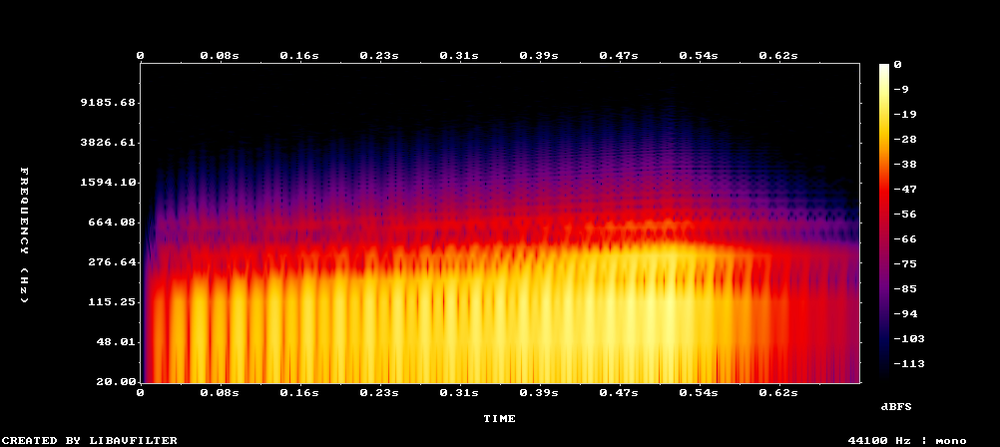 |

## Pistolenschuss

### pistole-d-hell-kurz

Drei Schichten: Anschlag als Druckpuls (1,2 ms, Friedlander-Form) mit 3 ms Hochpass-Rauschen; Körper aus Tiefpass-Rauschen 1,4 kHz (22 ms) und Stoß 100→45 Hz; Ausklang aus drei kalten frühen Reflexionen und kurzem Hall (RT60 0,35 s). Heller und kürzer als e.

| Datei | Länge | Spitze | Mittel | Spektrogramm |
|---|---|---|---|---|
| `pistole-d-hell-kurz.wav` | 0.400 s | -1.5 dBFS | -20.7 dBFS | 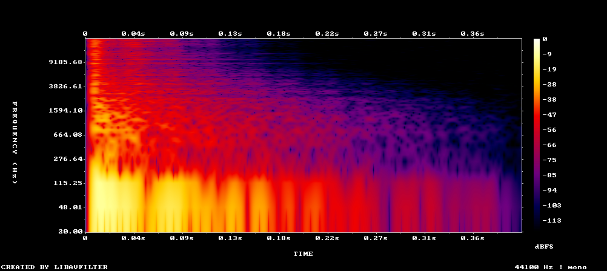 |

### pistole-d-hell-kurz-22k

Zusatz zur Frage nach dem Klang der Ära: genau Variante d, aber mit `ffmpeg` auf 22 050 Hz herunter- und wieder hochgerechnet, sodass oberhalb von etwa 11 kHz nichts mehr ist – wie bei einer mit 22 kHz abgelegten Datei. Keine Nachbildung der ADPCM-Körnung.

| Datei | Länge | Spitze | Mittel | Spektrogramm |
|---|---|---|---|---|
| `pistole-d-hell-kurz-22k.wav` | 0.400 s | -1.5 dBFS | -19.6 dBFS |  |

### pistole-e-dunkel-schwer

Drei Schichten: weicherer Druckpuls (2,5 ms) ohne Rausch-Klick; breiter Körper aus Tiefpass-Rauschen 800 Hz (40 ms) und Stoß 80→38 Hz; dunkler Gewölbe-Hall (RT60 0,5 s, Dämpfung 1,5 kHz). Tiefer, weicher und länger als d.

| Datei | Länge | Spitze | Mittel | Spektrogramm |
|---|---|---|---|---|
| `pistole-e-dunkel-schwer.wav` | 0.550 s | -1.5 dBFS | -16.7 dBFS | 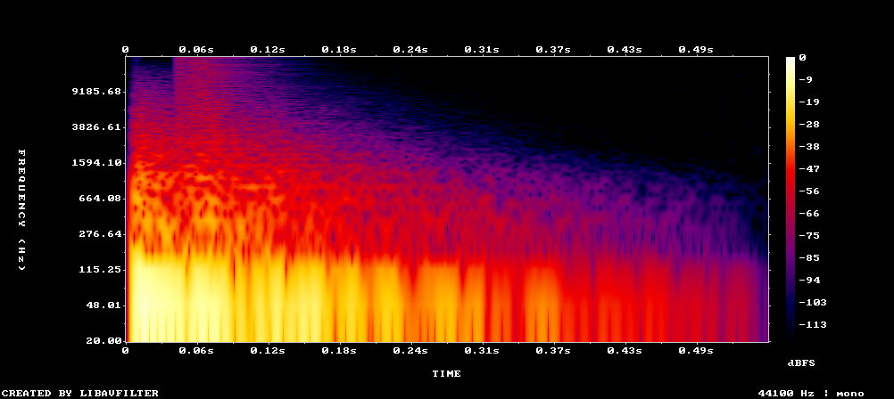 |

### vergleich-pistole-a-trocken

Unverändert aus Hörprobe 1. Kommt den neuen Regeln am nächsten: ein Ereignis, Knall + Druck + Stoß, nur zwei frühe Reflexionen.

| Datei | Länge | Spitze | Mittel | Spektrogramm |
|---|---|---|---|---|
| `vergleich-pistole-a-trocken.wav` | 0.300 s | -1.5 dBFS | -23.3 dBFS | 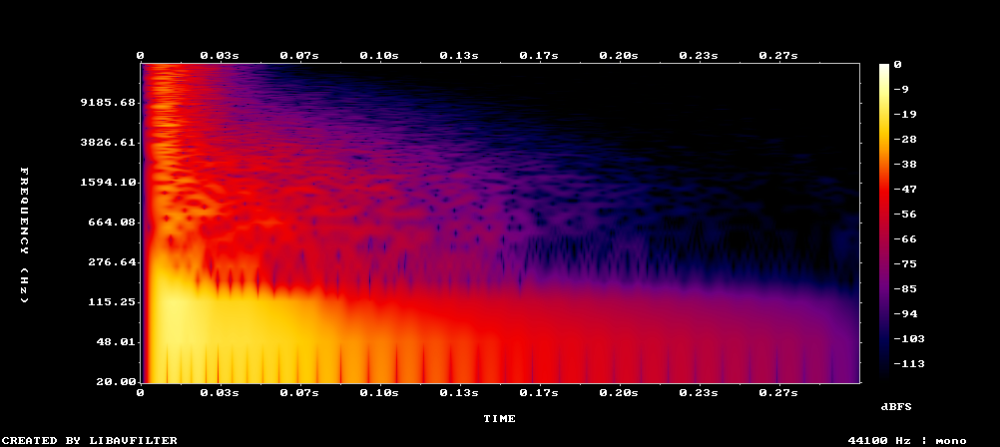 |

## Klingentreffer

### klinge-d-kurz-dumpf

Zwei Schichten, kein Ausklang: leiser Kanten-Klick (1,5 ms) und dumpfer Schlag aus Tiefpass-Rauschen 350 Hz (25 ms) mit Körperton 110→60 Hz. Die kürzeste Variante (0,24 s).

| Datei | Länge | Spitze | Mittel | Spektrogramm |
|---|---|---|---|---|
| `klinge-d-kurz-dumpf.wav` | 0.240 s | -4.0 dBFS | -16.7 dBFS | 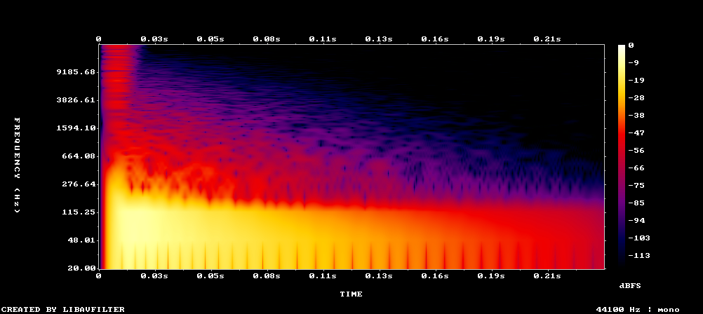 |

### klinge-e-schwer-nass

Drei Schichten: kaum hörbarer Klick, tieferer Schlag (Tiefpass 250 Hz, 40 ms, Körperton 80→45 Hz) und als Ausklang ein einziges kurzes, nasses Nachgeben (Bandrauschen 500 Hz, 70 ms, ohne Modulation).

| Datei | Länge | Spitze | Mittel | Spektrogramm |
|---|---|---|---|---|
| `klinge-e-schwer-nass.wav` | 0.320 s | -4.0 dBFS | -17.0 dBFS | 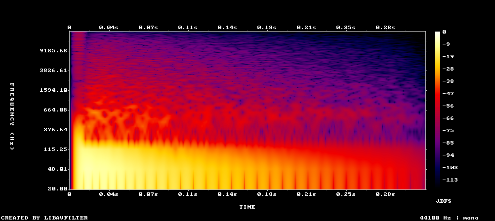 |

### vergleich-klinge-a-dumpf

Unverändert aus Hörprobe 1. Kommt den Regeln am nächsten: nur der Aufprall; das Quetschen dort ist allerdings unregelmäßig moduliert.

| Datei | Länge | Spitze | Mittel | Spektrogramm |
|---|---|---|---|---|
| `vergleich-klinge-a-dumpf.wav` | 0.300 s | -4.0 dBFS | -16.5 dBFS | 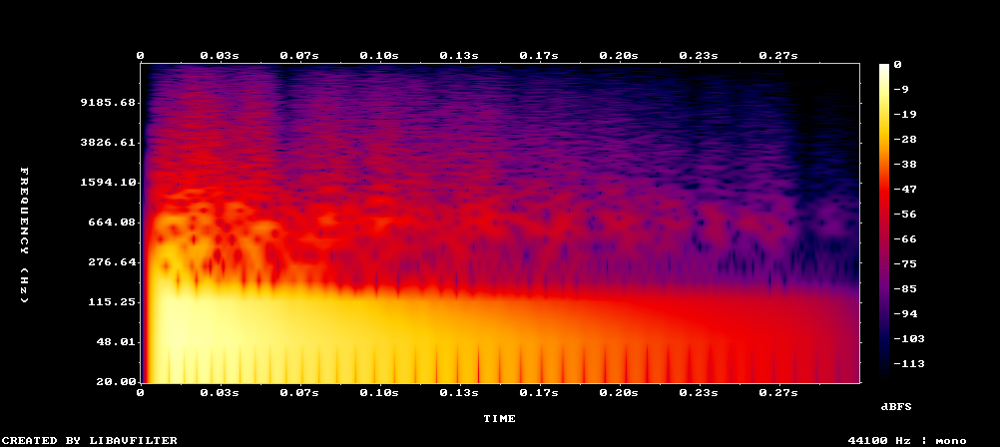 |

## Schritt auf Stein

### schritt-d-klar

Drei Schichten: Klick (Hochpass 3 kHz, 1 ms), Sohle (Tiefpass-Rauschen um 1,3 kHz, 9 ms) mit Stoß um 80 Hz, zwei kalte Reflexionen (4 und 9 ms). Vier Schritte, verschieden in Filter, Abklingzeit, Stoß-Tonhöhe und Pegel.

| Datei | Länge | Spitze | Mittel | Spektrogramm |
|---|---|---|---|---|
| `schritt-d-klar-1.wav` | 0.160 s | -13.3 dBFS | -30.8 dBFS | 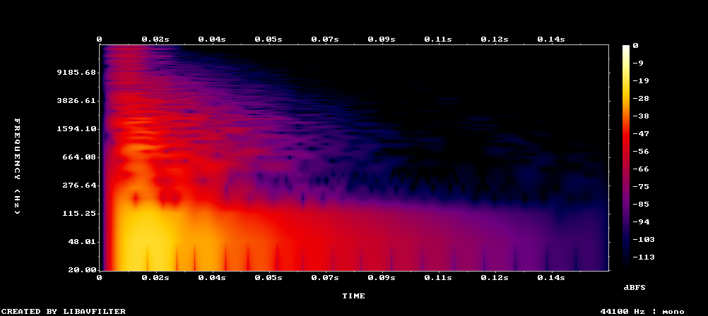 |
| `schritt-d-klar-2.wav` | 0.160 s | -13.0 dBFS | -30.5 dBFS | 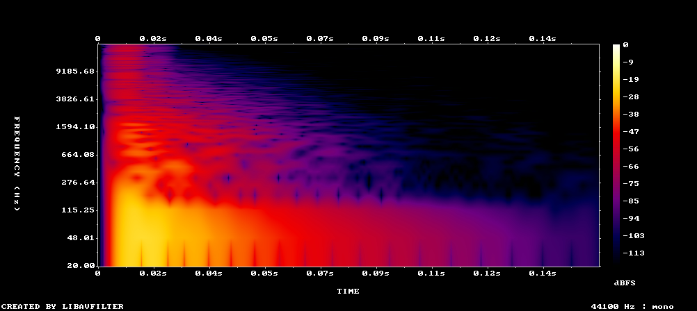 |
| `schritt-d-klar-3.wav` | 0.160 s | -13.1 dBFS | -31.0 dBFS | 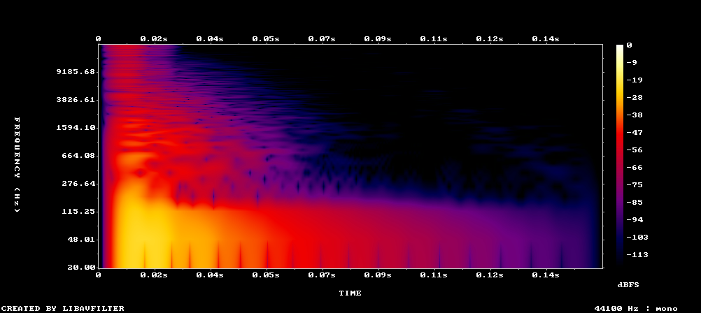 |
| `schritt-d-klar-4.wav` | 0.160 s | -12.3 dBFS | -31.0 dBFS | 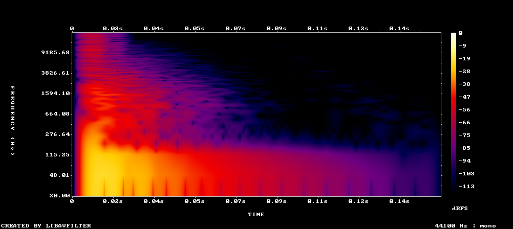 |

Hörhilfe, kein Spiel-Asset: die vier Schritte zweimal im Abstand von 0,5 s; für sie gilt die 0,3-s-Grenze nicht.

| Datei | Länge | Spitze | Mittel | Spektrogramm |
|---|---|---|---|---|
| `schritt-d-klar-folge.wav` | 4.300 s | -12.3 dBFS | -36.1 dBFS | 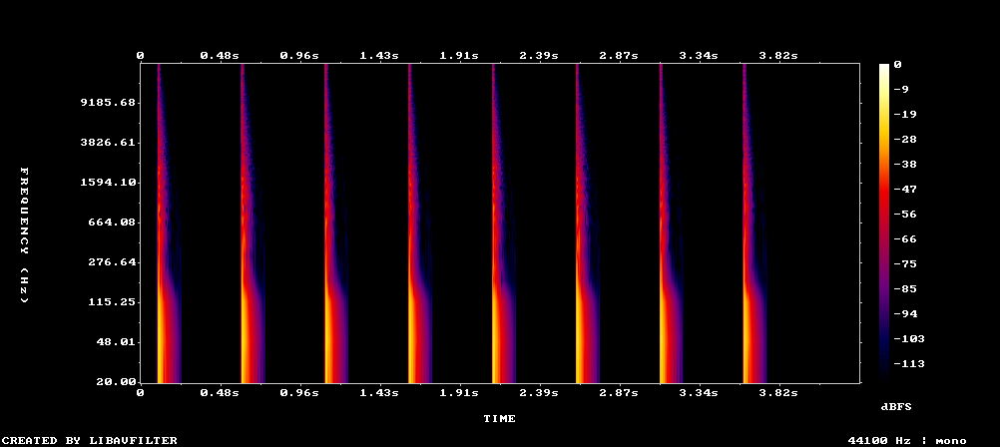 |

### schritt-e-schwer

Drei Schichten: kaum Klick, dunkle Sohle (Tiefpass um 700 Hz, 14 ms) mit kräftigem Stoß um 60 Hz, zwei dunklere Reflexionen (6 und 13 ms). Vier Schritte wie bei d variiert.

| Datei | Länge | Spitze | Mittel | Spektrogramm |
|---|---|---|---|---|
| `schritt-e-schwer-1.wav` | 0.200 s | -13.4 dBFS | -28.3 dBFS |  |
| `schritt-e-schwer-2.wav` | 0.200 s | -12.6 dBFS | -27.1 dBFS | 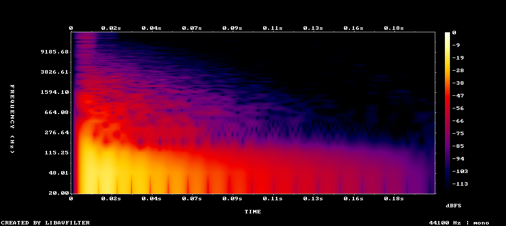 |
| `schritt-e-schwer-3.wav` | 0.200 s | -13.4 dBFS | -27.4 dBFS |  |
| `schritt-e-schwer-4.wav` | 0.200 s | -12.4 dBFS | -27.1 dBFS | 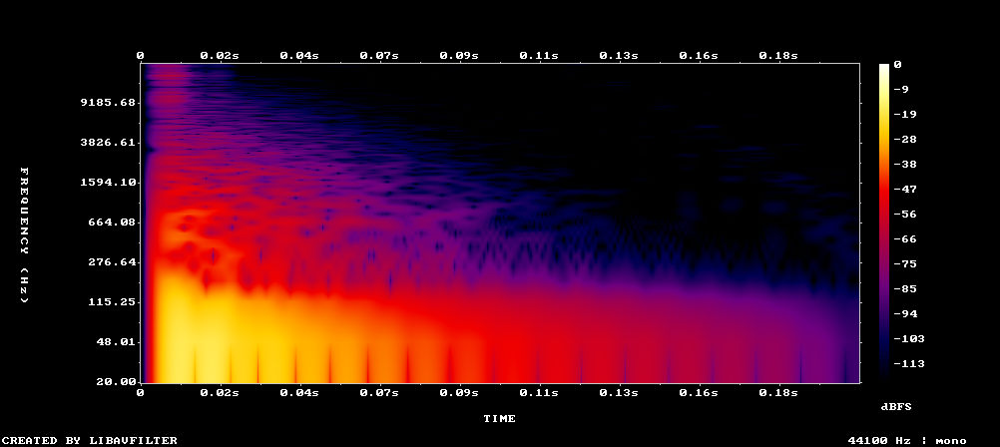 |

Hörhilfe, kein Spiel-Asset: die vier Schritte zweimal im Abstand von 0,5 s; für sie gilt die 0,3-s-Grenze nicht.

| Datei | Länge | Spitze | Mittel | Spektrogramm |
|---|---|---|---|---|
| `schritt-e-schwer-folge.wav` | 4.300 s | -12.4 dBFS | -31.7 dBFS | 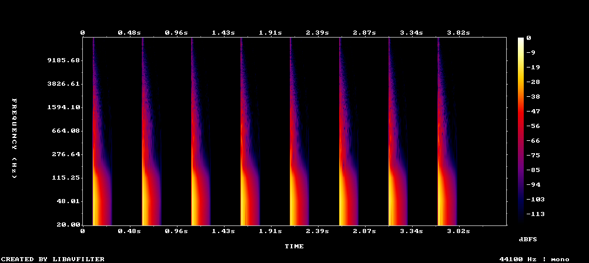 |

### vergleich-schritt-a-weich

Unverändert aus Hörprobe 1. Kommt den Regeln am nächsten: ein einzelner Aufsatz ohne Ferse/Spitze-Folge und ohne Knirschen.

| Datei | Länge | Spitze | Mittel | Spektrogramm |
|---|---|---|---|---|
| `vergleich-schritt-a-weich-1.wav` | 0.140 s | -12.3 dBFS | -28.0 dBFS | 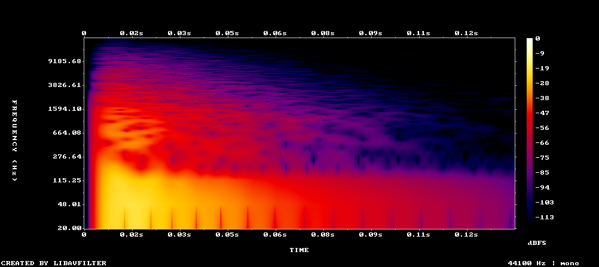 |
| `vergleich-schritt-a-weich-2.wav` | 0.140 s | -12.7 dBFS | -28.5 dBFS | 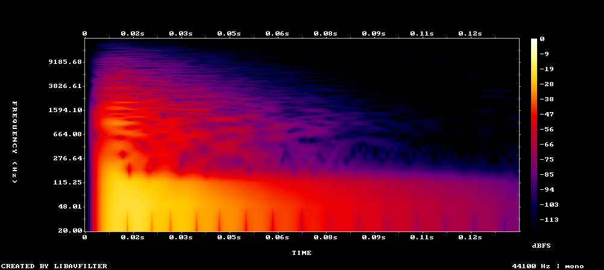 |
| `vergleich-schritt-a-weich-3.wav` | 0.140 s | -13.1 dBFS | -26.8 dBFS | 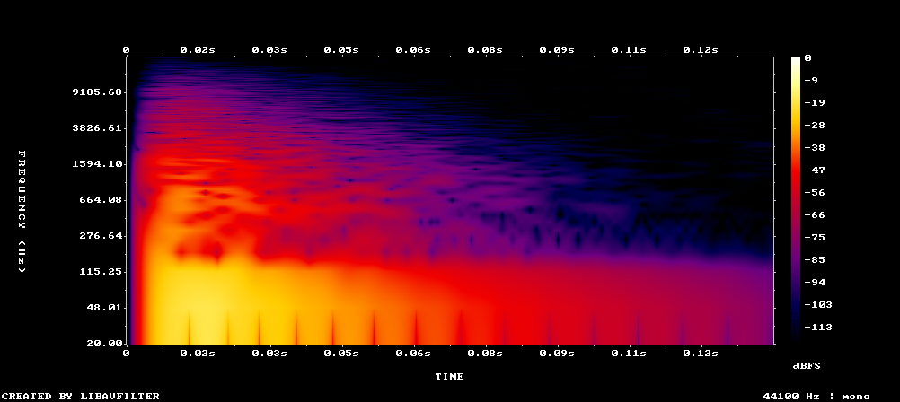 |
| `vergleich-schritt-a-weich-4.wav` | 0.140 s | -12.2 dBFS | -27.1 dBFS | 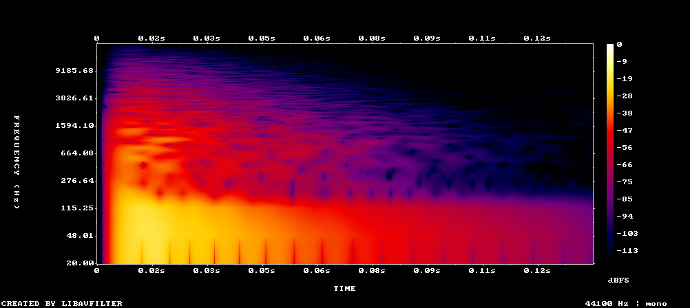 |

Hörhilfe, kein Spiel-Asset: die vier Schritte zweimal im Abstand von 0,5 s; für sie gilt die 0,3-s-Grenze nicht.

| Datei | Länge | Spitze | Mittel | Spektrogramm |
|---|---|---|---|---|
| `vergleich-schritt-a-weich-folge.wav` | 4.300 s | -12.2 dBFS | -33.4 dBFS | 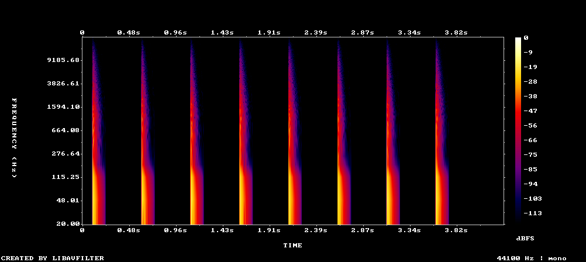 |

## Katakomben-Ambiente

### ambiente-b1-quinte

Vorlage ambiente-b-tropfen aus Hörprobe 1, Tropfen eine Quinte tiefer (Faktor 2/3): Grundton etwa 2,0–3,6 kHz statt 3,0–5,5 kHz; sonst unverändert.

| Datei | Länge | Spitze | Mittel | Spektrogramm |
|---|---|---|---|---|
| `ambiente-b1-quinte.wav` | 30.000 s | -22.7 dBFS | -38.0 dBFS | 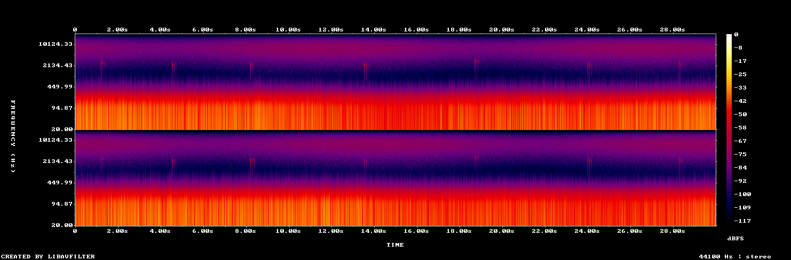 |

### ambiente-b2-oktave

Wie b1, Tropfen eine Oktave tiefer (Faktor 1/2): etwa 1,5–2,7 kHz.

| Datei | Länge | Spitze | Mittel | Spektrogramm |
|---|---|---|---|---|
| `ambiente-b2-oktave.wav` | 30.000 s | -22.7 dBFS | -38.0 dBFS |  |

### ambiente-b3-anderthalb-oktaven

Wie b1, Tropfen anderthalb Oktaven tiefer (Faktor 0,354): etwa 1,1–1,9 kHz – nach der Minnaert-Formel entspräche das einer Luftblase von etwa 2–3 mm Radius.

| Datei | Länge | Spitze | Mittel | Spektrogramm |
|---|---|---|---|---|
| `ambiente-b3-anderthalb-oktaven.wav` | 30.000 s | -22.7 dBFS | -38.0 dBFS |  |
