# Messwerte – Hörprobe 3

Erzeugt mit `python messen.py`. Spitze und Mittel aus `ffmpeg -af volumedetect`, Spektrogramme aus `ffmpeg -lavfi showspectrumpic` (Zeit nach rechts, Frequenz logarithmisch nach oben). WAV, 16 Bit, 44 100 Hz; Geräusche mono, Ambiente stereo und zusätzlich als OGG. Jede Datei gibt es `-sauber` und `-ps1`; wie die PS1-Kette arbeitet und was an ihr geprüft ist, steht in [ps1_pruefung.md](ps1_pruefung.md).

Diese Datei beschreibt nur Aufbau und Messwerte. Ob etwas gut klingt, entscheidet die Hörprobe.

## Prüfung gegen den technischen Rahmen der Audio Bible

| Datei | Länge | Spitze | Ränder | Ergebnis |
|---|---|---|---|---|
| `ghul-sauber.wav` | 0.620 s (< 1.5 s) ✔ | -3.0 dBFS ✔ | erstes/letztes Sample 0/0, Rest vor Blende -102 dB ✔ | bestanden |
| `ghul-ps1.wav` | 0.620 s (< 1.5 s) ✔ | -3.0 dBFS ✔ | erstes/letztes Sample 0/0, Rest vor Blende -105 dB ✔ | bestanden |
| `pistole-sauber.wav` | 0.400 s (< 0.6 s) ✔ | -1.5 dBFS ✔ | erstes/letztes Sample 0/0, Rest vor Blende -74 dB ✔ | bestanden |
| `pistole-ps1.wav` | 0.400 s (< 0.6 s) ✔ | -1.5 dBFS ✔ | erstes/letztes Sample 0/0, Rest vor Blende -74 dB ✔ | bestanden |
| `klinge-sauber-1.wav` | 0.240 s (< 0.6 s) ✔ | -5.2 dBFS ✔ | erstes/letztes Sample 0/0, Rest vor Blende -51 dB ✔ | bestanden |
| `klinge-ps1-1.wav` | 0.240 s (< 0.6 s) ✔ | -5.2 dBFS ✔ | erstes/letztes Sample 0/0, Rest vor Blende -51 dB ✔ | bestanden |
| `klinge-sauber-2.wav` | 0.240 s (< 0.6 s) ✔ | -5.5 dBFS ✔ | erstes/letztes Sample 0/0, Rest vor Blende -51 dB ✔ | bestanden |
| `klinge-ps1-2.wav` | 0.240 s (< 0.6 s) ✔ | -5.5 dBFS ✔ | erstes/letztes Sample 0/0, Rest vor Blende -50 dB ✔ | bestanden |
| `klinge-sauber-3.wav` | 0.240 s (< 0.6 s) ✔ | -5.4 dBFS ✔ | erstes/letztes Sample 0/0, Rest vor Blende -51 dB ✔ | bestanden |
| `klinge-ps1-3.wav` | 0.240 s (< 0.6 s) ✔ | -5.4 dBFS ✔ | erstes/letztes Sample 0/0, Rest vor Blende -51 dB ✔ | bestanden |
| `schritt-sauber-1.wav` | 0.160 s (< 0.3 s) ✔ | -12.1 dBFS ✔ | erstes/letztes Sample 0/0, Rest vor Blende -47 dB ✔ | bestanden |
| `schritt-ps1-1.wav` | 0.160 s (< 0.3 s) ✔ | -12.1 dBFS ✔ | erstes/letztes Sample 0/0, Rest vor Blende -47 dB ✔ | bestanden |
| `schritt-sauber-2.wav` | 0.160 s (< 0.3 s) ✔ | -12.1 dBFS ✔ | erstes/letztes Sample 0/0, Rest vor Blende -43 dB ✔ | bestanden |
| `schritt-ps1-2.wav` | 0.160 s (< 0.3 s) ✔ | -12.1 dBFS ✔ | erstes/letztes Sample 0/0, Rest vor Blende -43 dB ✔ | bestanden |
| `schritt-sauber-3.wav` | 0.160 s (< 0.3 s) ✔ | -12.7 dBFS ✔ | erstes/letztes Sample 0/0, Rest vor Blende -44 dB ✔ | bestanden |
| `schritt-ps1-3.wav` | 0.160 s (< 0.3 s) ✔ | -12.7 dBFS ✔ | erstes/letztes Sample 0/0, Rest vor Blende -43 dB ✔ | bestanden |
| `schritt-sauber-4.wav` | 0.160 s (< 0.3 s) ✔ | -13.5 dBFS ✔ | erstes/letztes Sample 0/0, Rest vor Blende -44 dB ✔ | bestanden |
| `schritt-ps1-4.wav` | 0.160 s (< 0.3 s) ✔ | -13.5 dBFS ✔ | erstes/letztes Sample 0/0, Rest vor Blende -44 dB ✔ | bestanden |
| `schritt-sauber-folge.wav` | 4.300 s (Hörhilfe) ✔ | -12.1 dBFS ✔ | erstes/letztes Sample 0/0, Rest vor Blende digitale Stille ✔ | bestanden |
| `schritt-ps1-folge.wav` | 4.300 s (Hörhilfe) ✔ | -12.1 dBFS ✔ | erstes/letztes Sample 0/0, Rest vor Blende digitale Stille ✔ | bestanden |
| `ambiente-sauber.wav` | 30.000 s (20–40 s) ✔ | -22.7 dBFS ✔ | Naht: WAV L: 0.00113 ≤ 0.00403; WAV R: 0.00043 ≤ 0.00430; OGG L: 0.00168 ≤ 0.00418; OGG R: 0.00107 ≤ 0.00443 ✔ | bestanden |
| `ambiente-ps1.wav` | 30.000 s (20–40 s) ✔ | -22.7 dBFS ✔ | Naht: WAV L: 0.00006 ≤ 0.00287; WAV R: 0.00018 ≤ 0.00375; OGG L: 0.00021 ≤ 0.00281; OGG R: 0.00055 ≤ 0.00360 ✔ | bestanden |

## Ghul: Regel 2 (ein Einsatz)

Der Schlag kommt bei 0,50 s. *Gipfel*: Mitte des lautesten 10-ms-Fensters. *Einsätze* nach der Messvorschrift von Regel 2 (50-ms-Fenster, Anstieg über 8 dB, der Beginn zählt mit). Ziel: 1.

| Datei | Gipfel | Einsätze |
|---|---|---|
| `ghul-sauber.wav` | 0.489 s | 1 |
| `ghul-ps1.wav` | 0.489 s | 1 |

## Ambiente: Regel 6 (Mitte frei)

Gemessen wird nach Regel 6 die Fläche **ohne** Tropfen: `ambiente.py` erzeugt sie mit denselben Zufallszahlen, nur mit stummen Tropfen. Zum Vergleich die fertigen Dateien mit Tropfen (die tiefen Tropfen liegen selbst im Band; das ist laut Regel 6 gewollt).

| Signal | Mitte 300–3000 Hz | gesamt | Abstand | Regel 6 |
|---|---|---|---|---|
| **Fläche ohne Tropfen** (nur für die Messung erzeugt, sauber) | -76.5 dBFS | -38.0 dBFS | -38.5 dB | ✔ mindestens 25 dB darunter |
| `ambiente-sauber.wav` (mit Tropfen) | -58.2 dBFS | -38.0 dBFS | -20.2 dB | – |
| `ambiente-ps1.wav` (mit Tropfen) | -58.3 dBFS | -37.9 dBFS | -20.4 dB | – |

## Färbung: sauber gegen PS1

Mittlerer Pegel gesamt, zwischen 2 und 8 kHz und über 8 kHz (je zwei Hoch-/Tiefpässe von `ffmpeg`). Der Unterschied zwischen `-sauber` und `-ps1` zeigt, wie viel Höhen die PS1-Kette wegnimmt.

| Datei | gesamt | 2–8 kHz | über 8 kHz |
|---|---|---|---|
| `ghul-sauber.wav` | -18.3 dBFS | -85.5 dBFS | -91.0 dBFS |
| `ghul-ps1.wav` | -18.3 dBFS | -82.5 dBFS | -91.0 dBFS |
| `pistole-sauber.wav` | -18.4 dBFS | -34.4 dBFS | -41.8 dBFS |
| `pistole-ps1.wav` | -18.2 dBFS | -35.7 dBFS | -51.7 dBFS |
| `klinge-sauber-1.wav` | -24.5 dBFS | -42.3 dBFS | -61.0 dBFS |
| `klinge-ps1-1.wav` | -24.2 dBFS | -42.5 dBFS | -73.0 dBFS |
| `klinge-sauber-2.wav` | -24.0 dBFS | -39.2 dBFS | -60.0 dBFS |
| `klinge-ps1-2.wav` | -23.5 dBFS | -39.3 dBFS | -70.0 dBFS |
| `klinge-sauber-3.wav` | -23.4 dBFS | -43.0 dBFS | -59.0 dBFS |
| `klinge-ps1-3.wav` | -23.3 dBFS | -43.3 dBFS | -71.9 dBFS |
| `schritt-sauber-1.wav` | -31.0 dBFS | -52.1 dBFS | -57.6 dBFS |
| `schritt-ps1-1.wav` | -30.8 dBFS | -52.9 dBFS | -74.9 dBFS |
| `schritt-sauber-2.wav` | -29.5 dBFS | -49.1 dBFS | -53.5 dBFS |
| `schritt-ps1-2.wav` | -29.4 dBFS | -49.8 dBFS | -70.5 dBFS |
| `schritt-sauber-3.wav` | -30.9 dBFS | -49.5 dBFS | -56.1 dBFS |
| `schritt-ps1-3.wav` | -30.5 dBFS | -50.0 dBFS | -72.8 dBFS |
| `schritt-sauber-4.wav` | -31.9 dBFS | -50.9 dBFS | -55.7 dBFS |
| `schritt-ps1-4.wav` | -31.8 dBFS | -51.6 dBFS | -73.5 dBFS |
| `schritt-sauber-folge.wav` | -36.0 dBFS | -55.5 dBFS | -60.7 dBFS |
| `schritt-ps1-folge.wav` | -35.8 dBFS | -56.1 dBFS | -77.8 dBFS |
| `ambiente-sauber.wav` | -38.0 dBFS | -65.4 dBFS | -65.2 dBFS |
| `ambiente-ps1.wav` | -37.9 dBFS | -68.8 dBFS | -76.3 dBFS |

## Dateien im Einzelnen

## Ghul-Laut

Grundlage `ghul-d-anschwellen` aus Hörprobe 2. **Geste:** Das Maul öffnet sich in 0,5 s und schließt sich beim Schlag – eine Steuerkurve treibt Lautstärke und einen Tiefpass (280 Hz → 2,5 kHz) zugleich. Zwei Schichten: raue Stimme (58 Hz, Formanten 450/1030/2380 Hz) und ein tiefer Sinus auf dem Grundton; dazu eine leise gesättigte Kopie der Stimme.

Die `-ps1`-Datei ist dieselbe Datei durch `ps1_klang.py`: auf 22 050 Hz umgerechnet, ADPCM kodiert und dekodiert, mit Gauß-Interpolation zurück auf 44,1 kHz, ohne Hall.

| Datei | Länge | Spitze | Mittel | Spektrogramm |
|---|---|---|---|---|
| `ghul-sauber.wav` | 0.620 s | -3.0 dBFS | -18.3 dBFS | 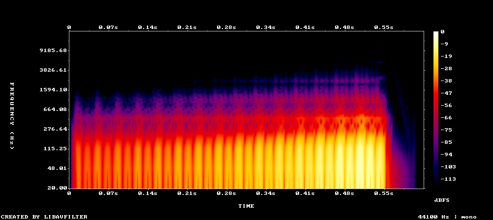 |
| `ghul-ps1.wav` | 0.620 s | -3.0 dBFS | -18.3 dBFS | 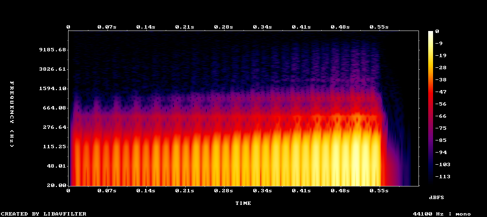 |

## Pistolenschuss

Grundlage `pistole-d-hell-kurz` aus Hörprobe 2. Anschlag: Druckpuls und Knall-Rauschen (Hochpass 1,5 kHz → Bandpass 3,2 kHz, 4 ms). Körper: eine Rauschquelle in zwei Bändern (Band um 550 Hz, Tiefpass 250 Hz, etwa 120 ms) und ein Sub-Stoß 90→45 Hz, zusammen weich gesättigt. Ausklang wie in Hörprobe 2: kalte frühe Reflexionen und kurzer Hall.

Die `-ps1`-Datei ist dieselbe Datei durch `ps1_klang.py`: auf 22 050 Hz umgerechnet, ADPCM kodiert und dekodiert, mit Gauß-Interpolation zurück auf 44,1 kHz, ohne Hall.

| Datei | Länge | Spitze | Mittel | Spektrogramm |
|---|---|---|---|---|
| `pistole-sauber.wav` | 0.400 s | -1.5 dBFS | -18.4 dBFS | 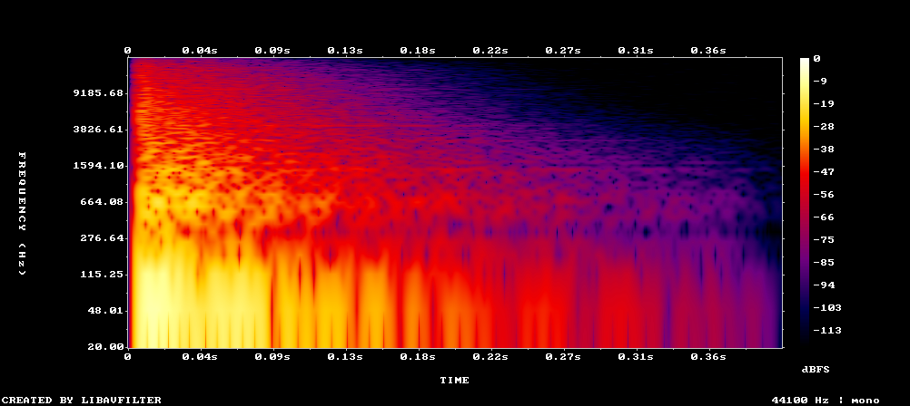 |
| `pistole-ps1.wav` | 0.400 s | -1.5 dBFS | -18.2 dBFS |  |

## Klingentreffer

Grundlage `klinge-d-kurz-dumpf` aus Hörprobe 2. Rauschen durch einen resonanten Tiefpass, dessen Grenze in etwa 50 ms von 1,8 kHz auf 180 Hz fällt, darunter ein Ton 110→55 Hz und ein sehr leiser Kanten-Klick. Drei Varianten mit ±15 % Filter, ±8 % Tonhöhe und bis −1,5 dB Pegel.

Die `-ps1`-Datei ist dieselbe Datei durch `ps1_klang.py`: auf 22 050 Hz umgerechnet, ADPCM kodiert und dekodiert, mit Gauß-Interpolation zurück auf 44,1 kHz, ohne Hall.

| Datei | Länge | Spitze | Mittel | Spektrogramm |
|---|---|---|---|---|
| `klinge-sauber-1.wav` | 0.240 s | -5.2 dBFS | -24.5 dBFS | 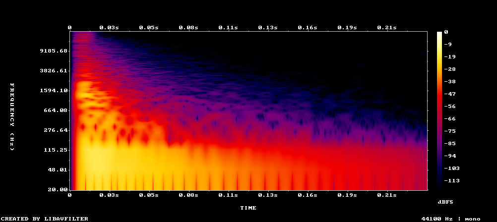 |
| `klinge-ps1-1.wav` | 0.240 s | -5.2 dBFS | -24.2 dBFS | 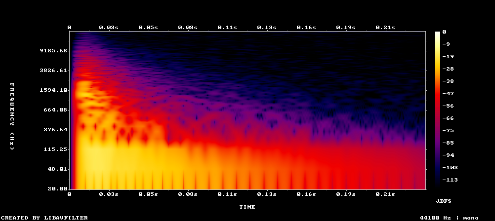 |
| `klinge-sauber-2.wav` | 0.240 s | -5.5 dBFS | -24.0 dBFS | 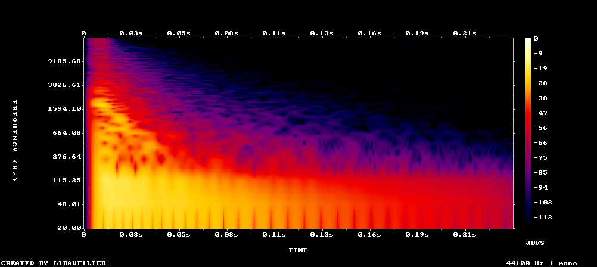 |
| `klinge-ps1-2.wav` | 0.240 s | -5.5 dBFS | -23.5 dBFS |  |
| `klinge-sauber-3.wav` | 0.240 s | -5.4 dBFS | -23.4 dBFS | 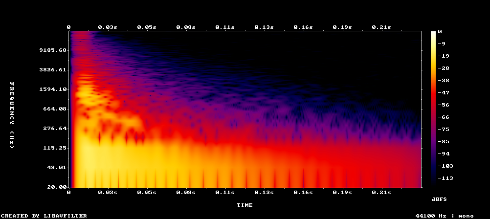 |
| `klinge-ps1-3.wav` | 0.240 s | -5.4 dBFS | -23.3 dBFS |  |

## Schritt auf Stein

Grundlage `schritt-d-klar` aus Hörprobe 2. Eine durchgehende Bodenreaktions-Kurve (Ferse, Abrollen, weicher Ballen nach 45–65 ms) trägt gefiltertes Rauschen (Tiefpass um 1,3 kHz, Hochpass 200 Hz), dazu tiefer Stoß, Klick und zwei kalte Reflexionen. Vier Schritte, verschieden in Tempo, Filter und Pegel.

Die `-ps1`-Datei ist dieselbe Datei durch `ps1_klang.py`: auf 22 050 Hz umgerechnet, ADPCM kodiert und dekodiert, mit Gauß-Interpolation zurück auf 44,1 kHz, ohne Hall.

Hörhilfe, kein Spiel-Asset: die vier Schritte zweimal im Abstand von 0,5 s.

| Datei | Länge | Spitze | Mittel | Spektrogramm |
|---|---|---|---|---|
| `schritt-sauber-1.wav` | 0.160 s | -12.1 dBFS | -31.0 dBFS |  |
| `schritt-ps1-1.wav` | 0.160 s | -12.1 dBFS | -30.8 dBFS | 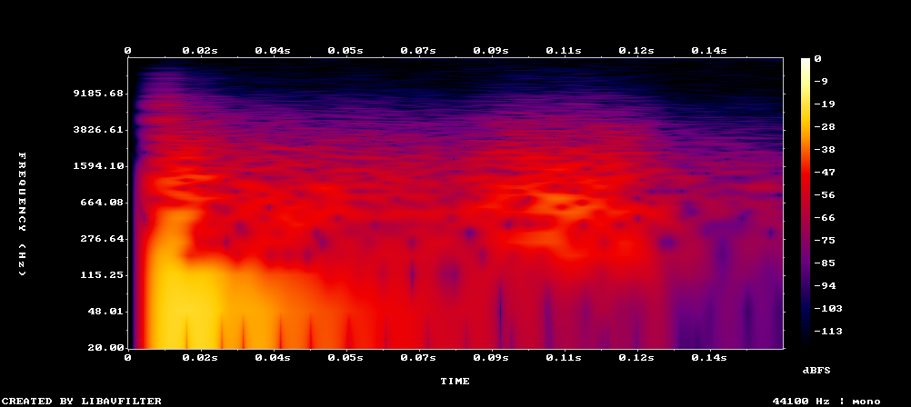 |
| `schritt-sauber-2.wav` | 0.160 s | -12.1 dBFS | -29.5 dBFS | 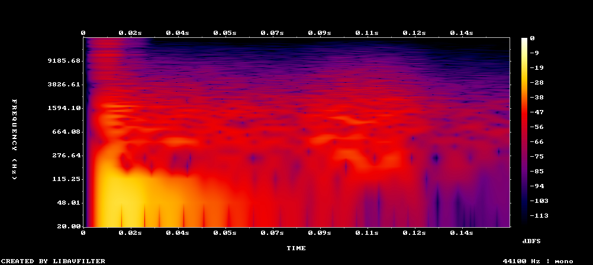 |
| `schritt-ps1-2.wav` | 0.160 s | -12.1 dBFS | -29.4 dBFS | 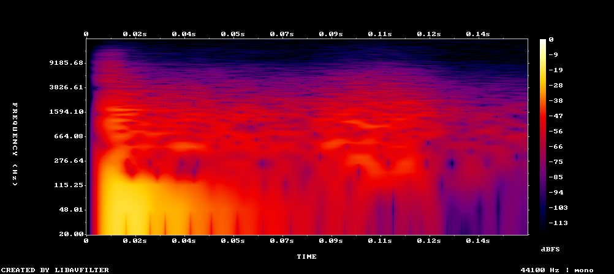 |
| `schritt-sauber-3.wav` | 0.160 s | -12.7 dBFS | -30.9 dBFS |  |
| `schritt-ps1-3.wav` | 0.160 s | -12.7 dBFS | -30.5 dBFS | 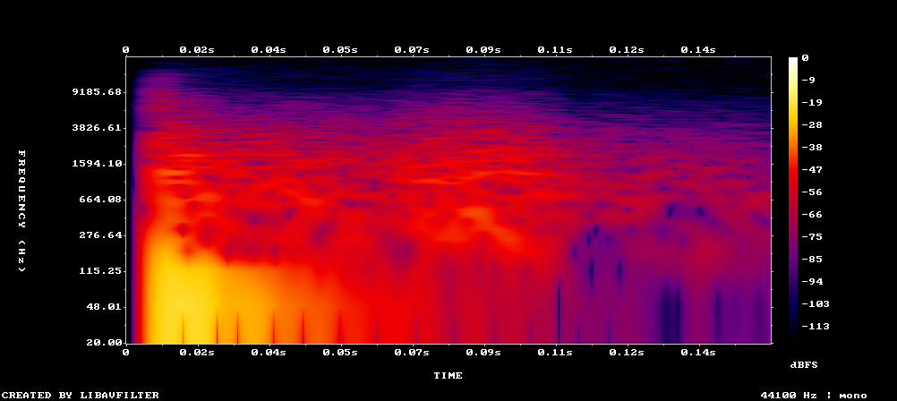 |
| `schritt-sauber-4.wav` | 0.160 s | -13.5 dBFS | -31.9 dBFS | 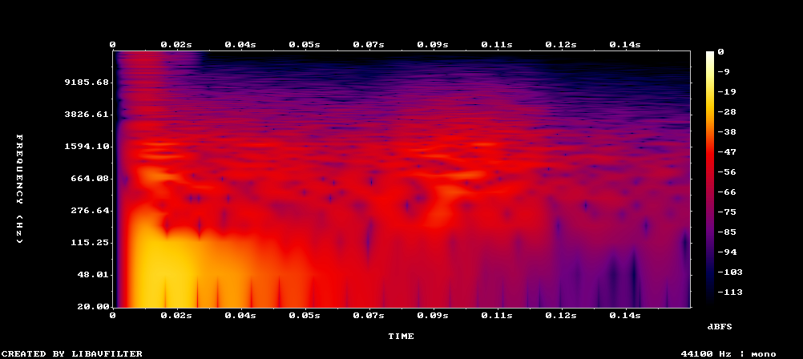 |
| `schritt-ps1-4.wav` | 0.160 s | -13.5 dBFS | -31.8 dBFS | 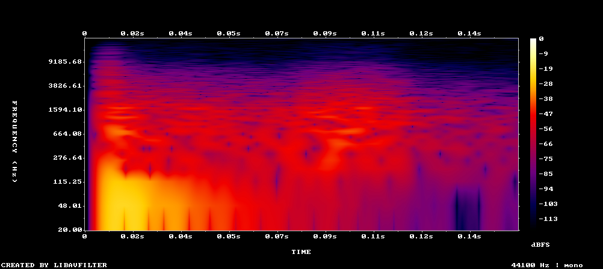 |
| `schritt-sauber-folge.wav` | 4.300 s | -12.1 dBFS | -36.0 dBFS | 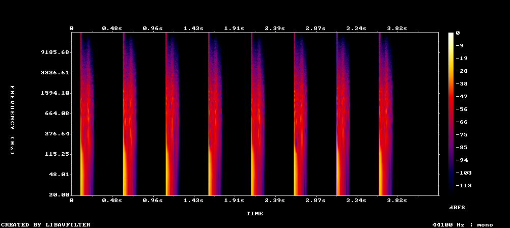 |
| `schritt-ps1-folge.wav` | 4.300 s | -12.1 dBFS | -35.8 dBFS | 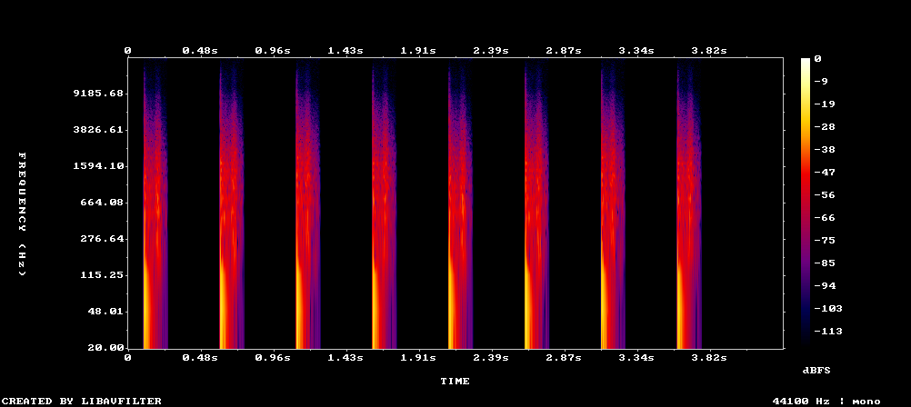 |

## Katakomben-Ambiente

Grundfläche wie Hörprobe 1. Sieben Tropfen anderthalb Oktaven tiefer (Grundton etwa 1,1–1,9 kHz) an denselben Stellen wie in Hörprobe 2, neu mit exponentiell steigender Tonhöhe, weichem Einsatz, 20 ms Abklingzeit und kleinem Höhlenhall (vier Verzögerungen im goldenen Schnitt).

Die `-ps1`-Datei ist dieselbe Datei durch `ps1_klang.py`: auf 22 050 Hz umgerechnet, ADPCM kodiert und dekodiert, mit Gauß-Interpolation zurück auf 44,1 kHz, ohne Hall.

| Datei | Länge | Spitze | Mittel | Spektrogramm |
|---|---|---|---|---|
| `ambiente-sauber.wav` | 30.000 s | -22.7 dBFS | -38.0 dBFS | 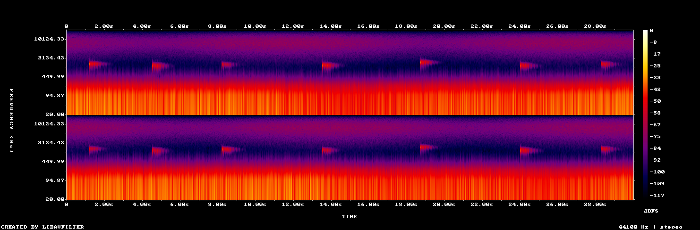 |
| `ambiente-ps1.wav` | 30.000 s | -22.7 dBFS | -37.9 dBFS | 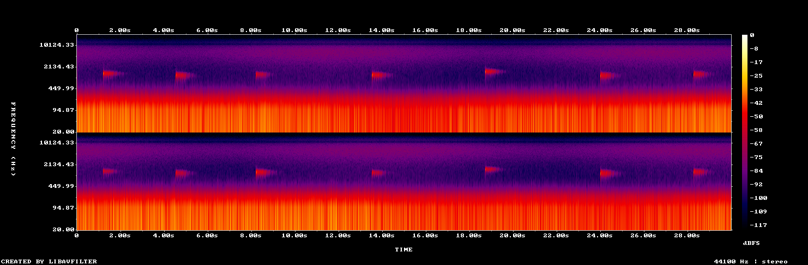 |
