# Messwerte – Hörprobe 4

Erzeugt mit `python messen.py`. Spitze und Mittel aus `ffmpeg -af volumedetect`, Spektrogramme aus `ffmpeg -lavfi showspectrumpic`. Alle Dateien sind durch die PS1-Kette aus Hörprobe 3 gegangen (`../hoerprobe-3/ps1_klang.py`, 22 050 Hz, ohne Hall). Die Fläche des Ambientes ist unverändert; Regel 6 ist dafür in Hörprobe 3 gemessen (38,5 dB Abstand).

Diese Datei beschreibt nur Aufbau und Messwerte. Ob etwas gut klingt, entscheidet die Hörprobe.

## Prüfung gegen den technischen Rahmen

| Datei | Länge | Spitze | Ränder | Ergebnis |
|---|---|---|---|---|
| `tropfen-a-kurz-einzeln-ps1.wav` | 3.600 s (Hörhilfe) ✔ | -7.8 dBFS ✔ | erstes/letztes Sample 0/0, Rest vor Blende digitale Stille ✔ | bestanden |
| `tropfen-b-breit-einzeln-ps1.wav` | 3.600 s (Hörhilfe) ✔ | -6.0 dBFS ✔ | erstes/letztes Sample 0/0, Rest vor Blende digitale Stille ✔ | bestanden |
| `tropfen-c-geraeusch-einzeln-ps1.wav` | 3.600 s (Hörhilfe) ✔ | -6.0 dBFS ✔ | erstes/letztes Sample 0/0, Rest vor Blende digitale Stille ✔ | bestanden |
| `ambiente-a-kurz-ps1.wav` | 30.000 s (20–40 s) ✔ | -22.7 dBFS ✔ | Naht: WAV L 0.00009 ≤ 0.00171; WAV R 0.00031 ≤ 0.00183; OGG L 0.00018 ≤ 0.00168; OGG R 0.00009 ≤ 0.00177 ✔ | bestanden |
| `ambiente-b-breit-ps1.wav` | 30.000 s (20–40 s) ✔ | -22.7 dBFS ✔ | Naht: WAV L 0.00009 ≤ 0.00177; WAV R 0.00040 ≤ 0.00189; OGG L 0.00006 ≤ 0.00174; OGG R 0.00055 ≤ 0.00186 ✔ | bestanden |
| `ambiente-c-geraeusch-ps1.wav` | 30.000 s (20–40 s) ✔ | -22.7 dBFS ✔ | Naht: WAV L 0.00009 ≤ 0.00186; WAV R 0.00031 ≤ 0.00211; OGG L 0.00000 ≤ 0.00183; OGG R 0.00021 ≤ 0.00204 ✔ | bestanden |
| `klinge-a-schneide-1-ps1.wav` | 0.260 s (< 0.6 s) ✔ | -4.3 dBFS ✔ | erstes/letztes Sample 0/0, Rest vor Blende -57 dB ✔ | bestanden |
| `klinge-a-schneide-2-ps1.wav` | 0.260 s (< 0.6 s) ✔ | -4.2 dBFS ✔ | erstes/letztes Sample 0/0, Rest vor Blende -56 dB ✔ | bestanden |
| `klinge-a-schneide-3-ps1.wav` | 0.260 s (< 0.6 s) ✔ | -4.0 dBFS ✔ | erstes/letztes Sample 0/0, Rest vor Blende -56 dB ✔ | bestanden |
| `klinge-b-biss-1-ps1.wav` | 0.260 s (< 0.6 s) ✔ | -5.0 dBFS ✔ | erstes/letztes Sample 0/0, Rest vor Blende -59 dB ✔ | bestanden |
| `klinge-b-biss-2-ps1.wav` | 0.260 s (< 0.6 s) ✔ | -4.2 dBFS ✔ | erstes/letztes Sample 0/0, Rest vor Blende -56 dB ✔ | bestanden |
| `klinge-b-biss-3-ps1.wav` | 0.260 s (< 0.6 s) ✔ | -4.4 dBFS ✔ | erstes/letztes Sample 0/0, Rest vor Blende -56 dB ✔ | bestanden |
| `klinge-c-klirr-1-ps1.wav` | 0.260 s (< 0.6 s) ✔ | -4.2 dBFS ✔ | erstes/letztes Sample 0/0, Rest vor Blende -55 dB ✔ | bestanden |
| `klinge-c-klirr-2-ps1.wav` | 0.260 s (< 0.6 s) ✔ | -4.9 dBFS ✔ | erstes/letztes Sample 0/0, Rest vor Blende -53 dB ✔ | bestanden |
| `klinge-c-klirr-3-ps1.wav` | 0.260 s (< 0.6 s) ✔ | -4.3 dBFS ✔ | erstes/letztes Sample 0/0, Rest vor Blende -55 dB ✔ | bestanden |

## Tropfen: Ursache des Klingelns und Abklingzeit

Der Höhlenhall aus Hörprobe 3 antwortet auf einen Impuls mit einzelnen, deutlich getrennten Echos (über −20 dB) bei 62, 100, 162, 262 ms und kreist über 1 s. Ein reiner Sinus, der so zurückgeworfen wird, klingt als Ton weiter.

Abklingzeit eines einzelnen sauberen Tropfens (mit Raum), ab dem lautesten 5-ms-Fenster bis der Pegel dauerhaft 20, 40 und 60 dB darunter liegt:

| Tropfen | −20 dB | −40 dB | −60 dB |
|---|---|---|---|
| Hörprobe 3 (reiner Ton + Höhlenhall) | 435 ms | 765 ms | 1245 ms |
| a-kurz | 15 ms | 55 ms | 65 ms |
| b-breit | 15 ms | 125 ms | 225 ms |
| c-geraeusch | 50 ms | 140 ms | 230 ms |

## Klinge: Höhen und PS1-Ausgleich

Mittlerer Pegel (dBFS) gesamt, im Band 2–8 kHz und über 8 kHz, je Treffer 1. Der Ausgleich hebt vor der PS1-Kette die Höhen über etwa 3 kHz an; über 11 kHz kann er nichts zurückholen, weil die Kette dort alles abschneidet.

| Signal | gesamt | 2–8 kHz | über 8 kHz |
|---|---|---|---|
| Hörprobe 3, sauber | -24.5 | -42.3 | -61.0 |
| Hörprobe 3, PS1 | -24.2 | -42.5 | -72.8 |
| a-schneide, sauber | -24.5 | -37.6 | -41.6 |
| a-schneide, PS1 ohne Ausgleich | -23.7 | -38.0 | -56.4 |
| a-schneide, PS1 mit Ausgleich (Datei) | -24.9 | -36.7 | -52.1 |
| b-biss, sauber | -25.5 | -34.1 | -42.2 |
| b-biss, PS1 ohne Ausgleich | -24.0 | -34.3 | -48.0 |
| b-biss, PS1 mit Ausgleich (Datei) | -26.7 | -34.1 | -46.0 |
| c-klirr, sauber | -23.3 | -34.2 | -47.3 |
| c-klirr, PS1 ohne Ausgleich | -23.4 | -35.3 | -56.7 |
| c-klirr, PS1 mit Ausgleich (Datei) | -23.2 | -33.3 | -51.1 |

## Dateien im Einzelnen

## Tropfen

Tropfen allein, ohne Fläche: vier Tropfen im Abstand von 0,8 s (Hörhilfe, kein Spiel-Asset).

| Datei | Länge | Spitze | Mittel | Spektrogramm |
|---|---|---|---|---|
| `tropfen-a-kurz-einzeln-ps1.wav` | 3.600 s | -7.8 dBFS | -35.8 dBFS | 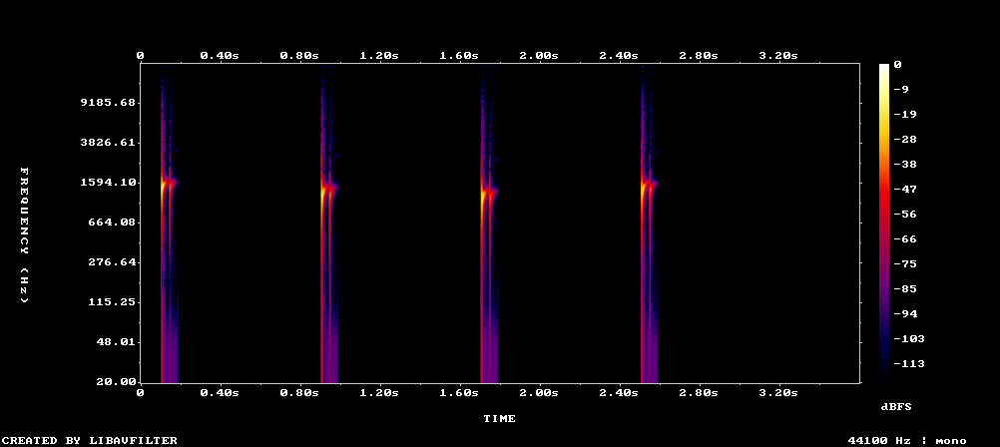 |
| `tropfen-b-breit-einzeln-ps1.wav` | 3.600 s | -6.0 dBFS | -34.4 dBFS | 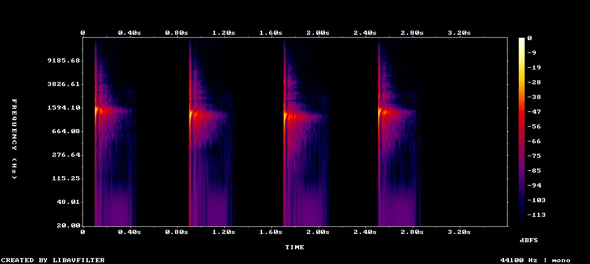 |
| `tropfen-c-geraeusch-einzeln-ps1.wav` | 3.600 s | -6.0 dBFS | -34.7 dBFS | 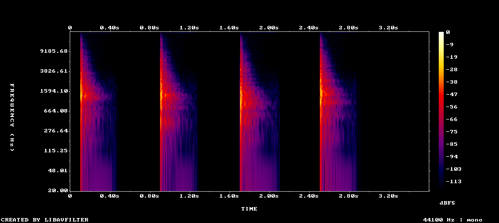 |

## Ambiente

Grundfläche und sieben Tropfen wie Hörprobe 3; nur der Tropfen ist neu gebaut (siehe `tropfen.py`). Durch die PS1-Kette (22 050 Hz, ohne Hall), kreisförmig verarbeitet.

| Datei | Länge | Spitze | Mittel | Spektrogramm |
|---|---|---|---|---|
| `ambiente-a-kurz-ps1.wav` | 30.000 s | -22.7 dBFS | -37.9 dBFS | 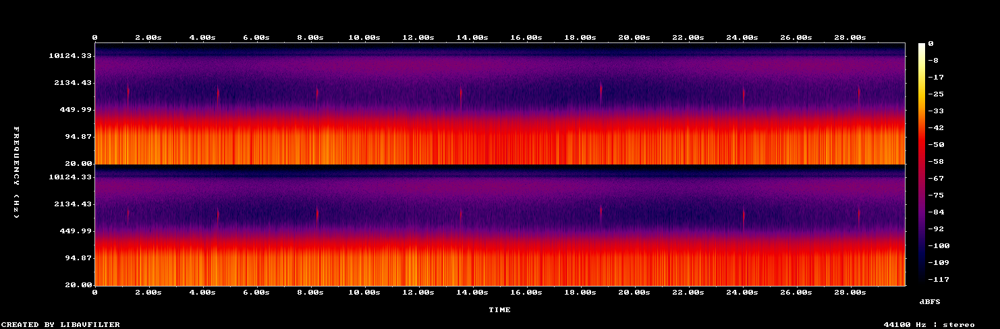 |
| `ambiente-b-breit-ps1.wav` | 30.000 s | -22.7 dBFS | -37.9 dBFS | 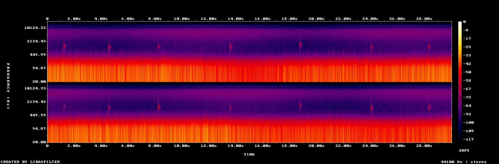 |
| `ambiente-c-geraeusch-ps1.wav` | 30.000 s | -22.7 dBFS | -37.9 dBFS |  |

## Klinge

Drei Fassungen zu je drei Treffern, durch die PS1-Kette mit Höhen-Ausgleich davor (siehe `klinge.py`).

| Datei | Länge | Spitze | Mittel | Spektrogramm |
|---|---|---|---|---|
| `klinge-a-schneide-1-ps1.wav` | 0.260 s | -4.3 dBFS | -24.9 dBFS | 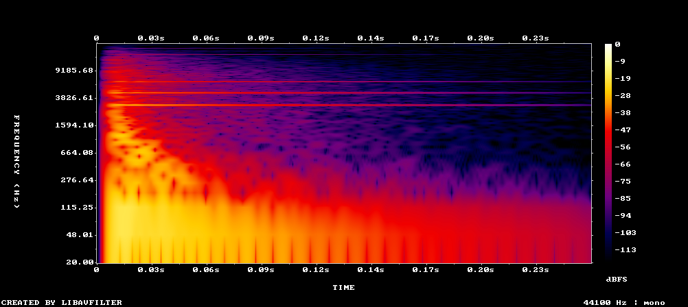 |
| `klinge-a-schneide-2-ps1.wav` | 0.260 s | -4.2 dBFS | -24.2 dBFS | 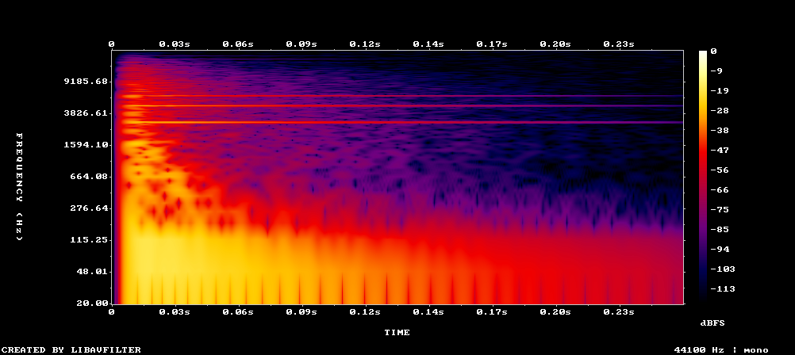 |
| `klinge-a-schneide-3-ps1.wav` | 0.260 s | -4.0 dBFS | -22.9 dBFS | 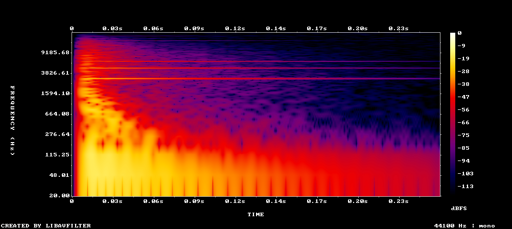 |
| `klinge-b-biss-1-ps1.wav` | 0.260 s | -5.0 dBFS | -26.7 dBFS | 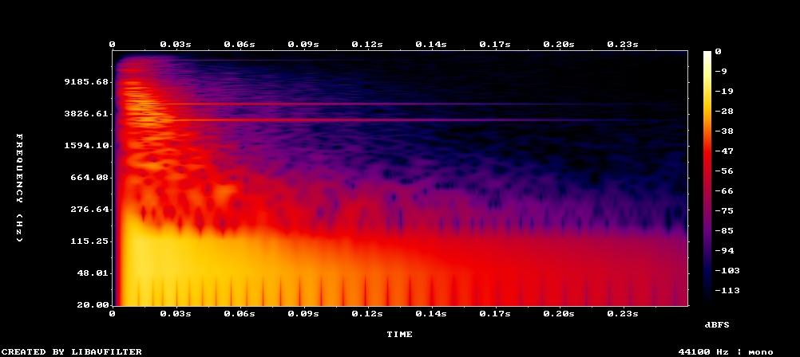 |
| `klinge-b-biss-2-ps1.wav` | 0.260 s | -4.2 dBFS | -24.2 dBFS | 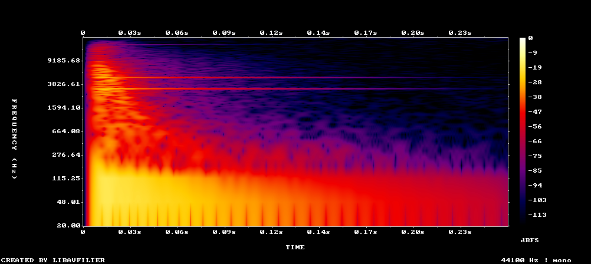 |
| `klinge-b-biss-3-ps1.wav` | 0.260 s | -4.4 dBFS | -23.2 dBFS | 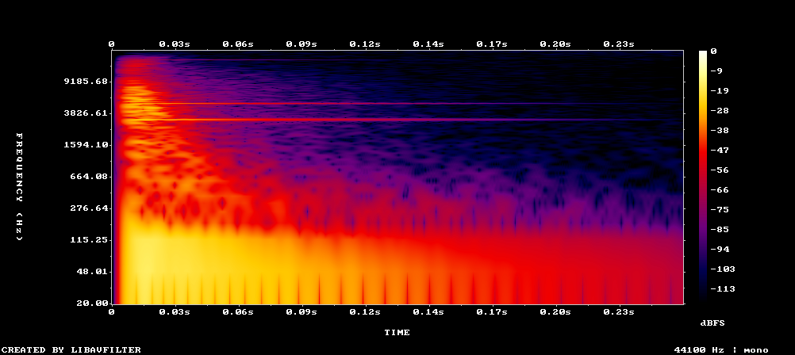 |
| `klinge-c-klirr-1-ps1.wav` | 0.260 s | -4.2 dBFS | -23.2 dBFS | 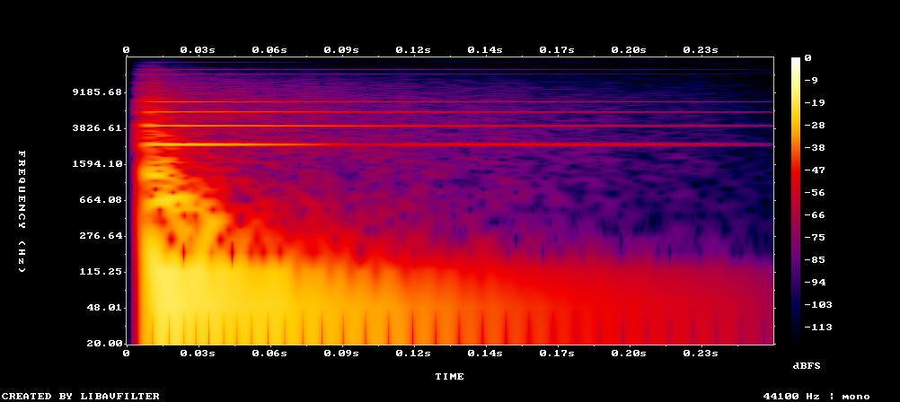 |
| `klinge-c-klirr-2-ps1.wav` | 0.260 s | -4.9 dBFS | -22.9 dBFS | 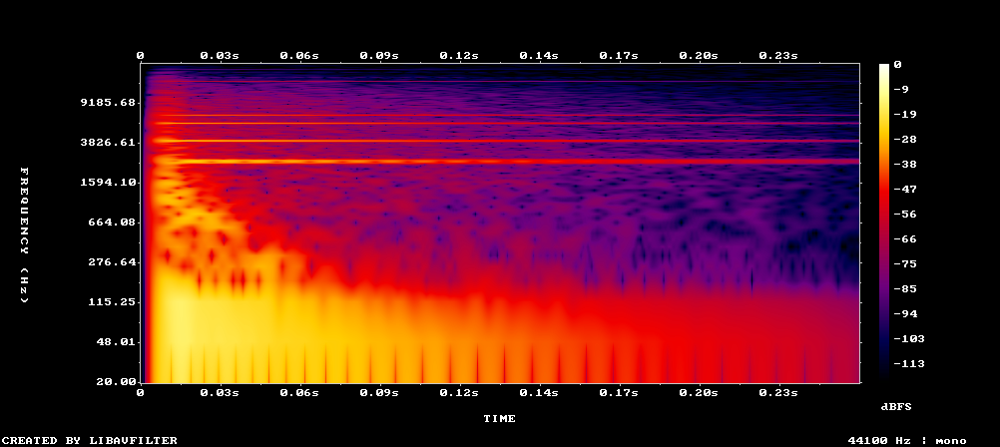 |
| `klinge-c-klirr-3-ps1.wav` | 0.260 s | -4.3 dBFS | -23.3 dBFS | 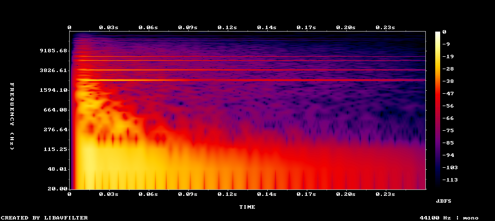 |
