# Messwerte – Hörprobe 5

Erzeugt mit `python messen.py`. Alle Dateien sind durch die PS1-Kette gegangen (Einstellung „a-leicht“: 22 050 Hz, Höhenausgleich, kein Hall), außer den Dateien `einstellung-*-b-stark` (11 025 Hz, kein Ausgleich, Hall „Room“). Herkunft der Originale: [klangquellen.md](../../../grundlagen/klangquellen.md). Bandpegel sind mittlere Pegel in dBFS (je zwei Filter 2. Ordnung); „Δ zum Vergleich“ ist der Unterschied zur bisher besten synthetischen Fassung derselben Kategorie in den Bändern < 300 Hz / 300–2 000 Hz / 2–8 kHz / > 8 kHz.

Diese Datei beschreibt Aufbau und Messwerte. Ob etwas gut klingt, entscheidet die Hörprobe.

## Herkunft und Bearbeitung je Kandidat

- `pistole-1-schlag-rein`: **Rein aus einer Aufnahme.** `impactPunch_heavy_001.ogg` (Impact Sounds): auf den Schlag geschnitten, Brummen unter 40 Hz entfernt, 2 Halbtöne tiefer (Varispeed), stark weich gesättigt (tanh), kurzer synthetischer Raum wie Hörprobe 3. Kenney hat keinen Schuss; der Faustschlag ersetzt ihn.
- `pistole-2-metall-plus-koerper`: **Mischung, verschmolzen.** Anschlag: erste 25 ms von `impactMetal_heavy_002.ogg` (Impact Sounds) + synthetischer Körper und Sub wie Hörprobe 3; beide tragen eine gemeinsame Hüllkurve, werden gemeinsam gesättigt und liegen im selben Raum.
- `pistole-3-platte-plus-koerper`: **Mischung, verschmolzen.** Anschlag: erste 20 ms von `impactPlate_heavy_001.ogg` (Impact Sounds), 3 Halbtöne tiefer, + synthetischer Körper; gemeinsame Hüllkurve, gemeinsame Sättigung, selber Raum.
- `vergleich-pistole-hp3`: Vergleich: `pistole-ps1.wav` aus Hörprobe 3, rein synthetisch, unverändert.
- `klinge-1-hieb-rein`: **Rein aus einer Aufnahme.** `chop.ogg` (RPG Audio): geschnitten, 2 Halbtöne tiefer.
- `klinge-2-schnitt-rein`: **Rein aus einer Aufnahme.** `knifeSlice.ogg` (RPG Audio): geschnitten, 3 Halbtöne tiefer. Die Aufnahme ist ein Schnitt, der durch die Frequenzen wandert; die Messung zeigt deshalb Einsatzversatz.
- `klinge-3-schneide-plus-koerper`: **Mischung, verschmolzen.** Erste 40 ms von `knifeSlice.ogg` (RPG Audio) und synthetisches Rauschen laufen gemeinsam durch einen Tiefpass, der von 7 kHz auf 180 Hz fällt, mit gemeinsamer Hüllkurve; darunter der Körperton 110→55 Hz. Ersetzt die Fassung „zwei Aufnahmen“ aus dem ersten Stand dieser Hörprobe.
- `vergleich-klinge-hp3-heller`: Vergleich, rein synthetisch: die Klinge aus **Hörprobe 3**, heller nur über die Klangfarbe desselben Ereignisses (Tiefpass startet bei 4,5 statt 1,8 kHz, Anschlag 0,2 statt 1 ms, Körperton 140→70 statt 110→55 Hz); der leise Klick wurde weggenommen, nichts hinzugefügt.
- `schritt-1-rpg-rein`: **Rein aus Aufnahmen.** `footstep00/02/06/07.ogg` (RPG Audio), je auf einen Schritt geschnitten. Diese vier ohne Übersteuerung ausgewählt (03 und 08 haben übersteuerte Samples).
- `schritt-2-beton-rein`: **Rein aus Aufnahmen.** `footstep_concrete_000–003.ogg` (Impact Sounds), 2 Halbtöne tiefer (schwerer). Die Originale sind sehr knapp geschnitten (0,1 s).
- `schritt-3-anschlag-plus-koerper`: **Mischung, verschmolzen.** Erste 20 ms der RPG-Schritte und synthetisches Rauschen werden gemeinsam von der Bodenreaktions-Kurve aus Hörprobe 3 getragen.
- `vergleich-schritt-hp3`: Vergleich: `schritt-ps1-folge.wav` aus Hörprobe 3, rein synthetisch, unverändert.
- `tropfen-1-glas`: **Rein aus einer Aufnahme.** `impactGlass_light_000.ogg` (Impact Sounds), eine Oktave tiefer (±2 Halbtöne je Tropfen), kein eigener Raum. Kenney hat kein Wasser; leichtes Glas ersetzt es.
- `tropfen-2-blech`: **Rein aus einer Aufnahme.** `impactTin_medium_004.ogg` (Impact Sounds), 7 Halbtöne tiefer, Tiefpass 2,5 kHz, kein eigener Raum.
- `tropfen-3-klopfen-plus-ton`: **Mischung, verschmolzen.** Erste 8 ms von `impactGeneric_light_000.ogg` (Impact Sounds) + synthetischer Ton (8 ms Abklingzeit) unter einer gemeinsamen Hüllkurve, kein eigener Raum.
- `vergleich-tropfen-hp3-gekuerzt`: Vergleich, rein synthetisch: der Tropfen aus **Hörprobe 3**, Klingeln durch Wegnehmen behoben – derselbe Ton, Abklingzeit 8 statt 20 ms, Höhlenhall ganz weggenommen (schon bei 5 % Pegel lieferte er eigene Einsätze). Nichts hinzugefügt.

## Vorauswahl-Messungen

| Datei | Einsätze | bis −60 dB | < 300 Hz | 300–2 000 | 2–8 kHz | > 8 kHz | Δ zum Vergleich (dB, 4 Bänder) | Spektrogramm |
|---|---|---|---|---|---|---|---|---|
| `klinge-1-hieb-rein.wav` | 1 | 200 ms | -47 | -25 | -29 | -53 | -23 / +9 / +3 / +0 | 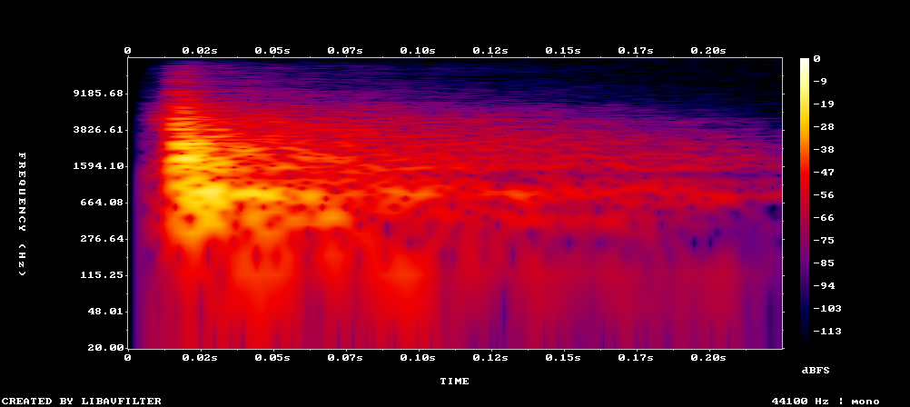 |
| `klinge-2-schnitt-rein.wav` | 1 | 285 ms | -45 | -34 | -23 | -38 | -21 / -0 / +9 / +16 | 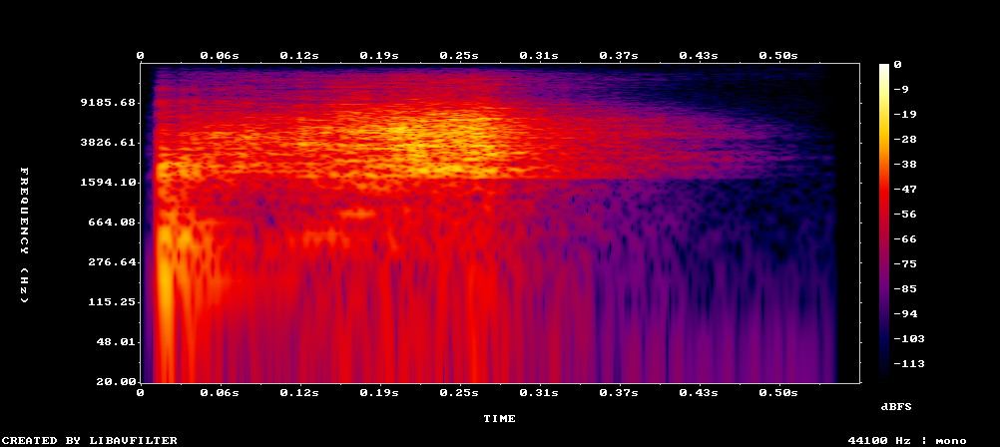 |
| `klinge-3-schneide-plus-koerper.wav` | 1 | 245 ms | -24 | -36 | -34 | -52 | +0 / -2 / -2 / +1 | 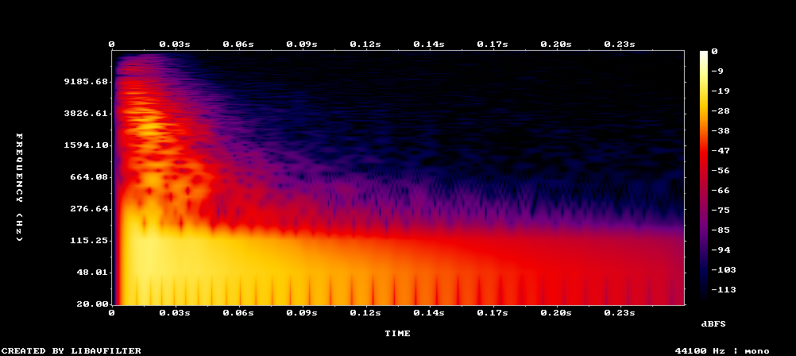 |
| `pistole-1-schlag-rein.wav` | 1 | 360 ms | -14 | -25 | -43 | -65 | +5 / +2 / -8 / -13 | 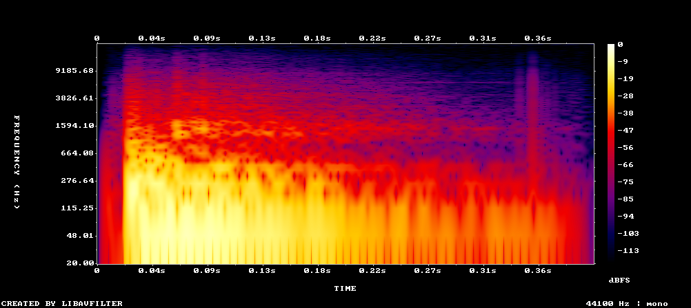 |
| `pistole-2-metall-plus-koerper.wav` | 1 | 290 ms | -23 | -31 | -36 | -55 | -3 / -3 / -0 / -3 | 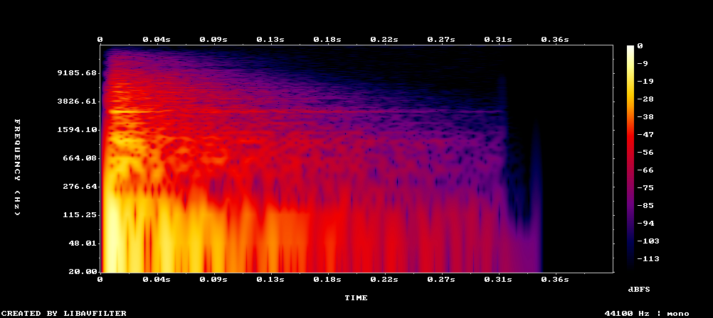 |
| `pistole-3-platte-plus-koerper.wav` | 1 | 290 ms | -22 | -26 | -33 | -48 | -3 / +1 / +3 / +4 |  |
| `schritt-1-rpg-rein-1.wav` | 1 | 210 ms | -37 | -37 | -49 | -64 | -1 / +9 / +7 / +13 | 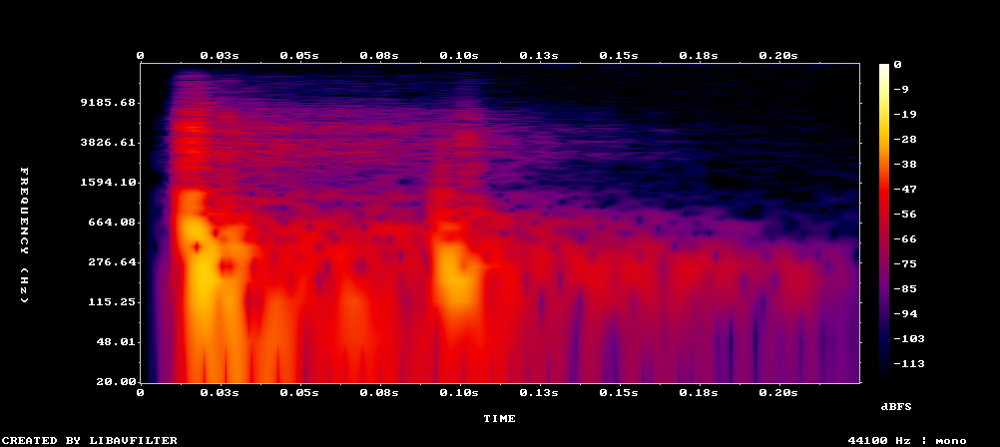 |
| `schritt-1-rpg-rein-2.wav` | 1 | 155 ms | -37 | -40 | -46 | -66 | -1 / +6 / +10 / +12 | 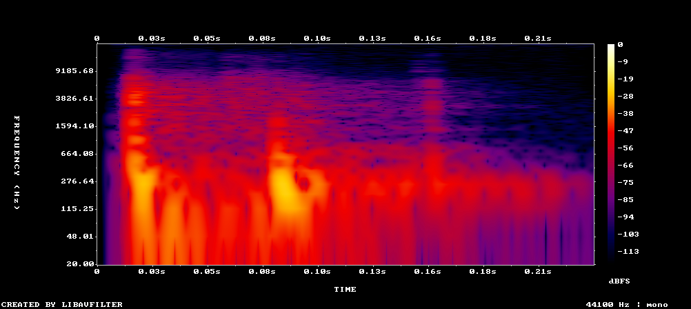 |
| `schritt-1-rpg-rein-3.wav` | 1 | 225 ms | -37 | -39 | -55 | -75 | -0 / +7 / +1 / +2 | 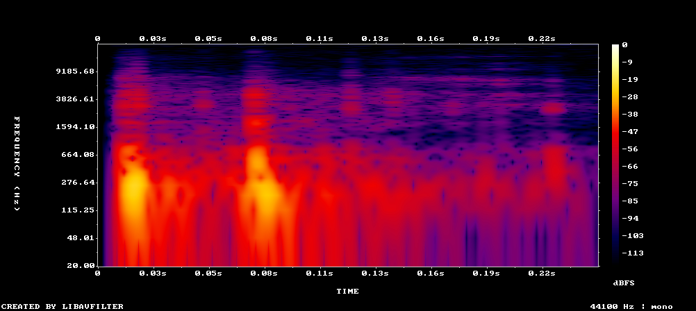 |
| `schritt-1-rpg-rein-4.wav` | 1 | 205 ms | -42 | -39 | -50 | -69 | -5 / +7 / +6 / +9 | 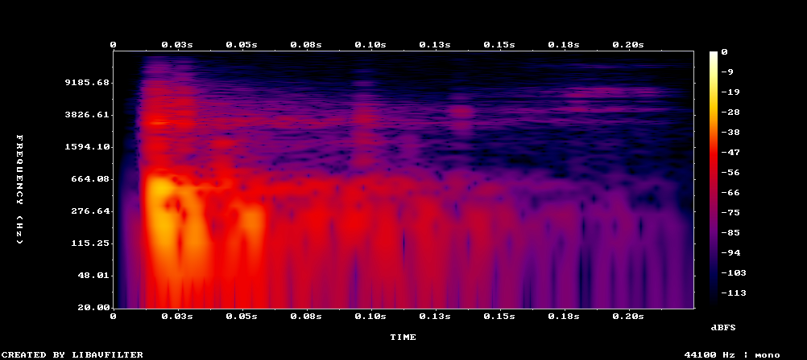 |
| `schritt-1-rpg-rein-folge.wav` | – | – | -42 | -42 | -52 | -71 | -5 / +4 / +4 / +7 |  |
| `schritt-2-beton-rein-1.wav` | 1 | 75 ms | -33 | -38 | -70 | -88 | +4 / +7 / -14 / -10 | 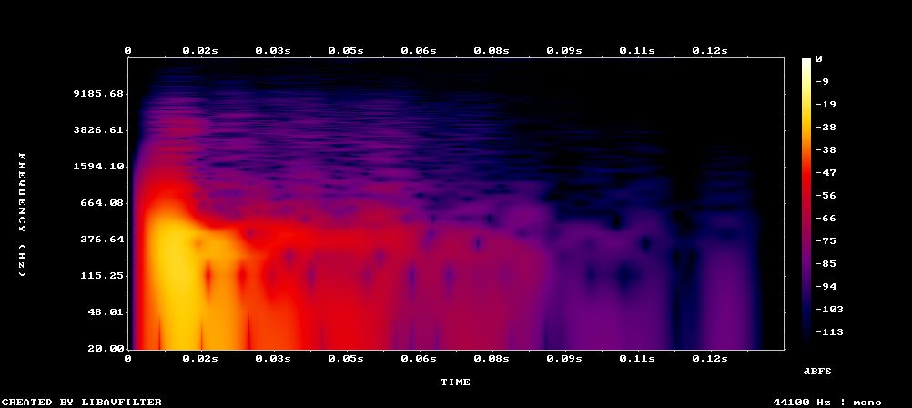 |
| `schritt-2-beton-rein-2.wav` | 1 | 90 ms | -35 | -39 | -56 | -71 | +1 / +7 / +0 / +7 |  |
| `schritt-2-beton-rein-3.wav` | 1 | 95 ms | -36 | -39 | -57 | -73 | +1 / +7 / -1 / +4 | 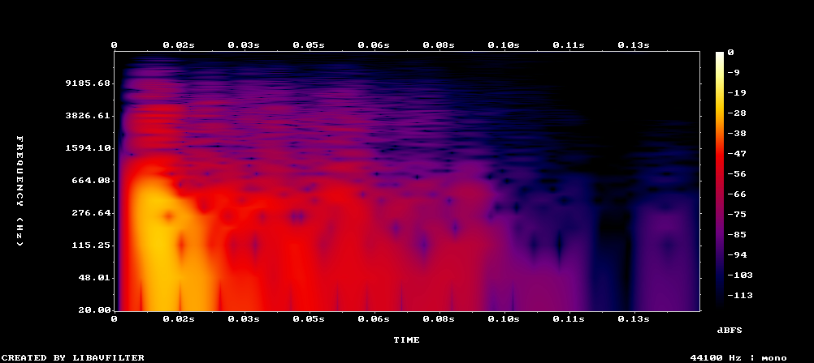 |
| `schritt-2-beton-rein-4.wav` | 1 | 90 ms | -35 | -39 | -66 | -82 | +2 / +6 / -10 / -4 |  |
| `schritt-2-beton-rein-folge.wav` | – | – | -40 | -45 | -65 | -81 | -4 / +1 / -9 / -3 | 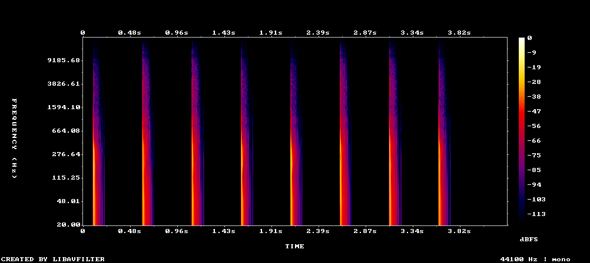 |
| `schritt-3-anschlag-plus-koerper-1.wav` | 1 | 220 ms | -41 | -35 | -45 | -63 | -5 / +11 / +11 / +14 |  |
| `schritt-3-anschlag-plus-koerper-2.wav` | 1 | 235 ms | -42 | -35 | -44 | -65 | -6 / +11 / +12 / +13 |  |
| `schritt-3-anschlag-plus-koerper-3.wav` | 1 | 225 ms | -39 | -38 | -50 | -71 | -3 / +8 / +7 / +7 |  |
| `schritt-3-anschlag-plus-koerper-4.wav` | 1 | 220 ms | -45 | -36 | -48 | -69 | -8 / +10 / +8 / +9 |  |
| `schritt-3-anschlag-plus-koerper-folge.wav` | – | – | -45 | -39 | -49 | -70 | -8 / +7 / +7 / +8 | 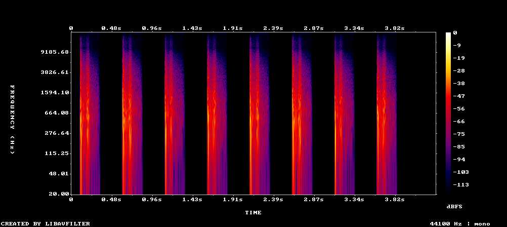 |
| `tropfen-1-glas-einzeln.wav` | – | – | -51 | -35 | -62 | -85 | +33 / +4 / -9 / +9 | 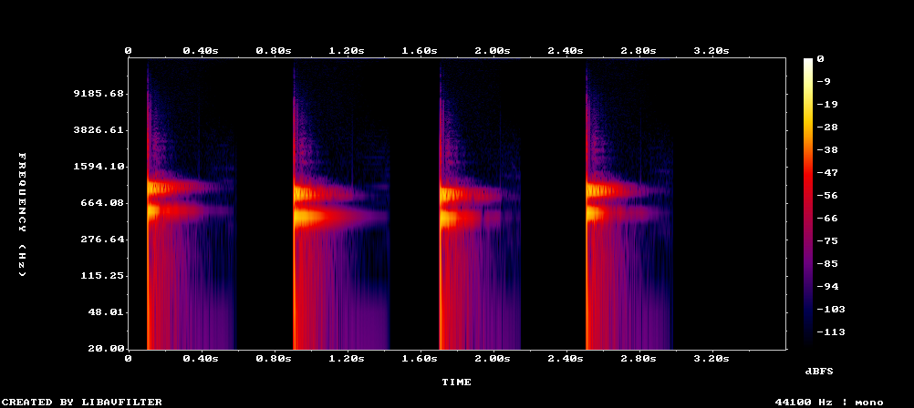 |
| `tropfen-2-blech-einzeln.wav` | – | – | -40 | -38 | -69 | -98 | +43 / +1 / -15 / -4 | 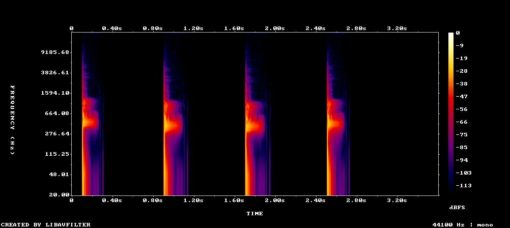 |
| `tropfen-3-klopfen-plus-ton-einzeln.wav` | – | – | -54 | -45 | -60 | -96 | +29 / -6 / -7 / -2 |  |
| `vergleich-klinge-hp3-heller.wav` | 1 | 230 ms | -24 | -34 | -32 | -53 | +0 / +0 / +0 / +0 | 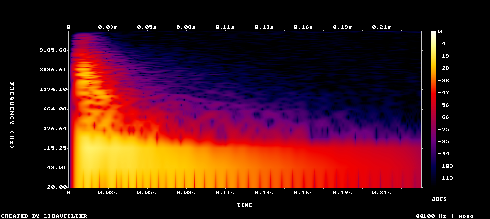 |
| `vergleich-pistole-hp3.wav` | 1 | 340 ms | -19 | -27 | -36 | -52 | +0 / +0 / +0 / +0 | 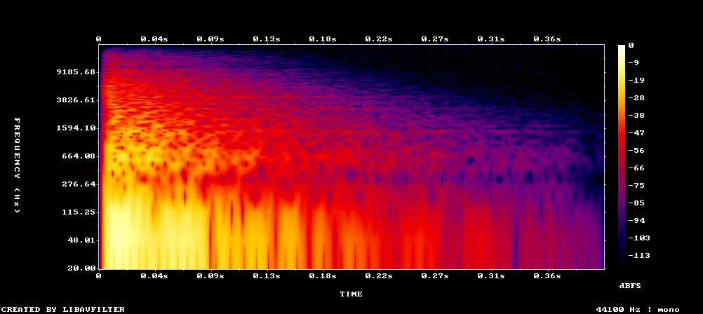 |
| `vergleich-schritt-hp3-folge.wav` | – | – | -37 | -46 | -56 | -78 | +0 / +0 / +0 / +0 | 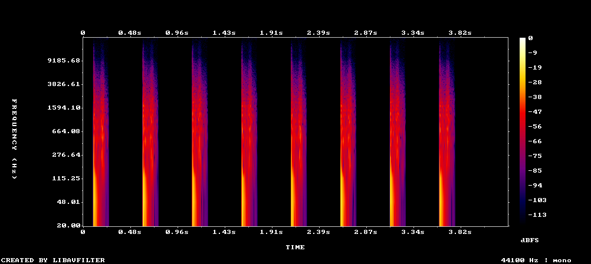 |
| `vergleich-tropfen-hp3-gekuerzt.wav` | – | – | -83 | -40 | -53 | -94 | +0 / +0 / +0 / +0 | 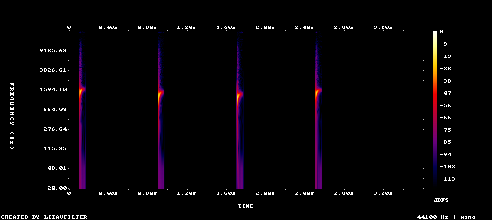 |

## PS1-Einstellung je Kategorie

| Datei | Einsätze | bis −60 dB | < 300 Hz | 300–2 000 | 2–8 kHz | > 8 kHz | Δ zum Vergleich (dB, 4 Bänder) | Spektrogramm |
|---|---|---|---|---|---|---|---|---|
| `einstellung-gegner-a-leicht.wav` | – | – | -20 | -46 | -83 | -94 | – | 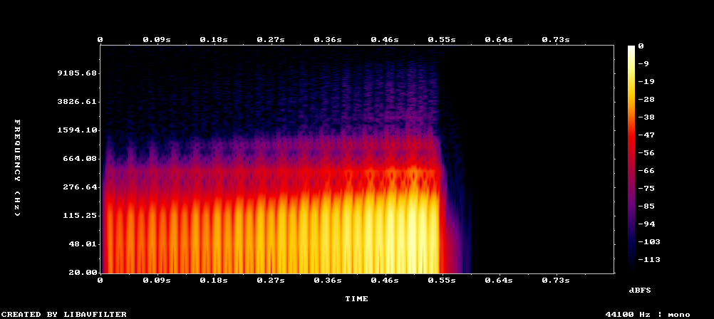 |
| `einstellung-gegner-b-stark.wav` | – | – | -20 | -46 | -83 | -97 | – |  |
| `einstellung-schritte-a-leicht.wav` | – | – | -42 | -42 | -52 | -71 | – |  |
| `einstellung-schritte-b-stark.wav` | – | – | -41 | -41 | -58 | -84 | – | 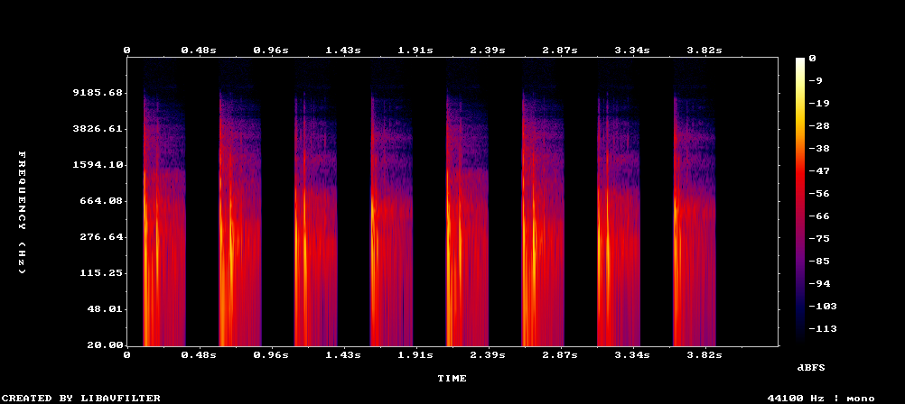 |
| `einstellung-schuss-a-leicht.wav` | – | – | -24 | -32 | -38 | -57 | – | 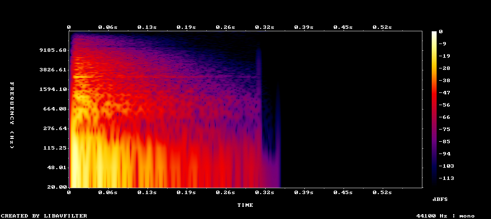 |
| `einstellung-schuss-b-stark.wav` | – | – | -24 | -32 | -42 | -74 | – | 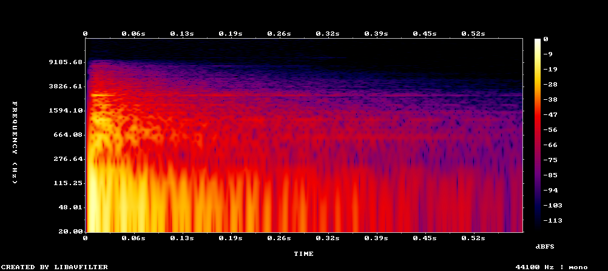 |
| `einstellung-treffer-a-leicht.wav` | – | – | -26 | -39 | -36 | -55 | – |  |
| `einstellung-treffer-b-stark.wav` | – | – | -25 | -37 | -40 | -70 | – | 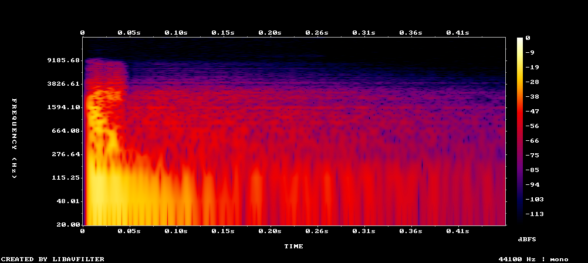 |
| `einstellung-tropfen-a-leicht.wav` | – | – | -54 | -45 | -60 | -96 | – |  |
| `einstellung-tropfen-b-stark.wav` | – | – | -55 | -45 | -59 | -98 | – | 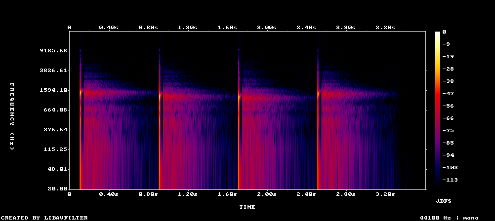 |

## Ambiente mit den Tropfen-Kandidaten (OGG, Naht nach dem Dekodieren)

| Datei | Länge | Spitze | Mittel | Naht (Sprung ≤ 99,9 % der Nachbar-Abstände) |
|---|---|---|---|---|
| `ambiente-tropfen-1-glas.ogg` | 30.000 s | -22.7 dBFS | -37.9 dBFS | L: 0.00003 ≤ 0.00156; R: 0.00049 ≤ 0.00156 ✔ |
| `ambiente-tropfen-2-blech.ogg` | 30.000 s | -22.6 dBFS | -37.9 dBFS | L: 0.00040 ≤ 0.00156; R: 0.00015 ≤ 0.00156 ✔ |
| `ambiente-tropfen-3-klopfen-plus-ton.ogg` | 30.000 s | -22.6 dBFS | -37.9 dBFS | L: 0.00037 ≤ 0.00156; R: 0.00055 ≤ 0.00156 ✔ |
| `ambiente-tropfen-vergleich-hp3-gekuerzt.ogg` | 30.000 s | -22.6 dBFS | -37.9 dBFS | L: 0.00024 ≤ 0.00156; R: 0.00006 ≤ 0.00159 ✔ |

## Prüfung gegen den technischen Rahmen

| Datei | Länge | Spitze | Ränder (0/0, Rest < −40 dB) | Ergebnis |
|---|---|---|---|---|
| `einstellung-gegner-a-leicht.wav` | 0.820 s ✔ | -3.0 dBFS ✔ | ✔ | bestanden |
| `einstellung-gegner-b-stark.wav` | 0.820 s ✔ | -3.0 dBFS ✔ | ✔ | bestanden |
| `einstellung-schritte-a-leicht.wav` | 4.300 s ✔ | -12.0 dBFS ✔ | ✔ | bestanden |
| `einstellung-schritte-b-stark.wav` | 4.300 s ✔ | -12.0 dBFS ✔ | ✔ | bestanden |
| `einstellung-schuss-a-leicht.wav` | 0.580 s ✔ | -1.5 dBFS ✔ | ✔ | bestanden |
| `einstellung-schuss-b-stark.wav` | 0.580 s ✔ | -1.5 dBFS ✔ | ✔ | bestanden |
| `einstellung-treffer-a-leicht.wav` | 0.460 s ✔ | -4.0 dBFS ✔ | ✔ | bestanden |
| `einstellung-treffer-b-stark.wav` | 0.460 s ✔ | -4.0 dBFS ✔ | ✔ | bestanden |
| `einstellung-tropfen-a-leicht.wav` | 3.600 s ✔ | -12.0 dBFS ✔ | ✔ | bestanden |
| `einstellung-tropfen-b-stark.wav` | 3.600 s ✔ | -12.0 dBFS ✔ | ✔ | bestanden |
| `klinge-1-hieb-rein.wav` | 0.222 s ✔ | -4.0 dBFS ✔ | ✔ | bestanden |
| `klinge-2-schnitt-rein.wav` | 0.559 s ✔ | -4.0 dBFS ✔ | ✔ | bestanden |
| `klinge-3-schneide-plus-koerper.wav` | 0.260 s ✔ | -4.0 dBFS ✔ | ✔ | bestanden |
| `pistole-1-schlag-rein.wav` | 0.400 s ✔ | -1.5 dBFS ✔ | ✔ | bestanden |
| `pistole-2-metall-plus-koerper.wav` | 0.400 s ✔ | -1.5 dBFS ✔ | ✔ | bestanden |
| `pistole-3-platte-plus-koerper.wav` | 0.400 s ✔ | -1.5 dBFS ✔ | ✔ | bestanden |
| `schritt-1-rpg-rein-1.wav` | 0.229 s ✔ | -12.0 dBFS ✔ | ✔ | bestanden |
| `schritt-1-rpg-rein-2.wav` | 0.235 s ✔ | -12.5 dBFS ✔ | ✔ | bestanden |
| `schritt-1-rpg-rein-3.wav` | 0.242 s ✔ | -13.0 dBFS ✔ | ✔ | bestanden |
| `schritt-1-rpg-rein-4.wav` | 0.230 s ✔ | -13.5 dBFS ✔ | ✔ | bestanden |
| `schritt-1-rpg-rein-folge.wav` | 4.300 s ✔ | -12.0 dBFS ✔ | ✔ | bestanden |
| `schritt-2-beton-rein-1.wav` | 0.136 s ✔ | -12.0 dBFS ✔ | ✔ | bestanden |
| `schritt-2-beton-rein-2.wav` | 0.138 s ✔ | -12.5 dBFS ✔ | ✔ | bestanden |
| `schritt-2-beton-rein-3.wav` | 0.143 s ✔ | -13.0 dBFS ✔ | ✔ | bestanden |
| `schritt-2-beton-rein-4.wav` | 0.141 s ✔ | -13.5 dBFS ✔ | ✔ | bestanden |
| `schritt-2-beton-rein-folge.wav` | 4.300 s ✔ | -12.0 dBFS ✔ | ✔ | bestanden |
| `schritt-3-anschlag-plus-koerper-1.wav` | 0.240 s ✔ | -12.0 dBFS ✔ | ✔ | bestanden |
| `schritt-3-anschlag-plus-koerper-2.wav` | 0.240 s ✔ | -12.5 dBFS ✔ | ✔ | bestanden |
| `schritt-3-anschlag-plus-koerper-3.wav` | 0.240 s ✔ | -13.0 dBFS ✔ | ✔ | bestanden |
| `schritt-3-anschlag-plus-koerper-4.wav` | 0.240 s ✔ | -13.5 dBFS ✔ | ✔ | bestanden |
| `schritt-3-anschlag-plus-koerper-folge.wav` | 4.300 s ✔ | -12.0 dBFS ✔ | ✔ | bestanden |
| `tropfen-1-glas-einzeln.wav` | 3.600 s ✔ | -12.0 dBFS ✔ | ✔ | bestanden |
| `tropfen-2-blech-einzeln.wav` | 3.600 s ✔ | -12.0 dBFS ✔ | ✔ | bestanden |
| `tropfen-3-klopfen-plus-ton-einzeln.wav` | 3.600 s ✔ | -12.0 dBFS ✔ | ✔ | bestanden |
| `vergleich-klinge-hp3-heller.wav` | 0.240 s ✔ | -4.0 dBFS ✔ | ✔ | bestanden |
| `vergleich-pistole-hp3.wav` | 0.400 s ✔ | -1.5 dBFS ✔ | ✔ | bestanden |
| `vergleich-schritt-hp3-folge.wav` | 4.300 s ✔ | -12.1 dBFS ✔ | ✔ | bestanden |
| `vergleich-tropfen-hp3-gekuerzt.wav` | 3.600 s ✔ | -12.0 dBFS ✔ | ✔ | bestanden |
