# Messwerte – Hörprobe 5

Erzeugt mit `python messen.py`. Alle Dateien sind durch die PS1-Kette gegangen (Einstellung „a-leicht“: 22 050 Hz, Höhenausgleich, kein Hall), außer den Dateien `einstellung-*-b-stark` (11 025 Hz, kein Ausgleich, Hall „Room“). Herkunft der Originale: [klangquellen.md](../../../grundlagen/klangquellen.md). Bandpegel sind mittlere Pegel in dBFS (je zwei Filter 2. Ordnung); „Δ zum Vergleich“ ist der Unterschied zur bisher besten synthetischen Fassung derselben Kategorie in den Bändern < 300 Hz / 300–2 000 Hz / 2–8 kHz / > 8 kHz.

Diese Datei beschreibt Aufbau und Messwerte. Ob etwas gut klingt, entscheidet die Hörprobe.

## Herkunft und Bearbeitung je Kandidat

- `pistole-1-schlag-rein`: **Rein aus einer Aufnahme.** `impactPunch_heavy_001.ogg` (Impact Sounds): auf den Schlag geschnitten, Brummen unter 40 Hz entfernt, 2 Halbtöne tiefer (Varispeed), stark weich gesättigt (tanh), kurzer synthetischer Raum wie Hörprobe 3. Kenney hat keinen Schuss; der Faustschlag ersetzt ihn.
- `pistole-2-metall-plus-koerper`: **Mischung.** Anschlag: erste 25 ms von `impactMetal_heavy_002.ogg` (Impact Sounds). Körper, Sub und Raum synthetisch wie Hörprobe 3; zusammen weich gesättigt.
- `pistole-3-platte-plus-koerper`: **Mischung.** Anschlag: erste 20 ms von `impactPlate_heavy_001.ogg` (Impact Sounds), 3 Halbtöne tiefer. Körper, Sub und Raum synthetisch wie Hörprobe 3.
- `vergleich-pistole-hp3`: Vergleich: `pistole-ps1.wav` aus Hörprobe 3, rein synthetisch.
- `klinge-1-hieb-rein`: **Rein aus einer Aufnahme.** `chop.ogg` (RPG Audio): geschnitten, 2 Halbtöne tiefer.
- `klinge-2-zwei-aufnahmen`: **Rein aus zwei Aufnahmen.** Körper `impactPunch_medium_000.ogg` (Impact Sounds) + Schneide: erste 60 ms von `knifeSlice.ogg` (RPG Audio), gleichzeitig.
- `klinge-3-schneide-plus-koerper`: **Mischung.** Schneide: erste 40 ms von `knifeSlice.ogg` (RPG Audio) + synthetischer Körper aus Hörprobe 4 (fallender Tiefpass, Ton 110→55 Hz).
- `vergleich-klinge-hp4-a`: Vergleich: `klinge-a-schneide-1-ps1.wav` aus Hörprobe 4, rein synthetisch (noch ohne Urteil).
- `schritt-1-rpg-rein`: **Rein aus Aufnahmen.** `footstep00/02/06/07.ogg` (RPG Audio), je auf einen Schritt geschnitten. Diese vier ohne Übersteuerung ausgewählt (03 und 08 haben übersteuerte Samples).
- `schritt-2-beton-rein`: **Rein aus Aufnahmen.** `footstep_concrete_000–003.ogg` (Impact Sounds), 2 Halbtöne tiefer (schwerer). Die Originale sind sehr knapp geschnitten (0,1 s).
- `schritt-3-anschlag-plus-koerper`: **Mischung.** Anschlag: erste 20 ms der RPG-Schritte + synthetische Bodenreaktions-Kurve aus Hörprobe 3.
- `vergleich-schritt-hp3`: Vergleich: `schritt-ps1-folge.wav` aus Hörprobe 3, rein synthetisch.
- `tropfen-1-glas`: **Rein aus einer Aufnahme.** `impactGlass_light_000.ogg` (Impact Sounds), eine Oktave tiefer (±2 Halbtöne je Tropfen), gedämpfter Raum aus Hörprobe 4. Kenney hat kein Wasser; leichtes Glas ersetzt es.
- `tropfen-2-blech`: **Rein aus einer Aufnahme.** `impactTin_medium_004.ogg` (Impact Sounds), 7 Halbtöne tiefer, Tiefpass 2,5 kHz, gedämpfter Raum.
- `tropfen-3-klopfen-plus-ton`: **Mischung.** Aufschlag: erste 8 ms von `impactGeneric_light_000.ogg` (Impact Sounds) + synthetischer kurzer Ton (Hörprobe 4, Fassung a), gedämpfter Raum.
- `vergleich-tropfen-hp4-b`: Vergleich: `tropfen-b-breit-einzeln-ps1.wav` aus Hörprobe 4, rein synthetisch (noch ohne Urteil).

## Vorauswahl-Messungen

| Datei | Einsätze | bis −60 dB | < 300 Hz | 300–2 000 | 2–8 kHz | > 8 kHz | Δ zum Vergleich (dB, 4 Bänder) | Spektrogramm |
|---|---|---|---|---|---|---|---|---|
| `klinge-1-hieb-rein.wav` | 1 | 200 ms | -47 | -25 | -29 | -53 | -20 / +8 / +7 / -1 |  |
| `klinge-2-zwei-aufnahmen.wav` | 1 | 275 ms | -26 | -29 | -37 | -56 | +1 / +3 / -0 / -4 | 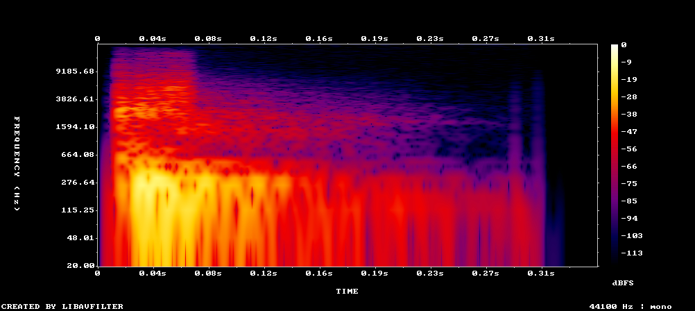 |
| `klinge-3-schneide-plus-koerper.wav` | 1 | 235 ms | -26 | -31 | -35 | -58 | +1 / +2 / +1 / -6 |  |
| `pistole-1-schlag-rein.wav` | 1 | 360 ms | -14 | -25 | -43 | -65 | +5 / +2 / -8 / -13 |  |
| `pistole-2-metall-plus-koerper.wav` | 1 | 305 ms | -22 | -29 | -34 | -53 | -2 / -2 / +1 / -1 |  |
| `pistole-3-platte-plus-koerper.wav` | 1 | 300 ms | -20 | -25 | -32 | -47 | -1 / +2 / +4 / +4 | 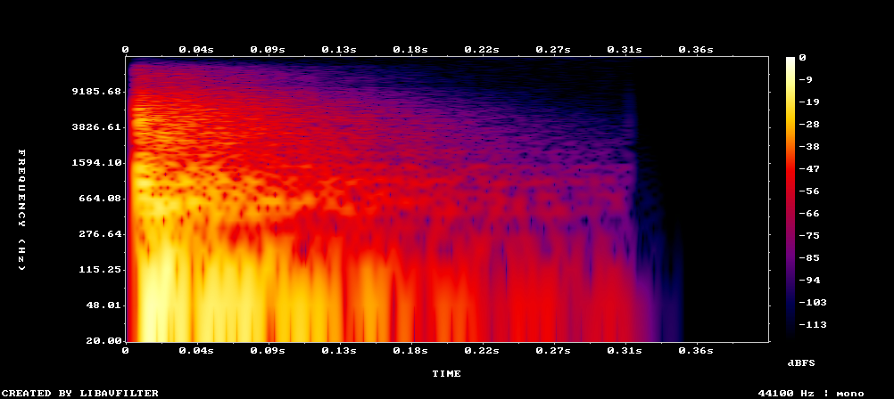 |
| `schritt-1-rpg-rein-1.wav` | 1 | 210 ms | -37 | -37 | -49 | -64 | -1 / +9 / +7 / +13 |  |
| `schritt-1-rpg-rein-2.wav` | 1 | 155 ms | -37 | -40 | -46 | -66 | -1 / +6 / +10 / +12 |  |
| `schritt-1-rpg-rein-3.wav` | 1 | 225 ms | -37 | -39 | -55 | -75 | -0 / +7 / +1 / +2 |  |
| `schritt-1-rpg-rein-4.wav` | 1 | 205 ms | -42 | -39 | -50 | -69 | -5 / +7 / +6 / +9 |  |
| `schritt-1-rpg-rein-folge.wav` | – | – | -42 | -42 | -52 | -71 | -5 / +4 / +4 / +7 |  |
| `schritt-2-beton-rein-1.wav` | 1 | 75 ms | -33 | -38 | -70 | -88 | +4 / +7 / -14 / -10 |  |
| `schritt-2-beton-rein-2.wav` | 1 | 90 ms | -35 | -39 | -56 | -71 | +1 / +7 / +0 / +7 | 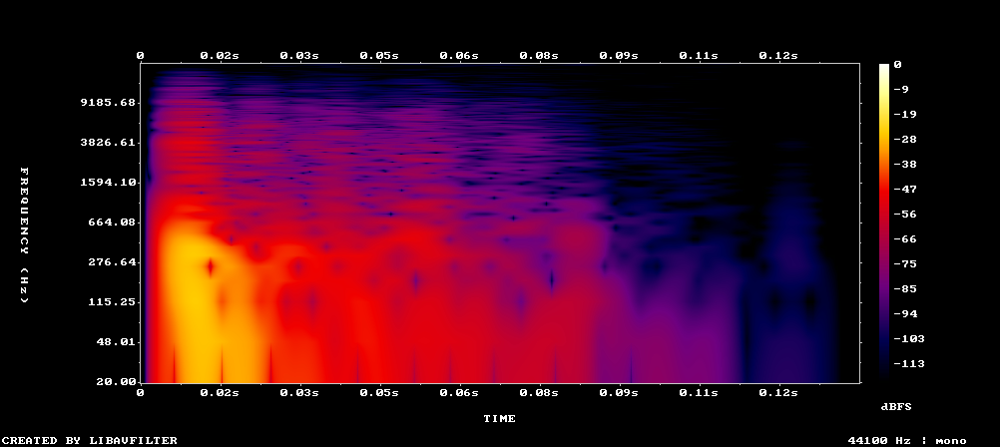 |
| `schritt-2-beton-rein-3.wav` | 1 | 95 ms | -36 | -39 | -57 | -73 | +1 / +7 / -1 / +4 |  |
| `schritt-2-beton-rein-4.wav` | 1 | 90 ms | -35 | -39 | -66 | -82 | +2 / +6 / -10 / -4 | 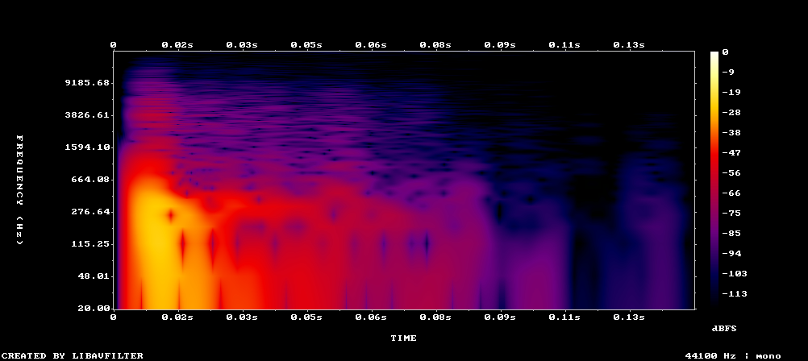 |
| `schritt-2-beton-rein-folge.wav` | – | – | -40 | -45 | -65 | -81 | -4 / +1 / -9 / -3 |  |
| `schritt-3-anschlag-plus-koerper-1.wav` | 1 | 220 ms | -40 | -33 | -44 | -63 | -3 / +12 / +12 / +14 | 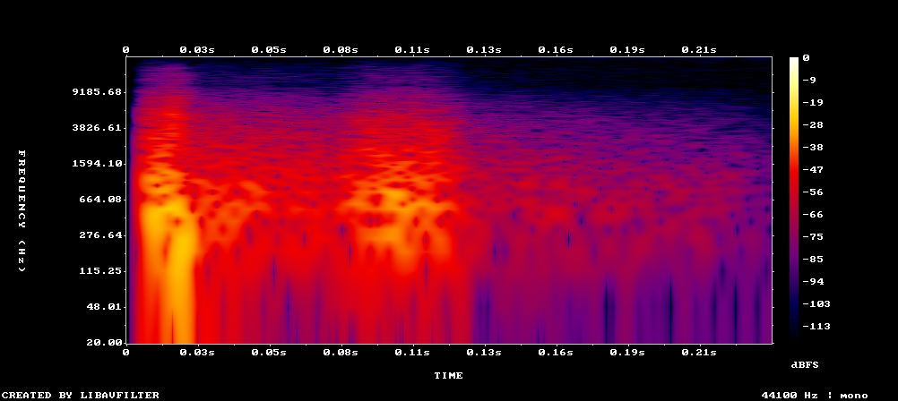 |
| `schritt-3-anschlag-plus-koerper-2.wav` | 1 | 235 ms | -42 | -34 | -44 | -65 | -5 / +12 / +12 / +13 | 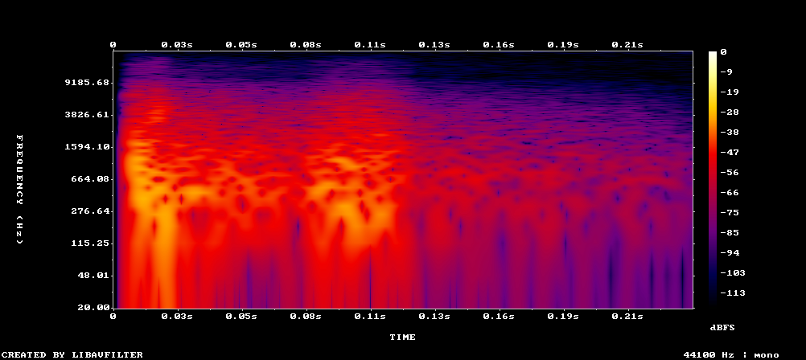 |
| `schritt-3-anschlag-plus-koerper-3.wav` | 1 | 225 ms | -40 | -33 | -43 | -65 | -4 / +12 / +13 / +13 | 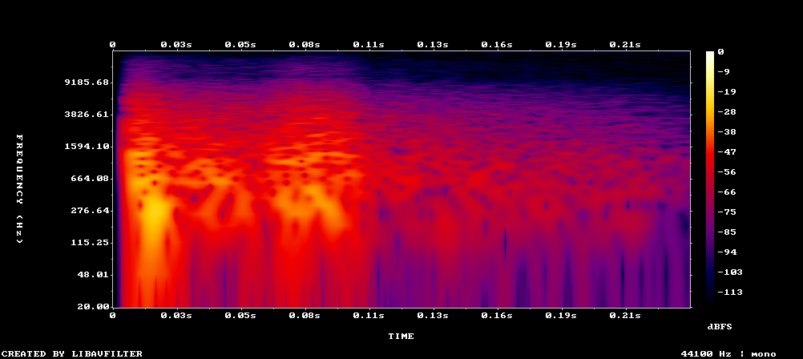 |
| `schritt-3-anschlag-plus-koerper-4.wav` | 1 | 220 ms | -44 | -35 | -47 | -68 | -7 / +11 / +9 / +9 | 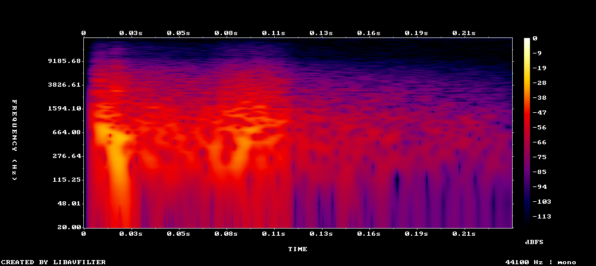 |
| `schritt-3-anschlag-plus-koerper-folge.wav` | – | – | -45 | -37 | -48 | -68 | -8 / +8 / +8 / +9 |  |
| `tropfen-1-glas-einzeln.wav` | – | – | -51 | -35 | -62 | -85 | +25 / +1 / -13 / -12 |  |
| `tropfen-2-blech-einzeln.wav` | – | – | -40 | -38 | -69 | -97 | +36 / -2 / -20 / -24 |  |
| `tropfen-3-klopfen-plus-ton-einzeln.wav` | – | – | -53 | -44 | -58 | -92 | +23 / -8 / -10 / -19 |  |
| `vergleich-klinge-hp4-a.wav` | 1 | 240 ms | -27 | -33 | -37 | -52 | +0 / +0 / +0 / +0 |  |
| `vergleich-pistole-hp3.wav` | 1 | 340 ms | -19 | -27 | -36 | -52 | +0 / +0 / +0 / +0 |  |
| `vergleich-schritt-hp3-folge.wav` | – | – | -37 | -46 | -56 | -78 | +0 / +0 / +0 / +0 |  |
| `vergleich-tropfen-hp4-b.wav` | – | – | -76 | -36 | -49 | -73 | +0 / +0 / +0 / +0 | 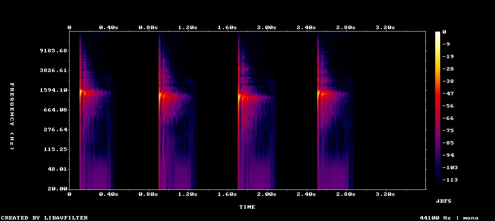 |

## PS1-Einstellung je Kategorie

| Datei | Einsätze | bis −60 dB | < 300 Hz | 300–2 000 | 2–8 kHz | > 8 kHz | Δ zum Vergleich (dB, 4 Bänder) | Spektrogramm |
|---|---|---|---|---|---|---|---|---|
| `einstellung-gegner-a-leicht.wav` | – | – | -20 | -46 | -83 | -94 | – |  |
| `einstellung-gegner-b-stark.wav` | – | – | -20 | -46 | -83 | -97 | – | 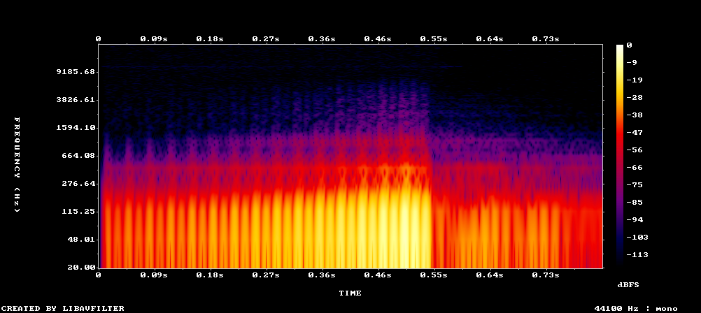 |
| `einstellung-schritte-a-leicht.wav` | – | – | -42 | -42 | -52 | -71 | – | 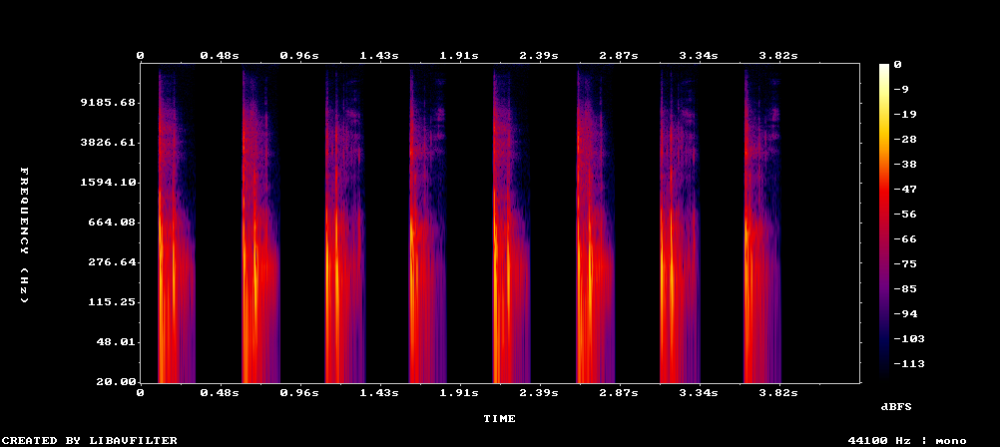 |
| `einstellung-schritte-b-stark.wav` | – | – | -41 | -41 | -58 | -84 | – |  |
| `einstellung-schuss-a-leicht.wav` | – | – | -23 | -31 | -36 | -54 | – |  |
| `einstellung-schuss-b-stark.wav` | – | – | -23 | -30 | -40 | -71 | – |  |
| `einstellung-treffer-a-leicht.wav` | – | – | -28 | -33 | -38 | -60 | – | 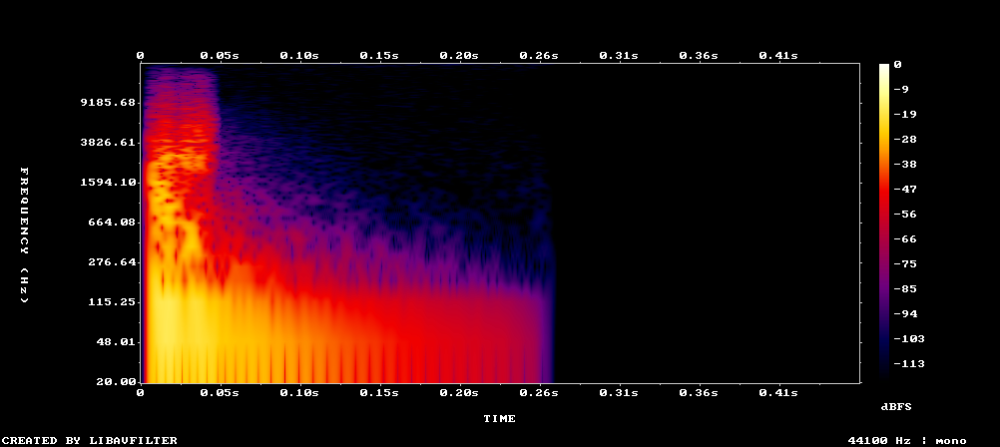 |
| `einstellung-treffer-b-stark.wav` | – | – | -28 | -32 | -41 | -73 | – |  |
| `einstellung-tropfen-a-leicht.wav` | – | – | -53 | -44 | -58 | -92 | – | 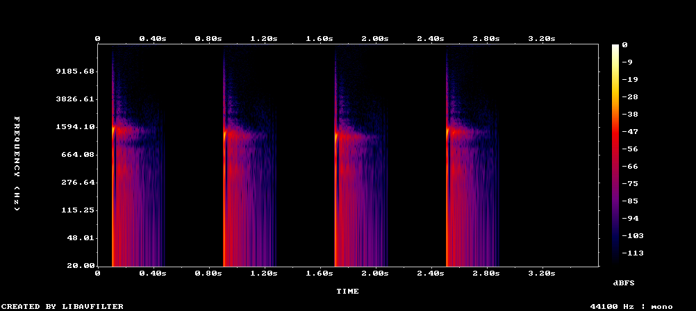 |
| `einstellung-tropfen-b-stark.wav` | – | – | -54 | -44 | -58 | -96 | – |  |

## Ambiente mit den Tropfen-Kandidaten (OGG, Naht nach dem Dekodieren)

| Datei | Länge | Spitze | Mittel | Naht (Sprung ≤ 99,9 % der Nachbar-Abstände) |
|---|---|---|---|---|
| `ambiente-tropfen-1-glas.ogg` | 30.000 s | -22.7 dBFS | -37.9 dBFS | L: 0.00052 ≤ 0.00183; R: 0.00043 ≤ 0.00214 ✔ |
| `ambiente-tropfen-2-blech.ogg` | 30.000 s | -22.8 dBFS | -37.9 dBFS | L: 0.00003 ≤ 0.00162; R: 0.00076 ≤ 0.00165 ✔ |
| `ambiente-tropfen-3-klopfen-plus-ton.ogg` | 30.000 s | -22.6 dBFS | -37.9 dBFS | L: 0.00018 ≤ 0.00165; R: 0.00031 ≤ 0.00171 ✔ |

## Prüfung gegen den technischen Rahmen

| Datei | Länge | Spitze | Ränder (0/0, Rest < −40 dB) | Ergebnis |
|---|---|---|---|---|
| `einstellung-gegner-a-leicht.wav` | 0.820 s ✔ | -3.0 dBFS ✔ | ✔ | bestanden |
| `einstellung-gegner-b-stark.wav` | 0.820 s ✔ | -3.0 dBFS ✔ | ✔ | bestanden |
| `einstellung-schritte-a-leicht.wav` | 4.300 s ✔ | -12.0 dBFS ✔ | ✔ | bestanden |
| `einstellung-schritte-b-stark.wav` | 4.300 s ✔ | -12.0 dBFS ✔ | ✔ | bestanden |
| `einstellung-schuss-a-leicht.wav` | 0.580 s ✔ | -1.5 dBFS ✔ | ✔ | bestanden |
| `einstellung-schuss-b-stark.wav` | 0.580 s ✔ | -1.5 dBFS ✔ | ✔ | bestanden |
| `einstellung-treffer-a-leicht.wav` | 0.460 s ✔ | -4.0 dBFS ✔ | ✔ | bestanden |
| `einstellung-treffer-b-stark.wav` | 0.460 s ✔ | -4.0 dBFS ✔ | ✔ | bestanden |
| `einstellung-tropfen-a-leicht.wav` | 3.600 s ✔ | -12.0 dBFS ✔ | ✔ | bestanden |
| `einstellung-tropfen-b-stark.wav` | 3.600 s ✔ | -12.0 dBFS ✔ | ✔ | bestanden |
| `klinge-1-hieb-rein.wav` | 0.222 s ✔ | -4.0 dBFS ✔ | ✔ | bestanden |
| `klinge-2-zwei-aufnahmen.wav` | 0.350 s ✔ | -4.0 dBFS ✔ | ✔ | bestanden |
| `klinge-3-schneide-plus-koerper.wav` | 0.260 s ✔ | -4.0 dBFS ✔ | ✔ | bestanden |
| `pistole-1-schlag-rein.wav` | 0.400 s ✔ | -1.5 dBFS ✔ | ✔ | bestanden |
| `pistole-2-metall-plus-koerper.wav` | 0.400 s ✔ | -1.5 dBFS ✔ | ✔ | bestanden |
| `pistole-3-platte-plus-koerper.wav` | 0.400 s ✔ | -1.5 dBFS ✔ | ✔ | bestanden |
| `schritt-1-rpg-rein-1.wav` | 0.229 s ✔ | -12.0 dBFS ✔ | ✔ | bestanden |
| `schritt-1-rpg-rein-2.wav` | 0.235 s ✔ | -12.5 dBFS ✔ | ✔ | bestanden |
| `schritt-1-rpg-rein-3.wav` | 0.242 s ✔ | -13.0 dBFS ✔ | ✔ | bestanden |
| `schritt-1-rpg-rein-4.wav` | 0.230 s ✔ | -13.5 dBFS ✔ | ✔ | bestanden |
| `schritt-1-rpg-rein-folge.wav` | 4.300 s ✔ | -12.0 dBFS ✔ | ✔ | bestanden |
| `schritt-2-beton-rein-1.wav` | 0.136 s ✔ | -12.0 dBFS ✔ | ✔ | bestanden |
| `schritt-2-beton-rein-2.wav` | 0.138 s ✔ | -12.5 dBFS ✔ | ✔ | bestanden |
| `schritt-2-beton-rein-3.wav` | 0.143 s ✔ | -13.0 dBFS ✔ | ✔ | bestanden |
| `schritt-2-beton-rein-4.wav` | 0.141 s ✔ | -13.5 dBFS ✔ | ✔ | bestanden |
| `schritt-2-beton-rein-folge.wav` | 4.300 s ✔ | -12.0 dBFS ✔ | ✔ | bestanden |
| `schritt-3-anschlag-plus-koerper-1.wav` | 0.240 s ✔ | -12.0 dBFS ✔ | ✔ | bestanden |
| `schritt-3-anschlag-plus-koerper-2.wav` | 0.240 s ✔ | -12.5 dBFS ✔ | ✔ | bestanden |
| `schritt-3-anschlag-plus-koerper-3.wav` | 0.240 s ✔ | -13.0 dBFS ✔ | ✔ | bestanden |
| `schritt-3-anschlag-plus-koerper-4.wav` | 0.240 s ✔ | -13.5 dBFS ✔ | ✔ | bestanden |
| `schritt-3-anschlag-plus-koerper-folge.wav` | 4.300 s ✔ | -12.0 dBFS ✔ | ✔ | bestanden |
| `tropfen-1-glas-einzeln.wav` | 3.600 s ✔ | -12.0 dBFS ✔ | ✔ | bestanden |
| `tropfen-2-blech-einzeln.wav` | 3.600 s ✔ | -12.0 dBFS ✔ | ✔ | bestanden |
| `tropfen-3-klopfen-plus-ton-einzeln.wav` | 3.600 s ✔ | -12.0 dBFS ✔ | ✔ | bestanden |
| `vergleich-klinge-hp4-a.wav` | 0.260 s ✔ | -4.3 dBFS ✔ | ✔ | bestanden |
| `vergleich-pistole-hp3.wav` | 0.400 s ✔ | -1.5 dBFS ✔ | ✔ | bestanden |
| `vergleich-schritt-hp3-folge.wav` | 4.300 s ✔ | -12.1 dBFS ✔ | ✔ | bestanden |
| `vergleich-tropfen-hp4-b.wav` | 3.600 s ✔ | -6.0 dBFS ✔ | ✔ | bestanden |
