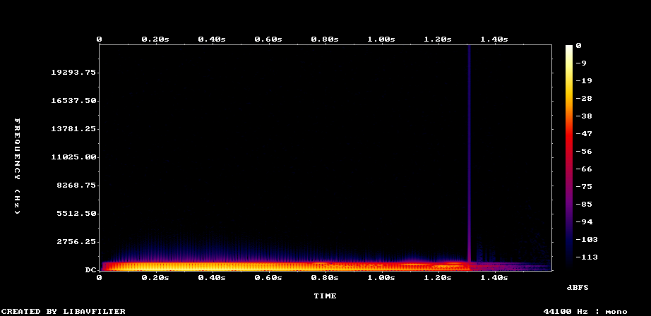
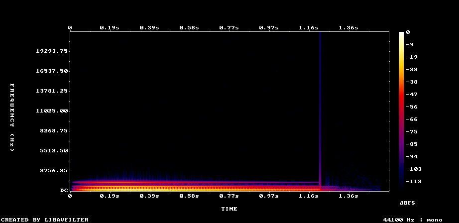
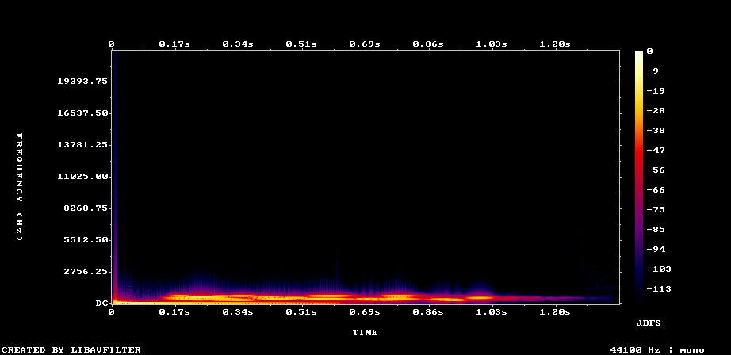
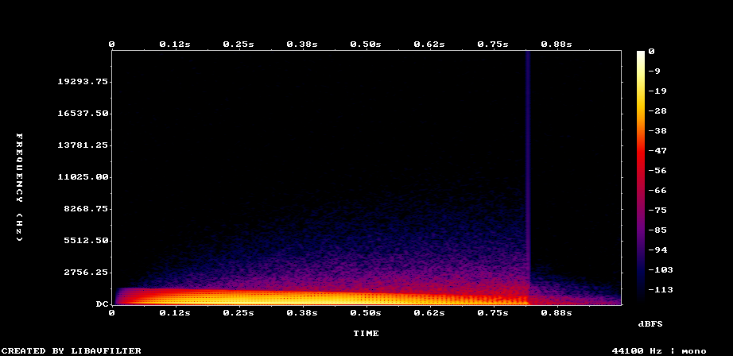
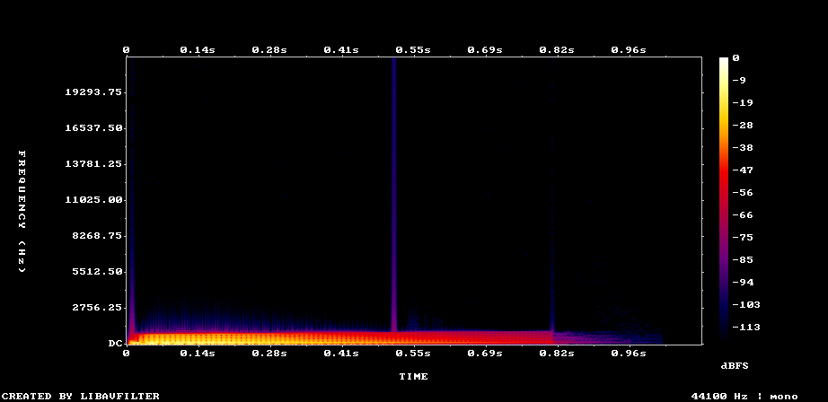
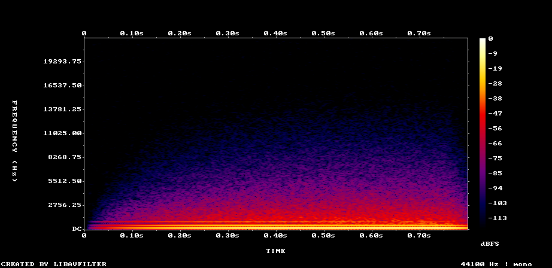
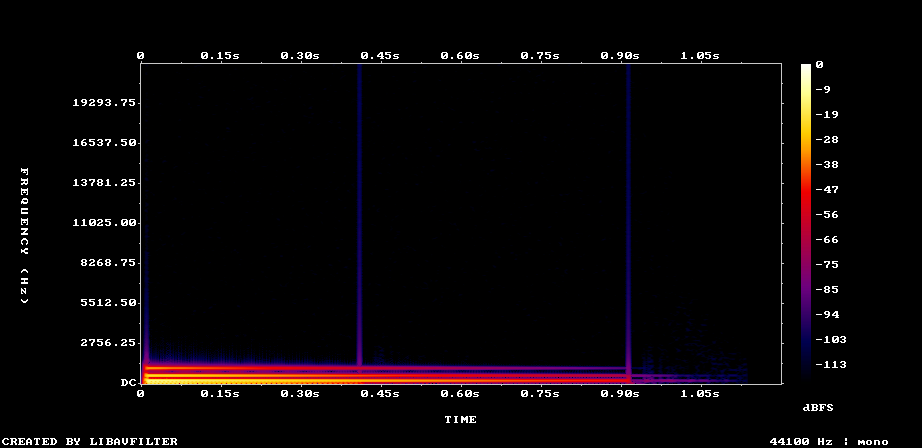
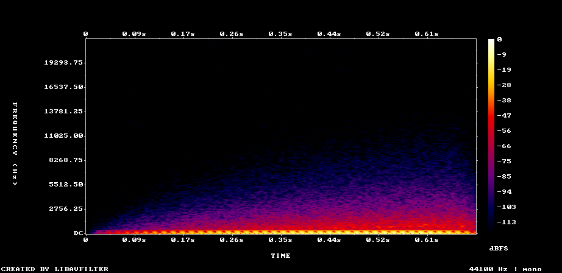
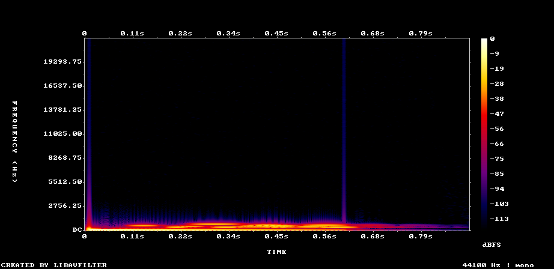

# Messwerte Teleporter-Hörprobe (#476)

Erzeugt von `messen.py`. Alles gemessen, nichts gehört. Spitze = höchster Abtastwert; mittlere Lautstärke = ffmpeg `volumedetect`; Anteil über 3 kHz = Pegel nach Hochpass 3 kHz minus Gesamtpegel (je kleiner, desto weniger Höhen); Einsätze = Pegelsprünge über 8 dB in 50 ms (10-ms- und 30-ms-Fenster); Abklang = Zeit bis 40 dB unter Spitze.

| Datei | Länge s | Spitze dBFS | Mittel dB | über 3 kHz dB | Einsätze 10/30 ms | Abklang s | Spektrogramm |
|---|---|---|---|---|---|---|---|
| freischalten-a-horn-glimmen.wav | 1.60 | -3.0 | -16.0 | -41.7 | 1 / 1 | 1.31 |  |
| freischalten-b-kristallton.wav | 1.55 | -3.0 | -18.4 | -39.7 | 1 / 1 | 1.21 |  |
| freischalten-c-puls-funken.wav | 1.37 | -3.0 | -16.9 | -36.8 | 3 / 1 | 1.02 |  |
| reise-a-horn-gleiten-abreise.wav | 1.00 | -3.0 | -14.2 | -36.9 | 1 / 1 | 0.81 |  |
| reise-a-horn-gleiten-ankunft.wav | 1.10 | -3.0 | -18.7 | -41.4 | 2 / 0 | 0.80 |  |
| reise-b-kristall-sog-abreise.wav | 0.80 | -3.3 | -11.2 | -41.3 | 1 / 1 | 0.79 |  |
| reise-b-kristall-sog-ankunft.wav | 1.20 | -3.0 | -20.4 | -38.3 | 0 / 0 | 0.90 |  |
| reise-c-droehnen-abreise.wav | 0.70 | -3.0 | -14.9 | -48.2 | 3 / 1 | 0.69 |  |
| reise-c-droehnen-ankunft.wav | 0.90 | -3.0 | -15.8 | -43.2 | 0 / 0 | 0.64 |  |
