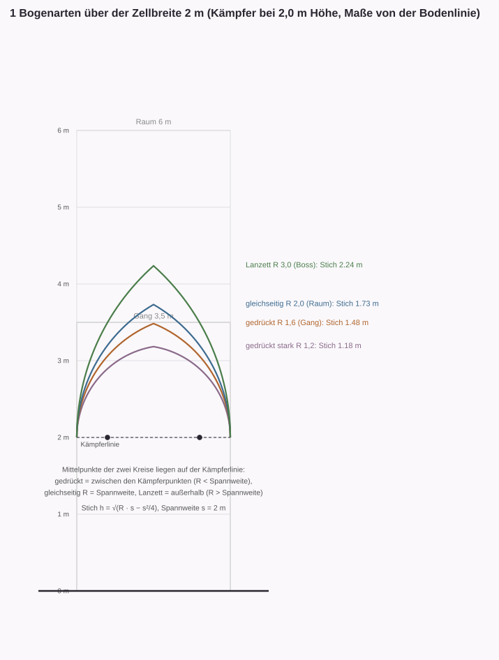
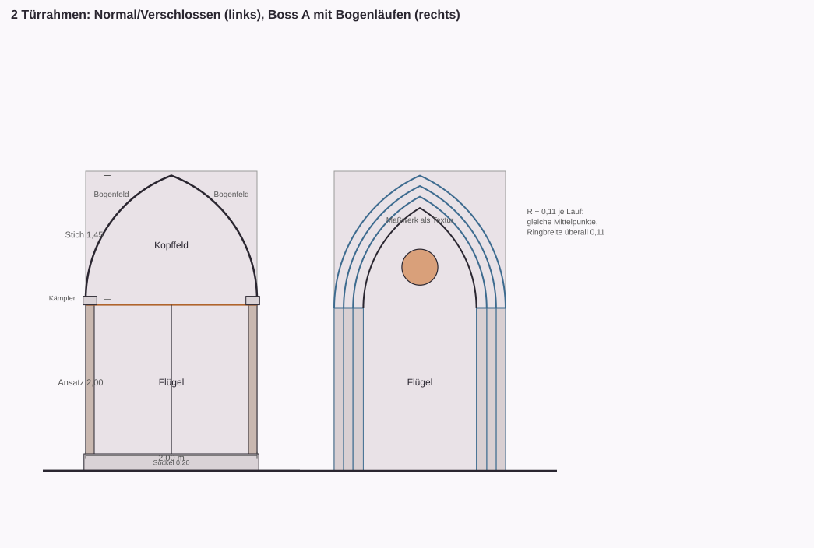
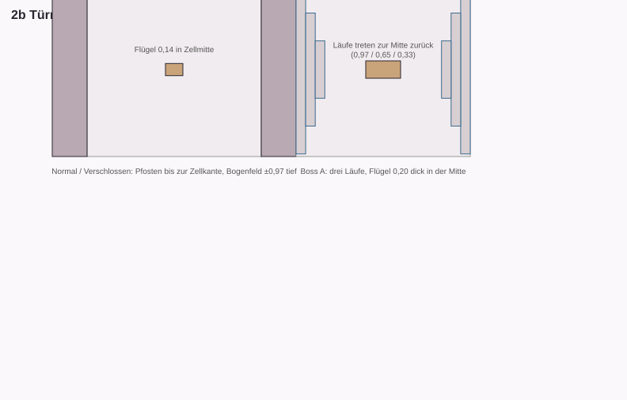
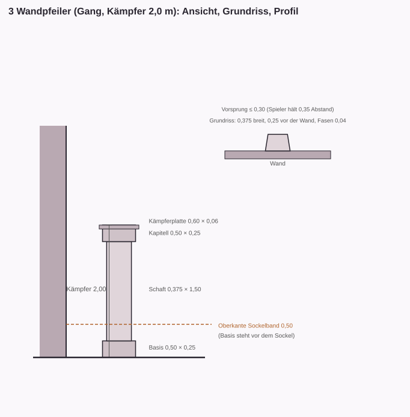
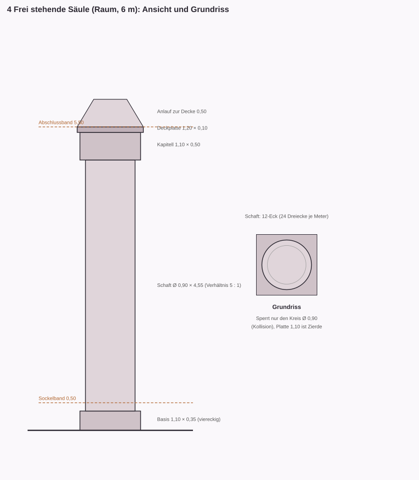
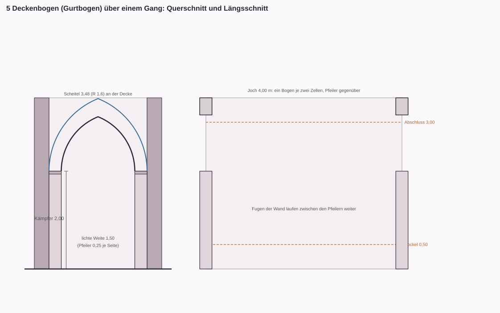
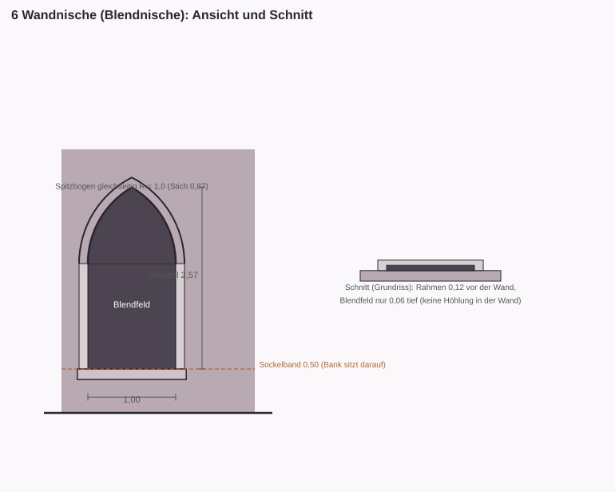
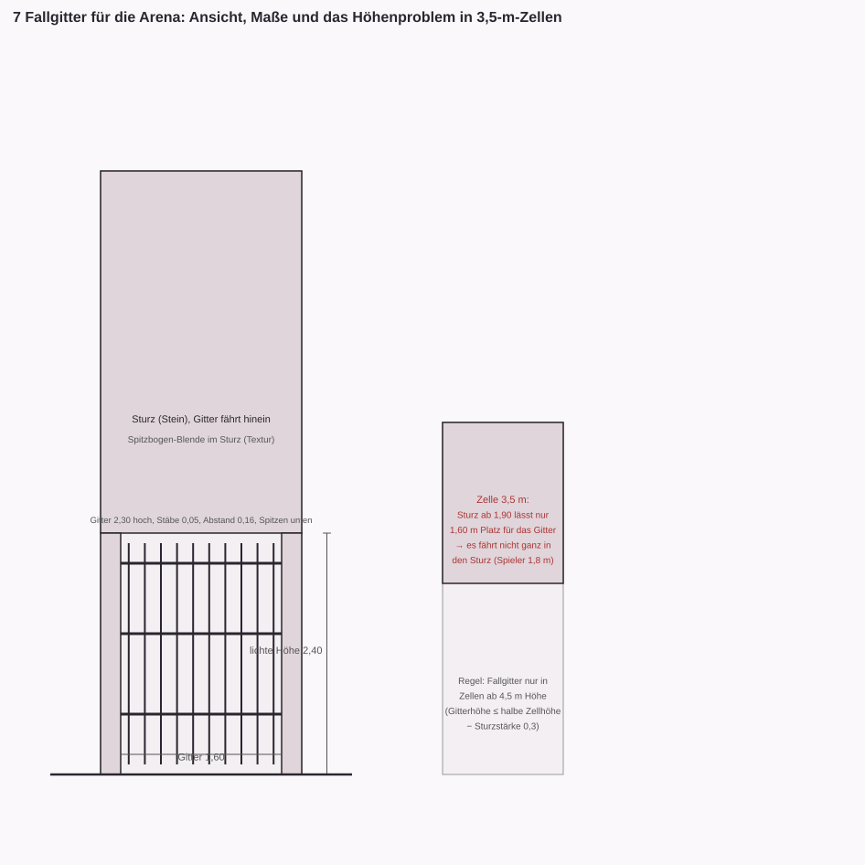
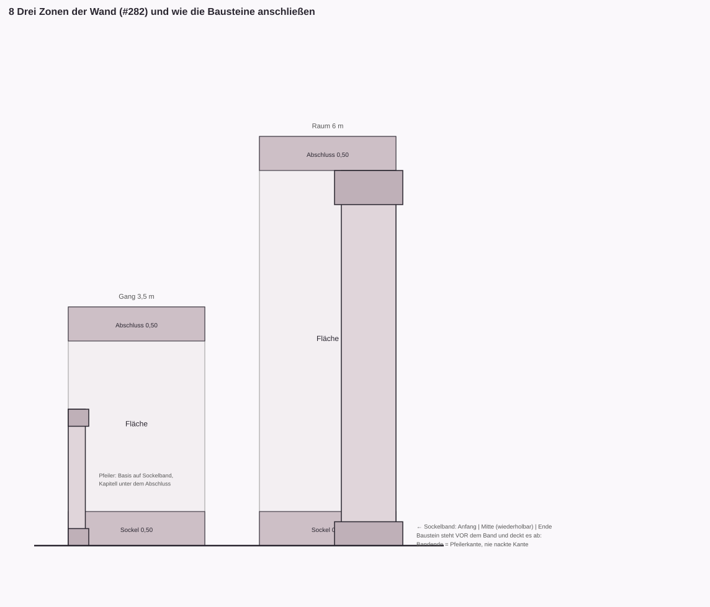

# Formenlehre Gotik für die Levelbausteine (Entwurf, Issue #281)

Entwurf des Grafikdesigners; bis zur Abnahme durch die Leitung kein Teil der Art Bible. Maße in Metern, Raster der Wand **64 Pixel je Meter** (1 px = 1,5625 cm), Zelle 2 m, Gang 3,5 m hoch, Raum 6 m hoch. Skizzen als SVG in `skizzen/` (erzeugt von `skizzen.py`, einfache Risszeichnungen).

**Leitform:** Gotik, vereinfacht: **Spitzbogen und Rippe als Geometrie, Maßwerk nur als Textur.** Alles Stein aus der **Stein-Rampe der Palette A** (15 Stufen, ein Farbton); Akzent-Reihen (Holz, Eisen, Messing/Gold, Blutrot) nur mit Zweck und auf kleinen Flächen.

## Quellen (nur Nachschlagewerke, nichts übernommen, nichts heruntergeladen)
- Wikipedia (en): [Pointed arch](https://en.wikipedia.org/wiki/Pointed_arch), [Archivolt](https://en.wikipedia.org/wiki/Archivolt), [Portal (architecture)](https://en.wikipedia.org/wiki/Portal_(architecture)), [Gothic architecture](https://en.wikipedia.org/wiki/Gothic_architecture), [Impost (architecture)](https://en.wikipedia.org/wiki/Impost_(architecture)), [Glossary of architecture](https://en.wikipedia.org/wiki/Glossary_of_architecture), [Tracery](https://en.wikipedia.org/wiki/Tracery).
- Wikipedia (de): [Spitzbogen](https://de.wikipedia.org/wiki/Spitzbogen), [Bogen (Architektur)](https://de.wikipedia.org/wiki/Bogen_(Architektur)), [Kreuzrippengewölbe](https://de.wikipedia.org/wiki/Kreuzrippengew%C3%B6lbe), [Schildbogen](https://de.wikipedia.org/wiki/Schildbogen), [Architektur-Glossar](https://de.wikipedia.org/wiki/Architektur-Glossar).
- Britannica: [Rib vault](https://www.britannica.com/technology/rib-vault), [Tracery](https://www.britannica.com/technology/tracery), [Plate tracery](https://www.britannica.com/topic/plate-tracery), [Bar tracery](https://www.britannica.com/topic/bar-tracery), [Portcullis](https://www.britannica.com/technology/portcullis-grating), [Portal](https://www.britannica.com/technology/portal-architecture).
- The Met: [Gothic Doorway – French](https://www.metmuseum.org/art/collection/search/471237).
- **Eigene Festlegungen, nicht aus Quellen:** die Maße von Pfeiler, Säule, Nische und Gitter, die Wandzonen und die Zahlen für Dreiecke. Die Quellen nennen Begriffe und Bauweise, aber keine Maße für ein Spiel mit 2-m-Zellen; ich habe sie nicht geschätzt aus einer Quelle, sondern für die Zelle entworfen und im Folgenden begründet.
- **Was die Quellen sagen und ich benutze:** Der Spitzbogen entsteht aus zwei Kreisbögen, deren Mittelpunkte auf der Kämpferlinie liegen; gleichseitig, wenn der Radius der Spannweite gleich ist, gedrückt (Mittelpunkte zwischen den Kämpferpunkten, Radius kleiner), überhöht/Lanzett (Mittelpunkte außerhalb, Radius größer). Portale bestehen aus gestuften Bogenläufen (Archivolten) auf Pfosten, darin Tür und Bogenfeld (Tympanon). Das Kämpfer-/Imposthöhe ist der oberste Teil des Widerlagers, von dem Bogen oder Rippen ausgehen. Ein Gurtbogen unterteilt ein Gewölbe quer und ist eine besonders kräftige Rippe. Plattenmaßwerk sind Öffnungen, die wie aus einer Platte ausgeschnitten wirken, Stabmaßwerk steht auf Stäben (Kreis, Drei- und Vierpass).

## 1 Bogenarten und die Zelle (2 m breit)

Konstruktion: Spannweite s auf der Kämpferlinie, Radius R, zwei Kreise um die Punkte (±(s/2 − R), Kämpferhöhe); **Stich h = √(R · s − s²/4)**.

| Bogen | R bei s = 2 m | Stich h | Wo |
|---|---|---|---|
| gedrückt stark | 1,2 | 1,18 | Nischen, niedrige Öffnungen |
| **gedrückt** | **1,6** | **1,48** | **Gang (3,5 m):** Kämpfer 2,00 + 1,48 = Scheitel **3,48**; Türen und Gurtbögen im Gang |
| gleichseitig | 2,0 | 1,73 | **Raum (6 m):** Kämpfer 3,3 bis 4,0, Scheitel 5,0 bis 5,7 |
| Lanzett (überhöht) | 3,0 | 2,24 | Boss-Raum, monumental (Kämpfer 3,5, Scheitel 5,74) |

**Regel:** Im Gang gedrückt (R ≈ 0,8 s), im Raum gleichseitig, im Boss-Raum Lanzett. Der gleichseitige Bogen passt **nicht** in den Gang (Scheitel 3,73 > 3,5). Kämpferhöhe im Gang **2,00**.
**PS1-nah:** Jede Bogenhälfte als **6 Strecken** (Näherung des Kreises, größter Fehler unter 1 cm); eine ganze Bogenlinie sind 12 Kanten, ein Bogenring 24 Dreiecke je Lauf.

## 2 Türrahmen (Spitzbogen)

- **Aufbau (Normal und Verschlossen):** Pfosten bis zur Zellkante, Flügel **rechteckig bis zum Kämpfer**, darüber **festes Kopffeld** im Bogen und **Bogenfeld** aus Stein in den Ecken bis zur Decke (die Flügel können so schwingen, ohne in den Bogen zu stechen).
- **Boss (Stufenportal):** drei **Bogenläufe** (Archivolten), je **0,125 breit** (8 px), alle mit **denselben Kreismittelpunkten** (Radius je Lauf um die Breite kleiner), damit die Ringbreite **überall gleich** ist; die Läufe treten zur Mitte zurück (Tiefe 0,97, 0,65, 0,33), Tür und Kopffeld im innersten.
- **Kämpfer:** eine vorspringende Platte (0,16 breit, 0,06 hoch, 0,04 vor) in Höhe der Bogenansätze auf jedem Pfosten; der Bogenlauf beginnt darauf.
- **Sockel:** Sockelband 0,50 (Zone Sockel) läuft in den Pfosten; der Pfosten sitzt darauf.
- **PS1-nah:** Pfosten, Läufe, Kämpfer sind Prismen (je 12 Dreiecke); Maßwerk (Drei-/Vierpass, Kreis) nur als dunkles Feld in der Textur des Kopffelds; der heutige Normal-Rahmen hat 928, Boss A 1 008 Dreiecke; Ziel höchstens 1 100.

## 3 Wandpfeiler (Wandvorlage)

- **Gang:** Basis 0,50 × 0,25 hoch, Schaft 0,375 × 1,50, Kapitell 0,50 × 0,25, **Kämpferplatte 0,60 × 0,06** ⇒ Kämpfer **2,00**. Grundriss 0,375 breit, **0,25 vor der Wand**, Fasen 0,04.
- **Vorsprung ≤ 0,30:** Der Spieler hält 0,35 Abstand zur Wand; Zierde darf nie in seine Kapsel ragen.
- **Abschluss zur Wand:** Seitlich Fase und 0,06 Rücksprung der Basis; die **Basis steht auf der Oberkante des Sockelbands** (0,50), das Kapitell endet unter dem Abschluss-Band.
- **PS1-nah:** 3 Quader, die Fasen als zusätzliche Schrägen, etwa 60 Dreiecke; Textur: 64-px-Feld Stein (Palette A) plus Streifen für Basis/Kapitell.

## 4 Frei stehende Säule

- **Raum (6 m):** Plinthe 1,10 × 0,35 (viereckig), **Schaft Ø 0,90** (der Kreis, den die Kollision sperrt) × 4,55 (**Verhältnis etwa 5 : 1**), Kapitell 1,10 × 0,50, Deckplatte 1,20 × 0,10, **Anlauf zur Decke** (Pyramidenstumpf 0,50) – die Säule endet nie nackt an der Decke.
- Nur in Räumen, nie in Gängen (Beschluss des Menschen).
- **PS1-nah:** Schaft als **12-Eck** (24 Dreiecke je Meter Höhe, 110 insgesamt), Plinthe, Kapitell und Deckplatte als Prismen; Gesamt etwa 160 Dreiecke. Die Platten sind Zierde (keine Kollision).

## 5 Deckenbogen (Gurtbogen) über Gängen

- **Gurtbogen** quer zum Gang, **gedrückt R = 1,6**, Kämpfer 2,00, Scheitel 3,48 (unter der Decke 3,50; der obere Rand wird 0,10 in die Decke gesteckt).
- **Rippenprofil:** 0,25 breit, 0,35 hoch (unter der Decke vorspringend), Rechteck mit zwei Fasen 0,04; kein Rundstab (zu viele Dreiecke).
- **Joch:** ein Bogen je **zwei Zellen** (4,0 m), gegenüber auf zwei Wandpfeilern (Abschnitt 3); die Rippe läuft **in** den Pfeiler (Kämpferplatte), nie nackt auf die Wand.
- **PS1-nah:** 12 Segmente × Profil 4 Flächen ≈ 100 Dreiecke, dazu 2 Kämpferblöcke; Rippenkreuz und Schlussstein später.

## 6 Wandnische (Blendnische)

- Breite **1,00**, Kämpfer 1,70, Spitzbogen gleichseitig (R = 1,0), Scheitel 2,57 (Blendfeld), Rahmen außen 2,68; Bank 0,12 hoch sitzt auf dem Sockelband (0,50).
- **Keine Höhlung in der Wand** (das Level ist aus flachen Wänden): Rahmen 0,12 **vor** der Wand, **Blendfeld** (dunkler Stein, aus der Stein-Rampe Stufe 2 bis 4) nur 0,06 tief.
- **Maßwerk** nur als Textur: Dreipass oder Kreis als dunkles Feld im Bogenfeld (2 bis 3 Farben).
- **PS1-nah:** etwa 60 Dreiecke.

## 7 Fallgitter für die Arena

- **Raumzelle (6 m):** Sturz ab **2,40**, Gitter **2,30 hoch**, Stäbe 0,05 im Abstand 0,16, drei Querbänder 0,06, Spitzen unten; das Gitter fährt in den Sturz (Quellen: Falltor läuft in Nuten und wird in den Mauerschlitz hochgezogen), die Spitzen bleiben knapp über dem Boden stehen, wenn es offen ist.
- **Höhenproblem in 3,5-m-Zellen:** Ein Gitter, das ganz im Sturz verschwindet, braucht Sturzhöhe ≥ Gitterhöhe; der Spieler ist 1,8 m hoch, also Gitter ≥ 1,9 und Sturz ≥ 1,9 ⇒ Zelle ≥ 3,8 + Sturzstärke. **Regel: Fallgitter nur in Zellen ab 4,5 m Höhe (Räume).** In Gängen (3,5 m) ist eine Tür oder ein Gitter nach Art der verworfenen Fassung Boss B zu niedrig (Sturz ab 1,75 < 1,8).
- **PS1-nah:** 10 Stäbe × 12 Dreiecke + Querbänder ≈ 170; Sturz mit Spitzbogenblende ≈ 60.

## 8 Wandzonen und Bänder (#282) und wie die Bausteine anschließen

- **Vorschlag der Zonen (mit #282 abzustimmen):** **Sockel** 0,00 bis 0,50, **Fläche** dazwischen, **Abschluss** 0,50 unter der Decke (Gang 3,00 bis 3,50, Raum 5,50 bis 6,00). Bänder nach **Anfang, Mitte, Ende**: Anfang und Ende haben eine eigene Stirn, die Mitte ist wiederholbar.
- **Anschluss:** Jeder Baustein steht **vor** dem Band und deckt es an seiner Kontaktstelle ab: Basis auf dem Sockelband, Kapitell unter dem Abschluss-Band; ein Band endet an der Kante des Bausteins (Bandende = Bausteinkante), **nie als nackte Kante auf der Wand**. Pfeiler und Säulen sind 1/16-Maße, also bleiben die Bandgrenzen im Raster.

## 9 Verbindliche Übergangsregeln (vom Menschen bestätigt)
1. **Fugen laufen im Raster der Wand weiter:** Die Textur-Koordinaten der Steinflächen eines Bausteins kommen **aus der Weltposition** (64 px je Meter, eine Kachel je Meter); Teile mit Stein werden an den Metergrenzen in Stücke geteilt, damit jedes Stück **in einer Kachel** liegt. Alle Maße sind Vielfache von **1/16 m (4 px)**.
2. **Jeder Baustein hat an der Kontaktstelle zur Wand einen eigenen Abschluss:** unten Basis, oben Kapitell/Kämpfer, seitlich Fase und 0,04–0,06 Rücksprung.
3. **Keine nackte Kante auf der Wandfläche:** Alles, was vor der Wand steht, endet mit Basis, Kapitell oder Band-Stirn.
4. **Farbe:** Stein nur aus der **Stein-Rampe der Palette A** (nach Helligkeit der Stufen, nie ein eigener Farbton); Akzente nur mit Zweck.
5. **Texturen:** je Baustein ein Feld Stein 64 × 64 (die echte Wand-Kachel der Variante) plus ein Streifen für Profile; höchstens 32 Farben; Maßwerk nur als gemalte Fläche.

## 10 Prüfung der vorhandenen Türbögen (Normal, Verschlossen, Boss A) und was nachzubessern wäre
Stand `tools/models/door.py` in `main`:
1. **Fugen des Bogenfelds** laufen nicht im Raster der Wand: Jedes Dreieck bildet das **ganze** 64-×-64-Wandfeld ab, die Steinlagen sitzen also an anderer Stelle als in der Wand daneben. **Nachbessern:** UV aus der Weltposition, Teile an Metergrenzen teilen (Regel 9.1).
2. **Boss A, Ringbreite:** die Läufe sind keine konzentrischen Bögen: Breite 0,11 am Ansatz, aber 0,15 / 0,18 / 0,27 im Scheitel (verschiedene Radien 1,70 / 1,55 / 1,34 / 1,01). **Nachbessern:** gleiche Mittelpunkte, Radius je Lauf um 0,125 kleiner.
3. **Maße im 1/16-Raster:** 0,89 / 0,78 / 0,66 / 0,11 / 0,97 / 3,45 sind keine Vielfachen von 0,0625. **Nachbessern:** Läufe 1,00 / 0,875 / 0,75 / 0,625, Ringbreite 0,125, Tiefe 0,96 / 0,64 / 0,32.
4. **Kein Kämpfer, kein Sockel:** Die Pfosten laufen ohne Platte in den Bogen und ohne Sockelband in den Boden. **Nachbessern:** Kämpferplatte (0,16 × 0,06) und Sockelband 0,50.
5. **Normal und Verschlossen im Gang:** Der Bogen (R 1,55, Stich 1,45) passt (Scheitel 3,45 < 3,50); Kämpfer 2,00 ✓. Die Ecken oben sind Bogenfeld bis zur Decke ✓. **Offen:** Die Vorderfläche des Steins liegt 3 cm hinter der Zellkante (±0,97): bei Wandzonen (#282) sauber an das Band anschließen.
6. **Boss A im Boss-Raum** (6 m): Der Bogen reicht nur bis 3,45; der Raum ist 6 m hoch: Bogenfeld bis zur Decke (6 m) und Lanzett-Läufe (R = 3,0) wären monumentaler (Abschnitt 1).
7. **Material:** Die Pfosten sind Eisen (0,105 breit), kein Stein; sie wirken wie ein Rahmen aus Metall. Nach der Formenlehre Stein-Pfosten mit Kämpfer; Eisen nur als Beschlag (Akzent).

## 11 Offene Fragen an die Leitung
- **Fallgitter in Gängen:** Regel „nur ab 4,5 m Zellhöhe“ (Räume) oder die Zelle des Gitters höher machen? Heute haben Türzellen im Gang 3,5 m.
- **Wandzonen 0,50 / 0,50:** Sind die Maße richtig, oder soll der Abschluss im Gang schmaler (0,25) sein?
- **Kämpfer im Gang bei 2,00 m** ist niedrig (die Pfeiler sind nur 2 m hoch). Ein höherer Ansatz geht nicht: Bei 2,25 würde auch der gedrückte Bogen (R = 1,6) bis 3,73 reichen, über die Decke (3,50). Also bleibt 2,00, oder die Gänge werden höher.
