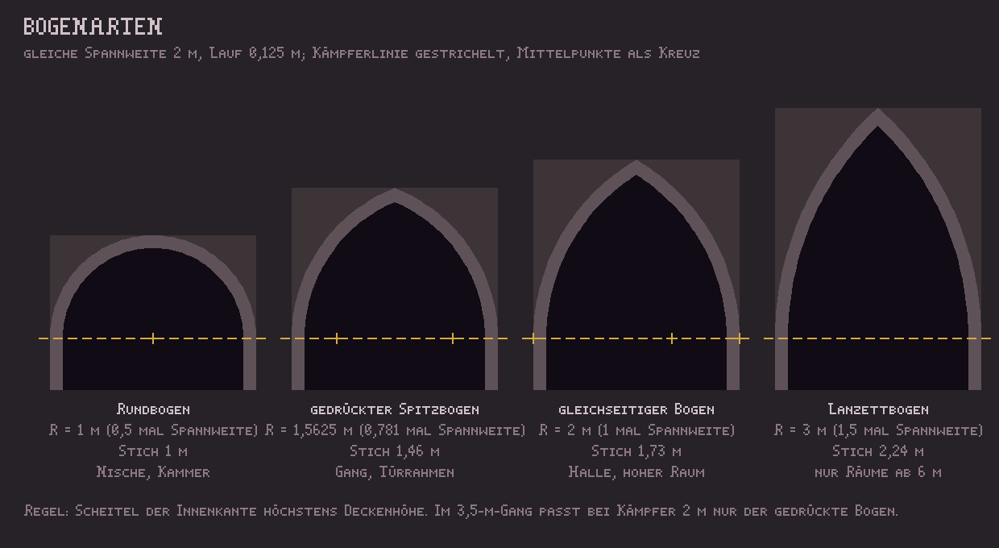
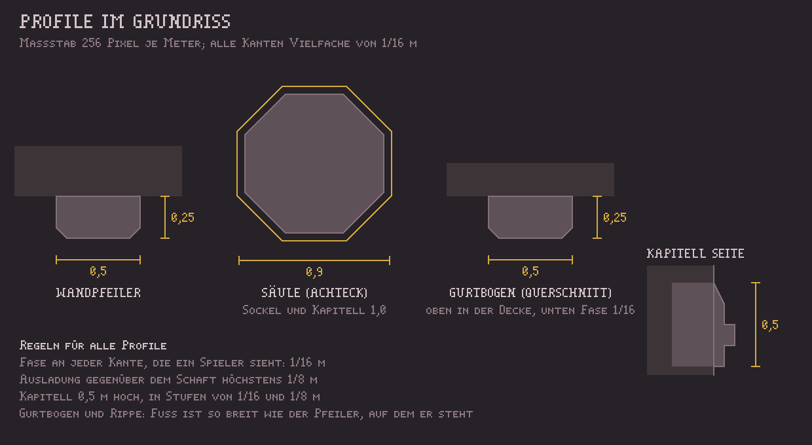

# Formenlehre Gotik

Verbindliche Vorlage für alle Raum-Bausteine (Issue #247) von Silver & Ash. Sie ergänzt die [Art Bible](art-bible.md). Alle Maße sind Meter, Vielfache von 1/16 m. Die Skizzen erzeugt `tools/design/formenlehre_gotik.py` (`python tools/design/formenlehre_gotik.py`); die Bilder liegen in `docs/design/bilder/`, das Übersichtsblatt ist `bilder/uebersicht.png`. Eigene Zeichnungen, keine Formen aus fremden Spielen oder Filmen.

## Raster, an dem alles hängt

- Zelle 2 × 2 m. Gänge 3,5 m breit und 3,5 m hoch; Räume (start, combat, boss) 6 m breit. Die Raumhöhe steht im Level; **die Wandzonen gelten für beide Höhen**.
- Textur 64 Pixel je Meter: 1 m = 64 Texel, 1/16 m = 4 Texel. Lagerfugen alle 0,25 m (16 Texel).
- Kleinste Stufe eines Profils: 1/16 m. Was kleiner ist, wird Textur, nie Geometrie.

## Bogenarten

Ein Bogen besteht aus zwei Kreisbögen; der Mittelpunkt liegt auf der Kämpferlinie, bei Spitzbögen jeweils auf der Gegenseite. Spannweite s, Radius R.

| Art | R | Stich bei s = 2 m | Wo |
|---|---|---|---|
| Rundbogen | 0,5 s | 1,0 | Wandnische, Kammer: der Katakomben-Bogen |
| gedrückter Spitzbogen | 0,78 s (1,5625 m) | 1,46 | Gänge, Türrahmen (Bestand `door.py`) |
| gleichseitiger Spitzbogen | 1,0 s | 1,73 | Hallen, hohe Räume |
| Lanzettbogen | 1,5 s | 2,24 | nur Räume ab 6 m |

Regeln:

1. **Rundbogen nur unterirdisch-schlicht:** Nischen, Gräber, Kammern. Alles, was tragend oder Portal ist, ist spitz.
2. **Der Scheitel der Innenkante liegt höchstens auf Deckenhöhe.** Im 3,5-m-Gang passt bei Kämpfer 2 m nur der gedrückte Spitzbogen (Scheitel 3,458).
3. Kämpferlinie und Mittelpunkte der beiden Kreise müssen auf einem 1/16-m-Punkt liegen.
4. Kein Bogen ohne Kämpfer: Der Ansatz sitzt auf einer Platte oder einem Kapitell.

## Wand in drei Zonen

| Zone | Höhe | Form |
|---|---|---|
| Sockel | 0 bis 0,5 | tritt 1/16 vor, oben Fase 1/16 |
| Steinfläche | 0,5 bis Decke − 0,5 | glatt, bündig; Lagerfugen alle 0,25 |
| Abschluss | Decke − 0,5 bis Decke | tritt 1/8 vor, unten Schräge 1/8 |

Die Steinfläche ist die einzige Zone, die mit der Raumhöhe wächst. Die Lagerfugen laufen **durch alle drei Zonen** auf denselben Höhen; die Stoßfugen liegen im 0,25-m-Raster und sind je Schicht versetzt (Fugenmuster der Textur `catacomb_wall.png`).

## Profile

- Fase an jeder Kante, die ein Spieler sieht: 1/16 m. Eine Fase ist ein Dreieckspaar, mehr nicht.
- Ausladung gegenüber dem Schaft höchstens 1/8 m.
- Kapitell: 0,5 m hoch, Stufen aus 1/16 m und 1/8 m (Platte, Wulst, Platte).
- Gurtbogen und Rippe: Querschnitt 0,5 breit, 0,25 hoch, unten Fase 1/16. Der Fuß ist so breit wie der Pfeiler, auf dem er steht.
- Sockel von Pfeiler und Säule: 0,5 m hoch, 1/16 m breiter als der Schaft je Seite.

## Die Bausteine

Zu jedem Baustein: Maße, Dreiecks-Rahmen (Richtwert, vom Modell zu bestätigen) und Kontaktstelle zur Wand.

| Baustein | Maße | Dreiecke | Kontakt zur Wand |
|---|---|---|---|
| [Wandpfeiler](bilder/wandpfeiler.png) | Schaft 0,5 breit, 0,25 tief; Sockel 0,625 × 0,3125; Kapitell 0,5 hoch bei 3,0 bis 3,5 | etwa 40 | Zahn 1/8 m in die Wand alle 0,5 m; Fuß im Sockel, Kopf im Abschluss |
| [Freie Säule](bilder/saeule.png) | Achteck, Umkreis 0,9; Sockel und Kapitell 1,0 | etwa 80 | freistehend, mindestens 0,5 m von der Wand; Trommeln 0,5 hoch |
| [Deckenbogen](bilder/deckenbogen.png) | Gurtbogen quer zum Gang: lichte Weite 3,5, Kämpfer 1,625, R 1,875, Ring 0,25 dick und 0,5 tief | etwa 100 | Fuß = Grundriss des Wandpfeilers; Scheitel taucht in die Decke |
| [Wandnische](bilder/nische.png) | Rundbogen, Weite 1,0, Tiefe 0,5, Sohle 0,5, Kämpfer 1,5, Scheitel 2,0; Rahmen 1/16 | etwa 60 | Rahmen bündig mit der Wandebene |
| [Türrahmen](bilder/tuerrahmen.png) | Pfostenband 1/8, Kämpferplatte 1/8 hoch bei 2,0, Lauf 1/8, R 1,5625, Scheitel 3,458; Boss: drei gestaffelte Läufe, Kämpfer 1,875, R 1,75 | etwa 120, Boss 200 | Bogenfeld bündig in der Wandebene; Wandfugen enden am Rahmen |

Das **Maßwerk** (Stäbe, Dreipässe, Fenstergliederung) ist nur Textur: Es hat keine Geometrie. Spitzbogen, Rippe, Pfeiler und Kapitell sind dagegen echte Geometrie; sie bleiben mit den Richtwerten oben im Rahmen eines PS1-nahen Modells.

## Fugen laufen weiter

**Kein Baustein endet mit nackter Kante auf der Wandfläche.** Jeder Baustein

1. nimmt die Lagerfugen der Wand auf gleicher Höhe auf (alle 0,25 m),
2. endet unten im Sockel und oben im Abschluss, in einem Kapitell oder einer Kämpferplatte, und
3. hat an der Wand einen Zahn oder bündigen Rahmen, nie eine freie Stoßkante.

Werkstein (helle Reihe) bleibt besonderen Portalen vorbehalten (Art Bible, Regel 6), nie auf der Wandfläche.

## Quellen

Nur zum Nachschlagen der Begriffe und Verhältnisse gelesen; Worte und Zeichnungen sind eigen, nichts kopiert.

- Wikipedia, Artikel „Spitzbogen“, „Gotik“, „Kreuzrippengewölbe“, „Säule“ (de.wikipedia.org/wiki/Spitzbogen, /Gotik, /Kreuzrippengewölbe, /Säule) und „Romanesque architecture“ (en.wikipedia.org/wiki/Romanesque_architecture).
- Nicht erreichbar zum Zeitpunkt der Erstellung (HTTP 403 und 429): Encyclopaedia Britannica und die Essays des Metropolitan Museum of Art; sie wurden nicht benutzt.

## Offen

- Die Fugenphase der Spieltextur `catacomb_wall.png` liegt nicht exakt auf dem 16-Texel-Raster; die Skizzen zeigen das Soll.
- Die Dreiecks-Richtwerte sind geschätzt und gelten, bis ein Modell sie ersetzt.
- Eine Säule Ø 0,9 m hat denselben Umkreis wie die Basis (1,0); an engen Stellen Abstand prüfen.
