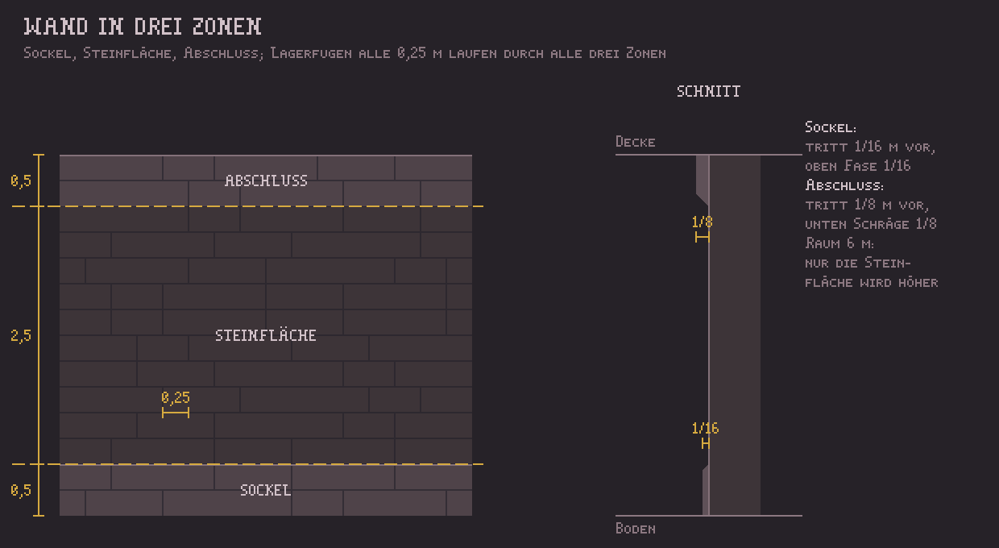
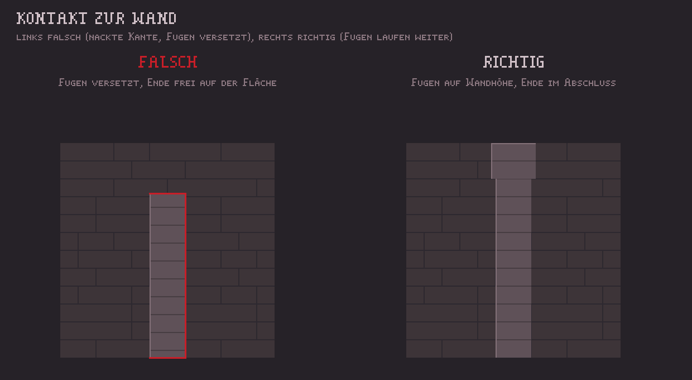

# Formenlehre Gotik

Verbindliche Vorlage für alle Raum-Bausteine (Issue #247) von Silver & Ash. Sie ergänzt die [Art Bible](art-bible.md). Alle Maße sind Meter, Vielfache von 1/16 m. Die Skizzen erzeugt `tools/design/formenlehre_gotik.py` (`python tools/design/formenlehre_gotik.py`); die Bilder liegen in `docs/design/formenlehre-gotik/`, das Übersichtsblatt ist `formenlehre-gotik/uebersicht.png`. Eigene Zeichnungen, keine Formen aus fremden Spielen oder Filmen.

**Herkunft der Regeln:** Hinter einer Regel steht in eckigen Klammern die Quelle (Liste unten): [RDK-B] = RDK Labor „Bogen (in der Architektur)“, [RDK-D] = RDK Labor „Dienst“, [W-S] = Wikipedia „Spitzbogen“, [W-K] = Wikipedia „Kreuzrippengewölbe“, [W-Sä] = Wikipedia „Säule“. **[Setzung]** heißt: eigene Festlegung für das Spiel, nicht aus einer Quelle (Raster, Maße in 1/16 m, Dreieckszahlen). Die Quellen belegen die Begriffe und Bauweisen, die Zahlen sind Setzung.

## Grundmaße aus dem Code

Diese Maße sind keine Setzung dieser Seite, sie stehen im Code oder in den Vorlagen; die Seite richtet sich danach:

| Maß | Wert | Stammt aus |
|---|---|---|
| Zelle | 2 m | `Level.CellSize` in `src/SilverAndAsh.Core/World/Level.cs` |
| Gang, Breite | 2 m (genau eine Bodenzelle) | `assets/rooms/corridor/straight.txt`, `bend.txt`, `zigzag.txt` |
| Gang, Höhe | 3,5 m | `Cell.DefaultCeilingHeight` in `src/SilverAndAsh.Core/World/Cell.cs` |
| Raum, Höhe | 6 m (die Breite steht je Vorlage in `assets/rooms/` und ist nicht fest) | `RoomTemplate.RoomCeilingHeight` in `src/SilverAndAsh.Core/World/RoomTemplate.cs` |
| Türöffnung | 1,75 m breit, Kämpfer 2,0 m | Breite: `frame_normal` in `tools/models/door.py` (halbe Weite 1,0 minus Lauf 0,125, je Seite); Kämpfer: `SPRING_N` ebenda |
| Spieler | 1,8 m hoch, Radius 0,35 m | `BodySizes.Player` in `src/SilverAndAsh.Core/BodySizes.cs` |
| Gruftwächter | Kopf 2,28 m hoch (Stab 2,52 m) | `CryptWardenLook` in `src/SilverAndAsh.Core/Presentation/CryptWardenLook.cs` |

## Raster, an dem alles hängt

- Zelle 2 × 2 m, Gang 2 m breit und 3,5 m hoch, Räume 6 m hoch (siehe Grundmaße). **Die Wandzonen gelten für beide Höhen**; Raumbreiten wechseln je Vorlage.
- [Setzung] Textur 64 Pixel je Meter: 1 m = 64 Texel, 1/16 m = 4 Texel. Lagerfugen alle 0,25 m (16 Texel).
- [Setzung] Kleinste Stufe eines Profils: 1/16 m. Was kleiner ist, wird Textur, nie Geometrie.

## Bogenarten

Ein Spitzbogen besteht aus zwei Kreisbögen, deren Mittelpunkte auf der Kämpferlinie liegen, jeweils auf der Gegenseite der Achse. Liegen sie in den Kämpferpunkten, ist der Radius gleich der Spannweite (gleichseitig); liegen sie dazwischen, ist der Bogen gedrückt, außerhalb überhöht (Lanzett) [RDK-B, W-S]. Der Rundbogen hat einen Mittelpunkt in der Mitte der Kämpferlinie und ist die ältere, romanische Form [RDK-B]. Spannweite s, Radius R. Die Radien der Tabelle sind [Setzung], auf 1/16 m gerundete Beispiele.

| Art | R | Stich bei s = 2 m | Wo |
|---|---|---|---|
| Rundbogen | 0,5 s | 1,0 | Kammer: der Katakomben-Bogen (die abgenommene Wandnische aus #538 ist gedrückt spitz) |
| gedrückter Spitzbogen | 0,78 s (1,5625 m) | 1,46 | Gänge, Türrahmen (Bestand `door.py`) |
| gleichseitiger Spitzbogen | 1,0 s | 1,73 | Hallen, hohe Räume |
| Lanzettbogen | 1,5 s | 2,24 | nur Räume (6 m hoch) |

Regeln:

1. **Rundbogen nur unterirdisch-schlicht:** Gräber, Kammern. Alles, was tragend oder Portal ist, ist spitz. Ausnahme: Die Wandnische wurde in #538 als gedrückter Spitzbogen abgenommen und bleibt so. [Setzung für den Katakomben-Ton; gotische Bauten setzen den Spitzbogen vor allem an tragenden Teilen wie Rippen und Gurten, RDK-B]
2. **Der Scheitel der Innenkante liegt höchstens auf Deckenhöhe.** Im 3,5-m-Gang passt bei Kämpfer 2 m nur der gedrückte Spitzbogen (Scheitel 3,458). [Setzung, folgt aus der Geometrie] Die Tabelle gilt für die Höhen: Gang 3,5 m, Raum 6 m.
3. [Setzung] Kämpferlinie und Mittelpunkte der beiden Kreise müssen auf einem 1/16-m-Punkt liegen.
4. Kein Bogen ohne Kämpfer: Der Ansatz sitzt auf einer Platte oder einem Kapitell. [Der Kämpfer ist die Stelle, an der der Bogen ansetzt, RDK-B]

## Wand in drei Zonen

Die Dreiteilung und alle Zahlen dieses Abschnitts sind [Setzung] für das Spiel, keine Vorgabe aus den Quellen.

| Zone | Höhe | Form |
|---|---|---|
| Sockel | 0 bis 0,5 | tritt 1/16 vor, oben Fase 1/16 |
| Steinfläche | 0,5 bis Decke − 0,5 | glatt, bündig; Lagerfugen alle 0,25 |
| Abschluss | Decke − 0,5 bis Decke | tritt 1/8 vor, unten Schräge 1/8 |

Die Steinfläche ist die einzige Zone, die mit der Raumhöhe wächst. Die Lagerfugen laufen **durch alle drei Zonen** auf denselben Höhen; die Stoßfugen liegen im 0,25-m-Raster und sind je Schicht versetzt (Fugenmuster der Textur `catacomb_wall.png`).

## Profile

- [Setzung] Fase an jeder Kante, die ein Spieler sieht: 1/16 m. Eine Fase ist ein Dreieckspaar, mehr nicht.
- [Setzung] Ausladung gegenüber dem Schaft höchstens 1/8 m.
- Kapitell: Eine Säule hat Basis, Schaft und Kapitell [W-Sä]. Maß [Setzung]: 0,5 m hoch, Stufen aus 1/16 m und 1/8 m (Platte, Wulst, Platte).
- Gurtbogen und Rippe: Rippen sind Bögen, die das Gewölbe bilden und tragen, Gurtbögen trennen die Joche [W-K]. Der Dienst ist ein schlanker Wandvorsprung, der Bögen und Rippen aufnimmt [RDK-D]. Maß [Setzung]: Querschnitt 0,5 breit, 0,25 hoch (im Gang 1/8 m dick), unten Fase 1/16. Der Fuß ist so breit wie der Pfeiler, auf dem er steht.
- [Setzung] Sockel von Pfeiler und Säule: 0,5 m hoch, 1/16 m breiter als der Schaft je Seite (Säule: 0,875 + 0,125 = 1,0).

## Die Bausteine

Zu jedem Baustein: Maße, Dreiecks-Rahmen und Kontaktstelle zur Wand. **Alle Maße sind [Setzung]; die Dreieckszahlen sind zusätzlich nur eine Schätzung** (an keinem Modell gemessen, das fertige Modell bestätigt oder ersetzt sie). Die Bauformen selbst (Wandpfeiler als Dienst, Gurtbogen, Säule mit Basis und Kapitell) stützen [RDK-D, W-K, W-Sä].

| Baustein | Maße | Dreiecke | Kontakt zur Wand |
|---|---|---|---|
| [Wandpfeiler](formenlehre-gotik/wandpfeiler.png) | Schaft 0,5 breit; Tiefe im Raum 0,25 (Sockel und Kapitell 0,3125), **im Gang 0,0625 (Sockel und Kapitell 0,125)**; Sockel und Kapitell 0,625 breit; Kapitell 0,5 hoch, im Gang bei 3,0 bis 3,5, im 6-m-Raum bei 5,5 bis 6,0; trägt er einen Bogen, endet er mit der Kapitell-Oberkante am Kämpfer | 196 (Gang), 238 (Raum), gemessen an den Modellen aus #536: etwa 40 Flächen, für die Welt-Textur an den Metergrenzen geteilt | Zahn 1/8 m in die Wand alle 0,5 m; Fuß im Sockel, Kopf im Abschluss |
| [Freie Säule](formenlehre-gotik/saeule.png) | Achteck, nur in Räumen: Schaft 0,875 über die Flächen (0,947 über die Ecken), Sockel und Kapitell 1,0 über die Flächen; Raum 6 m: Sockel 0,5, Schaft 5,0, Kapitell 0,5 (falls später ein Raum 3,5 m hoch wird: Schaft 2,5; heute sind alle Räume 6 m hoch) | etwa 80 | freistehend, mindestens 0,5 m von der Wand; Trommeln 0,5 hoch |
| [Deckenbogen](formenlehre-gotik/deckenbogen.png) | Gurtbogen quer zum Gang (2 m breit, 3,5 m hoch): Wand zu Wand 2,0, lichte Weite 1,75, Kämpfer 2,0, R außen 1,625, R innen 1,5, Ring 0,125 dick und 0,5 tief (im Raum 0,25 dick); sechs Keilsteine je Hälfte, Fuß und Schlussstein außen auf R 1,75 aufgeweitet; lichte Höhe 3,364 in der Mitte | 152 (Bogen), 516 mit beiden Pfeilern (je 182), gemessen an den Modellen aus #537 | sitzt bündig auf dem Kapitell des Wandpfeilers (Gang: Kapitell 0,125 tief, 0,625 breit; der Ring ist 0,5 tief und sitzt mittig darauf); Außenkante bündig mit der Decke; Zahn 1/8 m in jede Wand (Fuß) und in die Decke (Schlussstein) |
| [Wandnische](formenlehre-gotik/nische.png) | gedrückter Spitzbogen (abgenommen in #538): Öffnung 1,0, R 13/16 (0,8125), Mittelpunkte 0,3125 neben der Achse, Kämpfer 1,25, Scheitel 2,0, Sohle 0,5; Rahmen zwei gestufte Bänder zu je 1/8 (Breite 1,5); steht im Gang 0,125 vor, im Raum 0,25 | 312, gemessen an den Modellen aus #538 | Rückseiten 1/8 m in der Wand; die Rückplatte zeigt die Wandtextur abgedunkelt in Weltlage, darum sitzt die Nische mittig auf einer Zellenwand |
| [Türrahmen](formenlehre-gotik/tuerrahmen.png) | Pfostenband 1/8, Kämpferplatte 1/8 hoch bei 2,0, Lauf 1/8, R 1,5625, Scheitel 3,458; Boss: drei gestaffelte Läufe, Kämpfer 1,875, R 1,75 | etwa 120, Boss 200 | Bogenfeld bündig in der Wandebene; Wandfugen enden am Rahmen |

**Wie der Gurtbogen bemessen ist (neu hergeleitet für den 2 m breiten Gang):**

1. Die Pfeiler im Gang sind höchstens 1/8 m tief (siehe Regel unten); zwischen den Kapitell-Vorderkanten bleiben 1,75 m, so viel wie die Türöffnung. Das ist die lichte Weite des Bogens.
2. Der Kämpfer liegt bei 2,0 m, wie beim Türrahmen. Darunter ist der Durchgang auf voller Breite frei: Spieler (1,8 m) und Gruftwächter-Kopf bei 2,28 m kommen darunter her; auf 2,28 m ist die Öffnung noch 1,70 m breit, auf der Stabspitze (2,52 m) 1,56 m. Der Spieler ist 0,7 m breit (Radius 0,35). Bausteine sind Zierde ohne eigene Kollision; die Zellen bestimmen die Bewegung.
3. Der gedrückte Bogen mit R innen 1,5 hat Mittelpunkte 0,625 neben der Achse (alles Vielfache von 1/16 m) und einen Stich von 1,364: Scheitel innen 3,364. Der Ring ist 1/8 m dick; R außen 1,625 gibt einen Scheitel außen von genau 3,5 m, also bündig mit der Decke, ohne in sie einzutauchen.
4. **Kämpfer und Pfeiler an derselben Stelle:** Das Kapitell des Wandpfeilers, der den Bogen trägt, sitzt bei 1,5 bis 2,0 m; seine Oberkante ist der Kämpfer, der Ring setzt bündig darauf an. Ein solcher Pfeiler ist also kürzer (Schaft 0,5 bis 1,5) als ein Pfeiler ohne Bogen, der bis zum Abschluss reicht (Kapitell 3,0 bis 3,5). Es gibt keinen zweiten, höheren Pfeiler hinter dem Bogen.

Alt gegen neu: lichte Weite 3,5 → 1,75 (Wand zu Wand 2,0), Kämpfer 1,625 → 2,0, R 1,875 → 1,5 innen und 1,625 außen, Ring 0,25 → 0,125 dick im Gang. Der Kämpfer ist jetzt derselbe wie beim Türrahmen (2,0 m); der frühere Absatz über einen tieferen Gurtbogen-Kämpfer entfällt, weil er nur zur falschen Gangbreite gehörte.

**Regeln für Pfeiler und Säulen:**

- **Wandpfeiler im Gang:** Sockel und Kapitell höchstens 0,125 m tief je Seite (Schaft 0,0625), damit die lichte Breite nicht unter die Türöffnung (1,75 m) fällt. [Setzung, gestützt auf die Gangbreite 2 m und die Türöffnung 1,75 m aus dem Code] In Räumen darf der Pfeiler tiefer sein (Schaft 0,25, Sockel 0,3125).
- **Freie Säule nur in Räumen, nie in Gängen** (Antwort des Menschen in #247): Sie sperrt Bewegung und Schüsse, der Querschnitt ist rund (das Achteck ist die PS1-nahe Näherung). Der Mensch sagte „etwa 0,9 m“; **[Setzung der Leitung]** Schaft 0,875 m (14/16 m), damit die Rasterregel gilt. Das Maß ist der Abstand gegenüberliegender Flächen des Achtecks, über die Ecken sind es 0,947 m. Sockel nach der Sockelregel: 0,875 + 2 × 0,0625 = 1,0 m über die Flächen.
- **Bänder über mehrere Kacheln** folgen der Regel „Anfang, Mitte, Ende“ der Texturen, siehe #282; Profile und Fugen dieser Seite gelten dort unverändert.

Das **Maßwerk** (Stäbe, Dreipässe, Fenstergliederung) ist nur Textur: Es hat keine Geometrie. Spitzbogen, Rippe, Pfeiler und Kapitell sind dagegen echte Geometrie; sie bleiben mit den Richtwerten oben im Rahmen eines PS1-nahen Modells.

## Fugen laufen weiter

**Kein Baustein endet mit nackter Kante auf der Wandfläche.** Jeder Baustein

1. nimmt die Lagerfugen der Wand auf gleicher Höhe auf (alle 0,25 m),
2. endet unten im Sockel und oben im Abschluss, in einem Kapitell oder einer Kämpferplatte, und
3. hat an der Wand einen Zahn oder bündigen Rahmen, nie eine freie Stoßkante.

Werkstein (helle Reihe) bleibt besonderen Portalen vorbehalten (Art Bible, Regel 6), nie auf der Wandfläche.

## Quellen

Nur zum Nachschlagen der Begriffe und Bauweisen gelesen, nichts heruntergeladen. Worte und Zeichnungen sind eigen, nichts kopiert. Alle Adressen wurden am 2026-11-20 abgerufen und waren erreichbar.

Fachlexikon:

- [RDK-B] RDK Labor (Reallexikon zur Deutschen Kunstgeschichte), „Bogen (in der Architektur)“: https://www.rdklabor.de/wiki/Bogen_(in_der_Architektur) – Kämpfer, Rundbogen, Spitzbogen und seine Varianten.
- [RDK-D] RDK Labor, „Dienst“: https://www.rdklabor.de/wiki/Dienst – Dienst als Wandvorsprung für Bögen und Rippen.

Nachschlagewerk, nur ergänzend:

- [W-S] Wikipedia, „Spitzbogen“: https://de.wikipedia.org/wiki/Spitzbogen
- [W-K] Wikipedia, „Kreuzrippengewölbe“: https://de.wikipedia.org/wiki/Kreuzrippengewölbe
- [W-Sä] Wikipedia, „Säule“: https://de.wikipedia.org/wiki/Säule

Nicht benutzt, weil nicht abrufbar oder ohne tragenden Text: Encyclopaedia Britannica (HTTP 403), Metropolitan Museum of Art (HTTP 429), Historic England (HTTP 403), Getty Art & Architecture Thesaurus (erreichbar, aber ohne Text zum Begriff).

## Offen

- Die Fugenphase der Spieltextur `catacomb_wall.png` liegt nicht exakt auf dem 16-Texel-Raster; die Skizzen zeigen das Soll.
- Die Dreieckszahlen sind eine Schätzung und gelten, bis ein Modell sie ersetzt.
- Als Fachquelle trägt bisher nur ein Lexikon (RDK Labor); eine zweite (Denkmalamt, Museum) fehlt noch.
- Säule: Schaft 0,875 und Sockel 1,0, beide über die Flächen des Achtecks; über die Ecken sind es 0,947 und 1,083. An engen Stellen Abstand prüfen.
